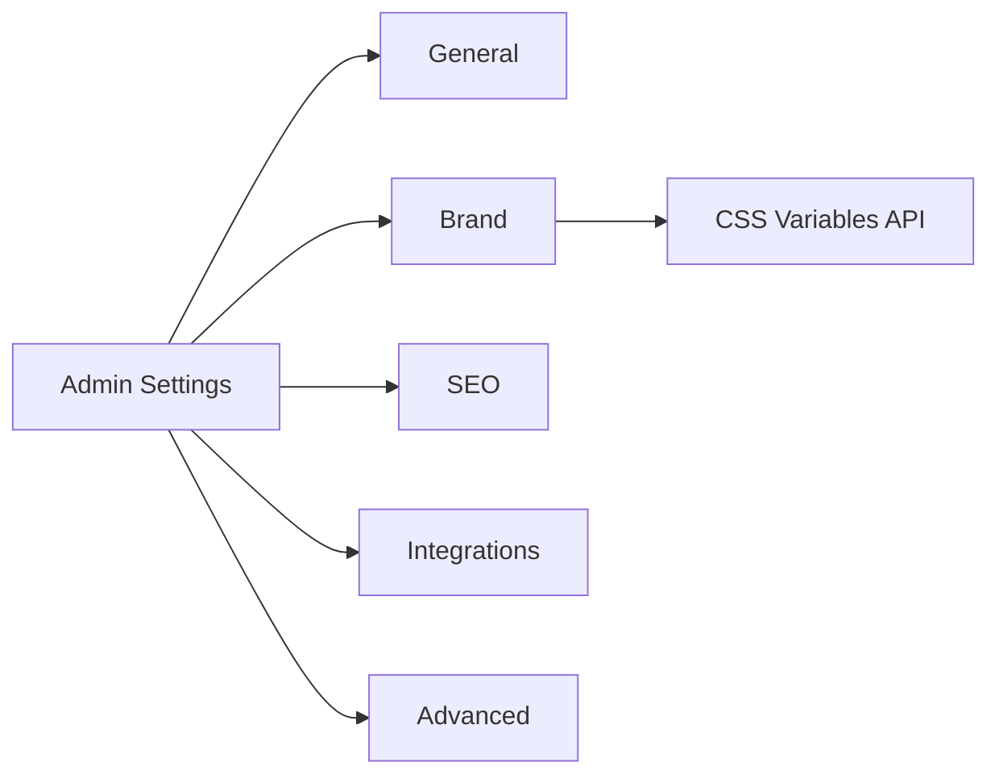

# Admin — Settings

| Field | Value |
|-------|-------|
| **Document ID** | ADMIN-SET-001 |
| **Route** | `/admin/settings` |
| **Product** | Founder Portfolio Platform (FounderOS v1.0) |
| **Status** | Approved |
| **Last Updated** | 2026-06-29 |
| **Related** | [Settings Module](../06_Modules/Settings.md) · [Settings API](../08_API/Settings_API.md) · [Dark Mode](../03_Design_System/Dark_Mode.md) · [SEO (Admin)](./SEO.md) |

---

## Purpose

Document the Admin Settings area — site configuration, branding, integrations, feature flags, and tenant-level preferences managed without code changes.

---

## Scope

| In Scope | Out of Scope |
|----------|--------------|
| Settings UI tabs and fields | Infrastructure env vars (see Deployment) |
| RBAC for settings edit | Billing/subscription UI (future) |

---

## Business Context

White-label tenants rebrand via Settings. Solo founders configure analytics, social links, and default theme. Misconfiguration here affects every public page — require confirmation on destructive changes.

---

## Goals

1. All tenant-facing config editable in one place.
2. Settings validated server-side before save.
3. Audit trail for changes.
4. Clear separation: public settings vs. secrets.

---

## Functional Requirements

| ID | Requirement | Priority |
|----|-------------|----------|
| FR-ASET-001 | Tabs: General, Brand, SEO, Integrations, Advanced | P0 |
| FR-ASET-002 | Brand tab: logo, colors, fonts, theme default | P0 |
| FR-ASET-003 | General: site name, URL, contact email, social links | P0 |
| FR-ASET-004 | Integrations: GA ID, GitHub token (masked), newsletter | P1 |
| FR-ASET-005 | Save SHALL validate and show toast feedback | P0 |
| FR-ASET-006 | Destructive reset requires AlertDialog | P1 |
| FR-ASET-007 | Only `admin` role edits Advanced tab | P0 |

---

## Non-functional Requirements

| ID | Requirement | Target |
|----|-------------|--------|
| NFR-ASET-001 | Settings API latency | &lt; 300ms |
| NFR-ASET-002 | Form autosave | off in v1.0 (explicit save) |

---

## User Stories

| ID | As a… | I want… | So that… |
|----|-------|---------|----------|
| US-ASET-001 | Tenant admin | upload logo and colors | site matches brand |
| US-ASET-002 | Editor | no access to secrets | integrations stay secure |
| US-ASET-003 | Founder | set default dark theme | visitors see our look |
| US-ASET-004 | Auditor | change history | I trace who changed what |

---

## UX Requirements

- **Layout**: Left tab nav (desktop); select on mobile.
- **Brand preview**: Live preview panel for color/font changes.
- **Secrets**: Masked display; rotate flow not inline reveal.
- **Validation**: Inline errors; disabled save until valid.

---

## Technical Considerations

- FastAPI `PATCH /api/v1/settings` with JSON schema validation.
- Redis cache invalidation on settings update.
- Public settings exposed via read-only endpoint for SSR theming.
- Secrets in env or encrypted DB columns — see [Secrets](../11_Security/Secrets.md).

---

## Security Considerations

- RBAC: `settings:write` permission required.
- CSRF protection on mutations.
- API keys never returned in full after save.
- Audit log entry per change.

---

## Acceptance Criteria

- [ ] Tab structure and fields documented
- [ ] RBAC matrix for settings sections
- [ ] Brand preview behavior specified
- [ ] API and cache invalidation cross-linked
- [ ] Audit logging requirement stated

---

## Future Enhancements

- Settings import/export JSON
- Environment-specific settings (staging)
- Webhook on settings change

---

## Open Questions

| # | Question | Owner |
|---|----------|-------|
| OQ-1 | Autosave for non-destructive fields? | UX |
| OQ-2 | Multi-language site name in v1.0? | Product |
| OQ-3 | Feature flags in Advanced tab? | Engineering |
