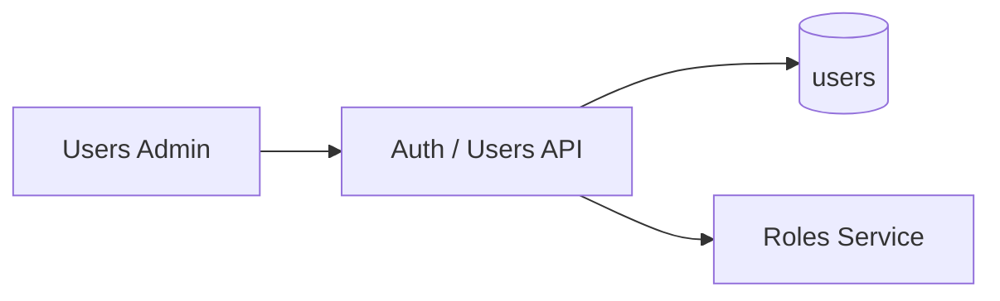

# Admin Users

| Field | Value |
|-------|-------|
| Admin Section ID | `ADM-USERS` |
| Version | 1.0 |
| Status | Specification |
| Owner | Admin Platform |
| Last Updated | 2026-06-29 |

## Purpose

The Admin Users section manages administrator accounts—creation, activation, deactivation, role assignment, and password reset initiation—for the FounderOS admin panel.

## Scope

| In Scope | Out of Scope |
|----------|--------------|
| User list with status and role | Public user registration |
| Create/edit/deactivate admin users | Self-service password reset email (v1.5) |
| Role assignment (single role v1.0) | Multi-role per user (v1.1) |
| Last login timestamp display | SSO user provisioning (v2.0) |
| Super Admin only access | Visitor account management |

## Business Context

Small founder teams need controlled admin access. User management establishes accountability and enables delegation (editor vs. admin) without sharing credentials.

## Goals

1. Allow Super Admin to invite team members.
2. Deactivate users without deleting audit history.
3. Assign roles that map to [Permissions](./Permissions.md).
4. Prevent last Super Admin deactivation.
5. Display clear user status indicators.

## Functional Requirements

| ID | Requirement | Priority |
|----|-------------|----------|
| USR-FR-01 | List all admin users with email, role, status | Must |
| USR-FR-02 | Create user with email, role, temporary password | Must |
| USR-FR-03 | Edit user role and active status | Must |
| USR-FR-04 | Deactivate user (`is_active=false`) | Must |
| USR-FR-05 | Prevent deactivating last Super Admin | Must |
| USR-FR-06 | Search users by email | Should |
| USR-FR-07 | Show `last_login_at` timestamp | Should |

## Non-functional Requirements

| ID | Requirement | Target |
|----|-------------|--------|
| USR-NFR-01 | User list p95 | < 100 ms |
| USR-NFR-02 | Max admin users v1.0 | 25 |
| USR-NFR-03 | Password min length on create | 12 characters |

## User Stories

| ID | As a… | I want to… | So that… |
|----|-------|-------------|----------|
| USR-US-01 | Super Admin | Add an editor account | They publish without full access |
| USR-US-02 | Super Admin | Deactivate a departed team member | They cannot log in |
| USR-US-03 | Super Admin | See who last logged in | I audit account usage |
| USR-US-04 | Super Admin | Change a user's role | Permissions update immediately |
| USR-US-05 | Editor | Not access user management | I cannot escalate privileges |

## UX Requirements

- Table: email, role badge, status (Active/Inactive), last login, actions.
- Create modal: email, role dropdown, generated or manual password.
- Deactivate confirmation with warning about active sessions.
- Role dropdown shows role description tooltip.
- Editors and below: section hidden from navigation.
- Success toast on create/update.

## Technical Considerations

### Architecture

### API Endpoints (planned)

| Method | Path | Permission | Description |
|--------|------|------------|-------------|
| GET | `/api/v1/admin/users` | `users:read` | List users |
| POST | `/api/v1/admin/users` | `users:write` | Create user |
| PUT | `/api/v1/admin/users/{id}` | `users:write` | Update user |
| DELETE | `/api/v1/admin/users/{id}` | `users:write` | Deactivate user |

### Data Entities

| Entity | Table | Reference |
|--------|-------|-----------|
| User | `users` | [Entities](../09_Database/Entities.md#users) |

## Security Considerations

- `users:read` and `users:write` restricted to `super_admin`.
- Passwords hashed with bcrypt on create; never returned in API.
- Temporary passwords force change on first login (v1.5).
- Audit log on role changes (v1.1).
- Email uniqueness enforced.

## Acceptance Criteria

- [ ] Super Admin can create editor user.
- [ ] Deactivated user cannot log in.
- [ ] Last Super Admin deactivation blocked with error.
- [ ] Role change reflects in permission checks immediately.
- [ ] Non-super-admin users cannot access Users section.
- [ ] User list paginates beyond 25 users.

## Future Enhancements

| Version | Enhancement |
|---------|-------------|
| v1.5 | Email invite with password reset link |
| v1.1 | Multi-role assignment |
| v2.0 | SSO/OAuth user linking |
| v2.0 | Session management (force logout) |

## Open Questions

| ID | Question | Owner | Status |
|----|----------|-------|--------|
| OQ-USR-01 | Bootstrap admin only via env or UI create? | DevOps | Open |
| OQ-USR-02 | Display user avatar/gravatar? | UX | Open |

## Related Documents

- [Roles Admin](./Roles.md)
- [Permissions Admin](./Permissions.md)
- [Authentication Module](../06_Modules/Authentication.md)
