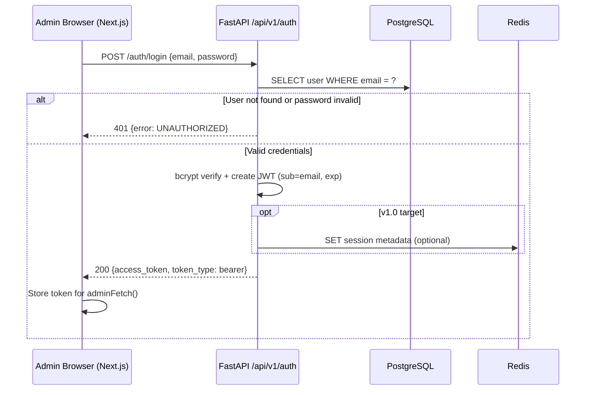
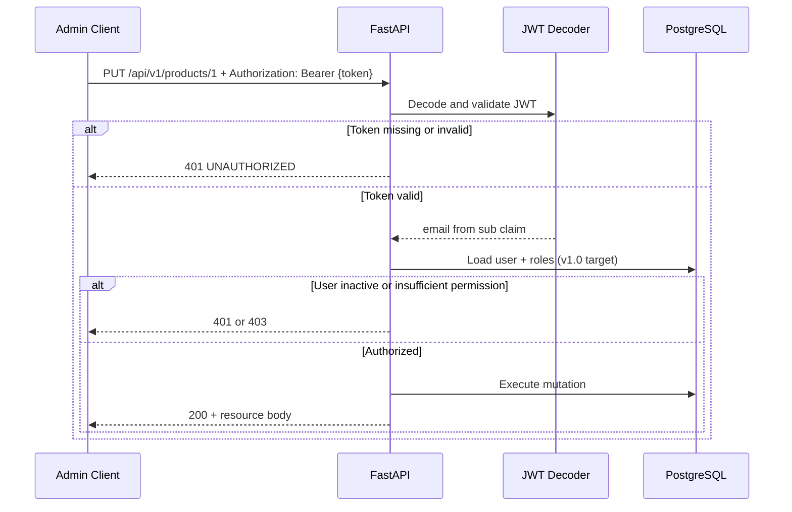

# Authentication API

| Field | Value |
|-------|-------|
| **Document ID** | API-AUTH-001 |
| **Product** | Founder Portfolio Platform (FounderOS v1.0) |
| **Base Path** | `/api/v1/auth` |
| **Status** | Approved |
| **Last Updated** | 2026-06-29 |
| **Related** | [Products API](./Products_API.md) · [Settings API](./Settings_API.md) · [Authentication Module](../06_Modules/Authentication.md) · [ERD](../09_Database/ERD.md) |

---

## Purpose

Define the REST API contract for administrator authentication in FounderOS v1.0. This document is the **authoritative reference for API-wide conventions** (versioning, errors, pagination, filtering, sorting) and JWT-based login used by the Next.js 15 admin panel and all protected mutation endpoints.

## Scope

| In Scope | Out of Scope |
|----------|--------------|
| Admin login (`POST /auth/login`) | Public visitor authentication |
| JWT access token issuance and validation | OAuth / SSO (v2.0) |
| Token expiry and refresh policy (documented) | Multi-factor authentication (v1.5) |
| API-wide error, pagination, and sorting conventions | Password reset email flow (v1.5) |
| RBAC permission model (contract) | SAML enterprise SSO (v2.0) |

## Business Context

FounderOS v1.0 is a **single-tenant CMS** where founders and their team manage products, portfolio, blog, travel, media, and inbound leads. Authentication must be simple enough for a two-person team at launch while establishing patterns for RBAC expansion in v1.0 admin sections.

The admin panel (Next.js 15) authenticates via `POST /api/v1/auth/login`. The **refresh token** is stored in an **httpOnly, Secure, SameSite=Strict** cookie. The **access token** (30-minute TTL) is held in memory on the client and sent as `Authorization: Bearer <token>` on mutation requests. Tokens MUST NOT be stored in `localStorage` or `sessionStorage`.

## Goals

1. Provide stateless JWT authentication compatible with FastAPI and Next.js 15.
2. Establish consistent API conventions reused across all [08_API](./) documents.
3. Support short-lived access tokens (default 30 minutes) with refresh token rotation (7 days).
4. Define RBAC permission strings consumed by all protected endpoints.
5. Enable MFA flows in v1.5 without breaking v1.0 clients.

## Functional Requirements

| ID | Requirement | Priority |
|----|-------------|----------|
| FR-AUTH-001 | `POST /auth/login` accepts email + password, returns JWT | P0 |
| FR-AUTH-002 | Invalid credentials return `401` with standardized error body | P0 |
| FR-AUTH-003 | Inactive users cannot obtain tokens | P0 |
| FR-AUTH-004 | Protected endpoints reject missing/invalid tokens with `401` | P0 |
| FR-AUTH-005 | Token `sub` claim contains user email (v1.0) | P0 |
| FR-AUTH-006 | RBAC permission checks on admin routes (v1.0 target) | P0 |
| FR-AUTH-007 | Account lockout after repeated failures (v1.0 target) | P1 |

## Non-functional Requirements

| ID | Requirement | Target |
|----|-------------|--------|
| NFR-AUTH-001 | Login p95 latency | < 200ms |
| NFR-AUTH-002 | Password hashing | bcrypt (cost factor ≥ 12) |
| NFR-AUTH-003 | JWT algorithm | HS256 (v1.0); RS256 path documented for v2.0 |
| NFR-AUTH-004 | Access token TTL | 30 minutes (configurable via `JWT_ACCESS_TTL_MINUTES`) |
| NFR-AUTH-005 | Refresh token TTL | 7 days with rotation on each use |
| NFR-AUTH-006 | Rate limit on login | 10 requests / minute / IP |

## User Stories

| ID | As a… | I want… | So that… |
|----|-------|---------|----------|
| US-AUTH-001 | Super Admin | to log in with email and password | I can manage site content |
| US-AUTH-002 | Admin | my session to expire after inactivity | compromised tokens have limited window |
| US-AUTH-003 | Editor | to be denied settings mutations | I cannot change integration credentials |
| US-AUTH-004 | DevOps | bootstrap admin on first deploy | the tenant is immediately operable |

## UX Requirements

- Login form shows generic "Invalid credentials" — never reveals whether email exists.
- Admin panel redirects unauthenticated users to `/admin` login.
- Token expiry triggers re-login prompt with preserved draft warning (client-side).
- Loading state on login button; disable double-submit.

## Technical Considerations

### API Versioning

All FounderOS REST endpoints are versioned under:

```
https://{api_host}/api/v1/{resource}
```

| Rule | Description |
|------|-------------|
| Prefix | `/api/v1` — immutable for v1.0 lifecycle |
| Breaking changes | Require `/api/v2` (v2.0+) |
| Health check | `GET /api/v1/health` |
| OpenAPI | `GET /docs`, `GET /openapi.json` |

### Standard Headers

| Header | Required | Description |
|--------|----------|-------------|
| `Content-Type` | Yes (JSON bodies) | `application/json` |
| `Authorization` | Protected routes | `Bearer <access_token>` |
| `Accept` | Recommended | `application/json` |
| `X-Request-ID` | Optional | Client-generated UUID for tracing |

### Error Response Format

All API errors follow a consistent envelope. FastAPI validation errors are normalized to this shape in v1.0 target middleware.

**Single error (4xx / 5xx):**

```json
{
  "error": {
    "code": "UNAUTHORIZED",
    "message": "Invalid credentials",
    "details": null,
    "request_id": "550e8400-e29b-41d4-a716-446655440000"
  }
}
```

**Validation error (422):**

```json
{
  "error": {
    "code": "VALIDATION_ERROR",
    "message": "Request validation failed",
    "details": [
      { "field": "email", "message": "value is not a valid email address" },
      { "field": "password", "message": "field required" }
    ],
    "request_id": "550e8400-e29b-41d4-a716-446655440000"
  }
}
```

| HTTP Status | `code` Value | When |
|-------------|--------------|------|
| 400 | `BAD_REQUEST` | Malformed request |
| 401 | `UNAUTHORIZED` | Missing/invalid token or credentials |
| 403 | `FORBIDDEN` | Authenticated but insufficient permissions |
| 404 | `NOT_FOUND` | Resource does not exist |
| 409 | `CONFLICT` | Duplicate slug, email, etc. |
| 422 | `VALIDATION_ERROR` | Pydantic validation failure |
| 429 | `RATE_LIMITED` | Too many requests |
| 500 | `INTERNAL_ERROR` | Unhandled server error |

> **v1.0 implementation note:** Current FastAPI handlers return `{"detail": "..."}` for some errors. Clients should handle both shapes during migration; server normalization is a v1.0 release gate item.

### Pagination Convention

List endpoints that support pagination accept:

| Query Param | Type | Default | Max | Description |
|-------------|------|---------|-----|-------------|
| `page` | integer | `1` | — | 1-based page number |
| `page_size` | integer | `20` | `100` | Items per page |

**Paginated response envelope:**

```json
{
  "items": [],
  "pagination": {
    "page": 1,
    "page_size": 20,
    "total": 87,
    "total_pages": 5,
    "has_next": true,
    "has_prev": false
  }
}
```

> **v1.0 implementation note:** Several list endpoints currently return unwrapped arrays. Pagination is the v1.0 target contract; see individual API docs for current vs. target behavior.

### Filtering Convention

| Pattern | Example | Description |
|---------|---------|-------------|
| Boolean flags | `?published_only=true` | Filter published records (default `true` on public reads) |
| Exact match | `?category=Enterprise SaaS` | Case-sensitive exact match unless noted |
| Multi-value | `?tags=ai,saas` | Comma-separated OR filter |
| Date range | `?created_after=2026-01-01&created_before=2026-06-30` | ISO 8601 UTC |
| Search | `?q=customer` | Full-text search where supported |

### Sorting Convention

| Query Param | Format | Example |
|-------------|--------|---------|
| `sort` | `{field}` or `{field}:asc` / `{field}:desc` | `?sort=sort_order:asc` |
| Multi-sort | Comma-separated (v1.5) | `?sort=sort_order:asc,created_at:desc` |

Default sorts are defined per resource in each API document.

### RBAC Permission Strings (v1.0 Target)

| Permission | Description |
|------------|-------------|
| `auth:login` | Public — no permission required |
| `users:read` | List/view admin users |
| `users:write` | Create/update/deactivate users |
| `roles:write` | Manage roles and permissions |
| `{module}:read` | Read module resources (e.g., `products:read`) |
| `{module}:write` | Create/update/delete (e.g., `blog:write`) |
| `settings:write` | Update site settings and integration credentials |
| `analytics:read` | View analytics dashboards |

Predefined roles: **Super Admin** (all), **Admin** (all except `roles:write`), **Editor** (`*:read`, content `*:write`, no `settings:write`), **Viewer** (`*:read` only).

### Endpoints

| Method | Path | Auth | Description |
|--------|------|------|-------------|
| `POST` | `/api/v1/auth/login` | Public | Authenticate admin user |
| `POST` | `/api/v1/auth/logout` | Bearer + refresh cookie | Invalidate refresh token in Redis |
| `POST` | `/api/v1/auth/refresh` | Refresh cookie | Issue new access + refresh token pair |
| `GET` | `/api/v1/auth/me` | Bearer | Return current user profile (v1.0 target) |
| `PUT` | `/api/v1/auth/password` | Bearer | Change own password (v1.0 target) |

### Request / Response Schemas

#### `POST /api/v1/auth/login`

**Request body:**

| Field | Type | Required | Constraints |
|-------|------|----------|-------------|
| `email` | string (email) | Yes | Valid email format |
| `password` | string | Yes | Min 8 characters (enforced on user create) |

**Response `200` — `Token`:**

| Field | Type | Description |
|-------|------|-------------|
| `access_token` | string | JWT bearer token |
| `token_type` | string | Always `"bearer"` |

**Response `401`:** Invalid credentials.

#### `GET /api/v1/auth/me` (v1.0 target)

**Response `200`:**

| Field | Type | Description |
|-------|------|-------------|
| `id` | string (UUID) | User ID |
| `email` | string | User email |
| `is_active` | boolean | Account status |
| `roles` | string[] | Assigned role slugs |
| `permissions` | string[] | Effective permission strings |
| `created_at` | datetime (ISO 8601) | Account creation timestamp |

### Login Sequence Diagram



### Protected Request Sequence



### JWT Claims

| Claim | Value | Description |
|-------|-------|-------------|
| `sub` | User email | Subject identifier (v1.0) |
| `exp` | Unix timestamp | Expiration (default +24h) |
| `iat` | Unix timestamp | Issued at (v1.0 target) |
| `jti` | UUID | Token ID for revocation (v1.5) |

### Implementation Stack

| Component | Technology |
|-----------|------------|
| Framework | FastAPI |
| ORM | SQLAlchemy 2.x |
| Password hashing | passlib + bcrypt |
| JWT | python-jose (HS256) |
| Session cache | Redis (v1.5 blocklist) |

## Security Considerations

- Passwords stored as bcrypt hashes only — never plaintext or reversible encryption.
- `SECRET_KEY` must be ≥ 32 random bytes in production (`openssl rand -hex 32`).
- Login endpoint rate-limited at edge (Cloudflare) and application layer (Redis).
- Generic error messages on failed login prevent user enumeration.
- CORS restricted to configured frontend origins (`CORS_ORIGINS` env).
- JWT in `Authorization` header — httpOnly cookie migration documented for v1.5.
- All admin mutations require authentication; public reads remain unauthenticated.
- Account lockout: 10 failures / 15 minutes → 429 with `Retry-After` header (v1.0 target).

## Acceptance Criteria

- [ ] `POST /auth/login` returns valid JWT for seeded admin credentials.
- [ ] Invalid password returns `401` without revealing account existence.
- [ ] Expired token rejected on all protected endpoints.
- [ ] Inactive user (`is_active=false`) cannot authenticate.
- [ ] Error responses conform to standard envelope (release gate).
- [ ] Login rate limit enforced at 10 req/min/IP.
- [ ] OpenAPI documents `Token` and `LoginRequest` schemas.
- [ ] Integration test: admin CRUD flow with token from login.

## Future Enhancements

| Version | Enhancement |
|---------|-------------|
| v1.5 | Refresh tokens, httpOnly cookie option, password reset email |
| v1.5 | Redis JWT blocklist for logout |
| v2.0 | OAuth2 (Google, GitHub), SAML SSO |
| v2.0 | MFA (TOTP), RS256 asymmetric signing |
| v2.0 | `sub` migrated to user UUID |

## Open Questions

| ID | Question | Impact | Owner |
|----|----------|--------|-------|
| OQ-AUTH-01 | httpOnly cookie vs. Bearer header for admin SPA? | High | Backend Lead |
| OQ-AUTH-02 | Refresh token rotation strategy? | Medium | Security |
| OQ-AUTH-03 | When to enforce RBAC vs. any-authenticated-user for v1.0 MVP? | High | PM |
| OQ-AUTH-04 | User `sub` claim migration timeline to UUID? | Low | Backend Lead |

---

**See also:** [Entities — users](../09_Database/Entities.md#users) · [Settings API](./Settings_API.md) · [System Architecture](../04_Architecture/System_Architecture.md)
