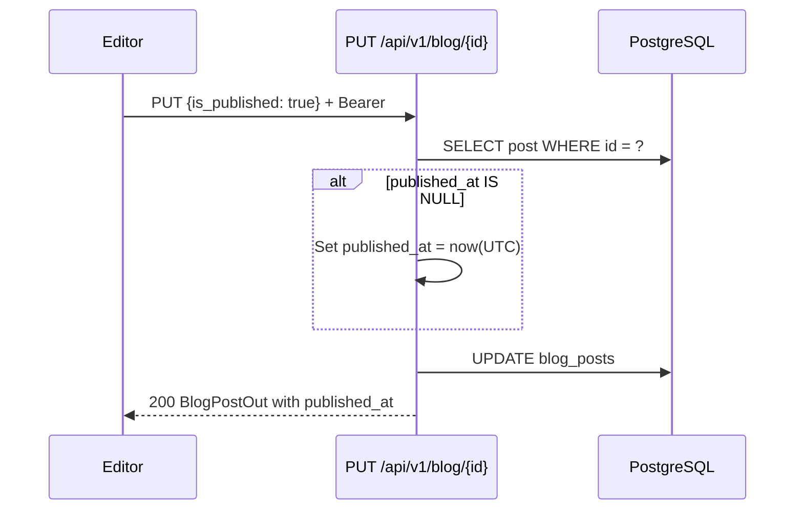
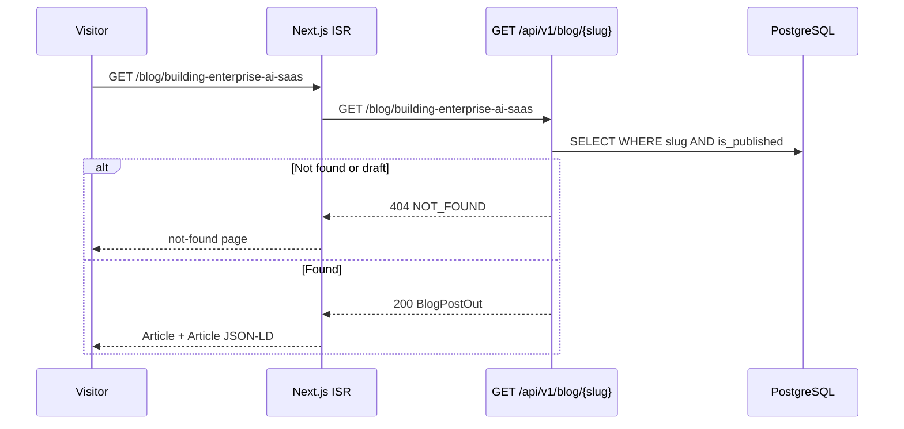

# Blog API

| Field | Value |
|-------|-------|
| **Document ID** | API-BLOG-001 |
| **Product** | Founder Portfolio Platform (FounderOS v1.0) |
| **Base Path** | `/api/v1/blog` |
| **Status** | Approved |
| **Last Updated** | 2026-06-29 |
| **Related** | [Media API](./Media_API.md) · [Case Studies](#case-studies-api-extension) · [Entities — blog_posts](../09_Database/Entities.md#blog_posts) |

---

## Purpose

Define the REST API contract for **blog content management** — thought leadership articles published on `/blog` and `/blog/[slug]`. Supports draft/publish workflow, tags, cover images, and HTML content storage.

## Scope

| In Scope | Out of Scope |
|----------|--------------|
| Public read of published posts | Comment system |
| Admin CRUD with publish workflow | RSS feed generation (frontend responsibility) |
| Tag filtering (comma-separated storage) | Full-text search index (v1.5) |
| `published_at` auto-set on first publish | Multi-author attribution (v1.5) |
| Case Studies API (`/case-studies`) — related narrative content | Newsletter send API (separate module) |

## Business Context

Blog posts drive **inbound marketing and SEO** for founders. Content editors publish articles on AI, SaaS, and enterprise topics. Case studies (separate resource) provide deeper client success narratives linked from blog and enterprise pages.

## Goals

1. Support draft → publish workflow with automatic `published_at` timestamp.
2. Order published posts by `published_at` descending (newest first).
3. Enable slug-based SEO URLs.
4. Store rich HTML content from Markdown or WYSIWYG editor.

## Functional Requirements

| ID | Requirement | Priority |
|----|-------------|----------|
| FR-BLOG-001 | List published posts, newest first | P0 |
| FR-BLOG-002 | Get post by slug (published only, public) | P0 |
| FR-BLOG-003 | Admin create post (draft default) | P0 |
| FR-BLOG-004 | Admin update post; set `published_at` on first publish | P0 |
| FR-BLOG-005 | Admin delete post | P0 |
| FR-BLOG-006 | Filter by tag (v1.0 target) | P1 |
| FR-BLOG-007 | Paginated list (v1.0 target) | P1 |

### Case Studies Extension

Case studies share the blog content module pattern but use `/api/v1/case-studies`:

| Method | Path | Auth | Description |
|--------|------|------|-------------|
| `GET` | `/api/v1/case-studies` | Public | List published case studies |
| `GET` | `/api/v1/case-studies/{slug}` | Public | Get by slug |
| `POST` | `/api/v1/case-studies` | Bearer | Create |
| `PUT` | `/api/v1/case-studies/{case_id}` | Bearer | Update |
| `DELETE` | `/api/v1/case-studies/{case_id}` | Bearer | Delete |

## Non-functional Requirements

| ID | Requirement | Target |
|----|-------------|--------|
| NFR-BLOG-001 | Single post GET p95 | < 200ms |
| NFR-BLOG-002 | Max content size | 500 KB per post |
| NFR-BLOG-003 | Slug max length | 200 characters |
| NFR-BLOG-004 | Cache published list | 60s Redis TTL |

## User Stories

| ID | As a… | I want… | So that… |
|----|-------|---------|----------|
| US-BLOG-001 | Visitor | to read published blog posts | I learn from founder insights |
| US-BLOG-002 | Editor | to save drafts before publishing | I can review content |
| US-BLOG-003 | Editor | cover image on posts | social sharing looks professional |
| US-BLOG-004 | SEO | slug-based URLs | posts rank in search |

## UX Requirements

- Blog index: card with cover image, title, excerpt, date, tag chips.
- Post detail: typography-optimized reading layout, share buttons, related posts.
- Admin editor: preview mode, publish toggle, slug auto-generate from title.
- Unpublished drafts never appear in public list or slug GET.

## Technical Considerations

### API Conventions

See [Authentication API](./Authentication_API.md).

| Convention | Value |
|------------|-------|
| Default sort | `published_at:desc` (nulls last), `created_at:desc` |
| Tags format | Comma-separated string: `"ai,saas,enterprise"` |
| Content format | HTML string (sanitized on output) |

### Blog Endpoints

| Method | Path | Auth | Permission | Description |
|--------|------|------|------------|-------------|
| `GET` | `/api/v1/blog` | Public | — | List posts |
| `GET` | `/api/v1/blog/{slug}` | Public | — | Get post by slug |
| `POST` | `/api/v1/blog` | Bearer | `blog:write` | Create post |
| `PUT` | `/api/v1/blog/{post_id}` | Bearer | `blog:write` | Update post |
| `DELETE` | `/api/v1/blog/{post_id}` | Bearer | `blog:write` | Delete post |

### Query Parameters — `GET /blog`

| Param | Type | Default | Description |
|-------|------|---------|-------------|
| `published_only` | boolean | `true` | Exclude drafts |
| `tag` | string | — | Filter posts containing tag (v1.0 target) |
| `page` | integer | `1` | Pagination (v1.0 target) |
| `page_size` | integer | `20` | Page size |
| `sort` | string | `published_at:desc` | Sort expression |

### Schemas — Blog

#### `BlogPostOut`

| Field | Type | Nullable | Description |
|-------|------|----------|-------------|
| `id` | integer | No | Primary key |
| `slug` | string | No | URL slug |
| `title` | string | No | Post title (max 300) |
| `excerpt` | string | No | Summary for cards and meta |
| `content` | string | No | Full HTML body |
| `cover_image` | string | Yes | Cover image URL |
| `tags` | string | No | Comma-separated tags |
| `is_published` | boolean | No | Publish state |
| `published_at` | datetime | Yes | First publish timestamp |
| `created_at` | datetime | No | Created |
| `updated_at` | datetime | No | Last modified |

#### `BlogPostCreate` / `BlogPostUpdate`

`Create` uses `BlogPostBase` defaults (`is_published=false`). `Update` is partial; setting `is_published=true` when `published_at` is null triggers auto-timestamp.

### Schemas — Case Study

#### `CaseStudyOut`

| Field | Type | Description |
|-------|------|-------------|
| `id` | integer | Primary key |
| `slug` | string | URL slug |
| `title` | string | Case study title |
| `client` | string | Client company name |
| `industry` | string | Industry vertical |
| `summary` | string | Executive summary |
| `challenge` | string | Problem statement |
| `solution` | string | Solution narrative |
| `results` | string | Outcome narrative |
| `metrics` | array | `[{label, value}]` e.g., `{"label":"Cost Reduction","value":"45%"}` |
| `cover_image` | string | Nullable image URL |
| `is_published` | boolean | Visibility |
| `sort_order` | integer | List order |
| `created_at` | datetime | Created timestamp |

### Publish Workflow Sequence

### Public Read Sequence

## Security Considerations

- HTML content sanitized with allowlist tags on output (bleach or equivalent).
- Admin-only mutations; public cannot read drafts via slug guessing (404, not 403).
- Cover image URLs validated; prefer [Media API](./Media_API.md) asset references.
- Rate limit public blog list: 60 req/min/IP.

## Acceptance Criteria

- [ ] Draft posts excluded from public list.
- [ ] First publish sets `published_at` automatically.
- [ ] Slug GET returns 404 for unpublished posts.
- [ ] Case studies list/detail work independently.
- [ ] Tags stored and retrievable as comma-separated string.
- [ ] Delete returns `{"ok": true}`.

## Future Enhancements

| Version | Enhancement |
|---------|-------------|
| v1.5 | PostgreSQL full-text search on title/excerpt/content |
| v1.5 | Author entity, reading time estimate |
| v2.0 | Scheduled publish (`publish_at` datetime) |
| v2.0 | Related posts recommendation API |

## Open Questions

| ID | Question | Impact | Owner |
|----|----------|--------|-------|
| OQ-BLOG-01 | Markdown storage with runtime HTML vs. stored HTML? | High | PM |
| OQ-BLOG-02 | WYSIWYG editor choice (TipTap, Lexical)? | High | Frontend |
| OQ-BLOG-03 | Tags: normalized `blog_tags` junction table? | Medium | Backend |

---

**See also:** [Blog page spec](../05_Pages/Blog.md) · [Case Studies page](../05_Pages/Case_Studies.md)
