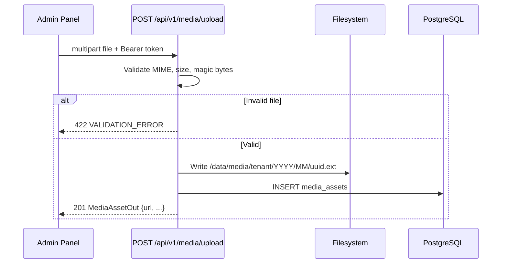
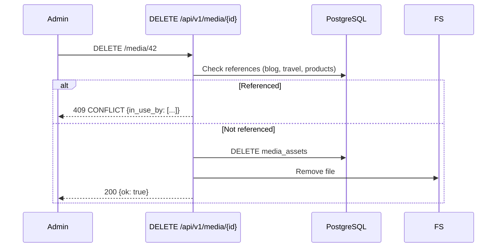

# Media API

| Field | Value |
|-------|-------|
| **Document ID** | API-MEDIA-001 |
| **Product** | Founder Portfolio Platform (FounderOS v1.0) |
| **Base Path** | `/api/v1/media` |
| **Status** | Approved (Specification) |
| **Last Updated** | 2026-06-29 |
| **Related** | [Travel API](./Travel_API.md) · [Blog API](./Blog_API.md) · [Entities — media_assets](../09_Database/Entities.md#media_assets) |

---

## Purpose

Define the REST API contract for the **media library** — centralized upload, organization, and delivery of images, videos, and documents used across blog posts, travel galleries, products, portfolio, and site branding.

## Scope

| In Scope | Out of Scope |
|----------|--------------|
| File upload (multipart) | Video transcoding pipeline |
| Folder organization | CDN purge automation (v1.5) |
| Alt text, captions, metadata | DRM-protected media |
| Public URL resolution | S3-compatible storage (v1.5) |
| Admin list, update metadata, delete | On-the-fly image resizing API (v1.5) |
| Filesystem storage (v1.0) | Podcast RSS hosting |

## Business Context

Every FounderOS module references visual assets. The Media API eliminates duplicated uploads and ensures **consistent alt text for accessibility and SEO**. v1.0 stores files on VPS filesystem under `/data/media/{tenant_id}/`; v1.5 migrates to S3/R2 with signed URLs.

## Goals

1. Single upload endpoint consumed by admin panel and all content modules.
2. Folder hierarchy for editor organization.
3. Enforce file type and size limits per OWASP file upload guidance.
4. Return stable public URLs for Next.js `<Image>` consumption.

## Functional Requirements

| ID | Requirement | Priority |
|----|-------------|----------|
| FR-MEDIA-001 | Upload image/video/document via multipart | P0 |
| FR-MEDIA-002 | List media with folder filter and pagination | P0 |
| FR-MEDIA-003 | Update alt text, caption, folder | P0 |
| FR-MEDIA-004 | Delete asset (hard delete v1.0; soft v1.5) | P0 |
| FR-MEDIA-005 | Create/rename/delete folders | P1 |
| FR-MEDIA-006 | Search by filename or alt text | P1 |
| FR-MEDIA-007 | Reference counting before delete (v1.0 target) | P1 |

## Non-functional Requirements

| ID | Requirement | Target |
|----|-------------|--------|
| NFR-MEDIA-001 | Max image upload size | 10 MB |
| NFR-MEDIA-002 | Max video upload size | 100 MB (v1.0) |
| NFR-MEDIA-003 | Allowed image types | JPEG, PNG, WebP, GIF, SVG |
| NFR-MEDIA-004 | Storage path | `/data/media/{tenant_id}/YYYY/MM/` |
| NFR-MEDIA-005 | Upload p95 | < 5s for 5 MB image |

## User Stories

| ID | As a… | I want… | So that… |
|----|-------|---------|----------|
| US-MEDIA-001 | Editor | to upload images once and reuse | I maintain consistent assets |
| US-MEDIA-002 | Editor | folder organization | I find assets quickly |
| US-MEDIA-003 | SEO admin | to set alt text on every image | we meet WCAG and SEO requirements |
| US-MEDIA-004 | Developer | stable public URLs | Next.js Image optimization works |

## UX Requirements

- Admin media library: grid/list toggle, folder tree sidebar, drag-upload zone.
- Upload progress indicator; error toast on type/size violation.
- Click asset → metadata panel (alt, caption, URL copy, usage references).
- Empty folder state with upload CTA.

## Technical Considerations

### API Conventions

See [Authentication API](./Authentication_API.md).

| Convention | Value |
|------------|-------|
| Default sort | `created_at:desc` |
| Public access | Direct URL to `/media/files/{path}` (nginx/static) or API redirect |
| Upload content type | `multipart/form-data` |

### Endpoints

| Method | Path | Auth | Permission | Description |
|--------|------|------|------------|-------------|
| `GET` | `/api/v1/media` | Bearer | `media:read` | List media assets |
| `GET` | `/api/v1/media/{asset_id}` | Bearer | `media:read` | Get asset metadata |
| `POST` | `/api/v1/media/upload` | Bearer | `media:write` | Upload file |
| `PUT` | `/api/v1/media/{asset_id}` | Bearer | `media:write` | Update metadata |
| `DELETE` | `/api/v1/media/{asset_id}` | Bearer | `media:write` | Delete asset |
| `GET` | `/api/v1/media/folders` | Bearer | `media:read` | List folders |
| `POST` | `/api/v1/media/folders` | Bearer | `media:write` | Create folder |
| `PUT` | `/api/v1/media/folders/{folder_id}` | Bearer | `media:write` | Rename folder |
| `DELETE` | `/api/v1/media/folders/{folder_id}` | Bearer | `media:write` | Delete empty folder |

### Query Parameters — `GET /media`

| Param | Type | Default | Description |
|-------|------|---------|-------------|
| `folder_id` | integer | — | Filter by folder |
| `mime_type` | string | — | e.g., `image/jpeg` |
| `q` | string | — | Search filename, alt_text |
| `page` | integer | `1` | Page number |
| `page_size` | integer | `40` | Items per page |
| `sort` | string | `created_at:desc` | Sort expression |

### Schemas

#### `MediaAssetOut`

| Field | Type | Nullable | Description |
|-------|------|----------|-------------|
| `id` | integer | No | Primary key |
| `filename` | string | No | Original filename |
| `stored_path` | string | No | Internal storage path |
| `url` | string | No | Public CDN URL |
| `mime_type` | string | No | MIME type |
| `file_size` | integer | No | Bytes |
| `width` | integer | Yes | Image width px |
| `height` | integer | Yes | Image height px |
| `alt_text` | string | Yes | Accessibility alt text |
| `caption` | string | Yes | Display caption |
| `folder_id` | integer | Yes | Parent folder FK |
| `uploaded_by` | integer | Yes | User ID FK |
| `created_at` | datetime | No | Upload timestamp |
| `updated_at` | datetime | No | Metadata updated |

#### `POST /media/upload` — multipart fields

| Field | Type | Required | Description |
|-------|------|----------|-------------|
| `file` | file | Yes | Binary upload |
| `folder_id` | integer | No | Target folder |
| `alt_text` | string | No | Initial alt text |

**Response `201`:** `MediaAssetOut`

### Upload Sequence

### Delete with Reference Check

## Security Considerations

- Authenticated uploads only; no anonymous upload.
- MIME validation via magic bytes, not extension alone.
- SVG uploads sanitized or disabled (XSS vector).
- Filename sanitized; UUID-based stored names prevent traversal.
- Rate limit: 30 uploads/hour/user.
- Public URLs served without directory listing.

## Acceptance Criteria

- [ ] JPEG/PNG/WebP upload returns public URL.
- [ ] Oversized file rejected with 422.
- [ ] Invalid MIME rejected.
- [ ] Folder CRUD works; assets movable between folders.
- [ ] Delete blocked when asset referenced (v1.0 target).
- [ ] Paginated list with folder filter.

## Future Enhancements

| Version | Enhancement |
|---------|-------------|
| v1.5 | S3/R2 storage, Cloudflare Images transforms |
| v1.5 | Soft delete with 30-day retention |
| v2.0 | Automatic WebP conversion on upload |
| v2.5 | AI-generated alt text suggestions |

## Open Questions

| ID | Question | Impact | Owner |
|----|----------|--------|-------|
| OQ-MEDIA-01 | Serve files via nginx static vs. FastAPI streaming? | Medium | DevOps |
| OQ-MEDIA-02 | SVG allowed for logos/icons? | Medium | Security |
| OQ-MEDIA-03 | Virus scanning on upload (ClamAV)? | Medium | Security |

---

**See also:** [File Manager module](../06_Modules/File_Manager.md) · [Naming Convention](../09_Database/Naming_Convention.md)
