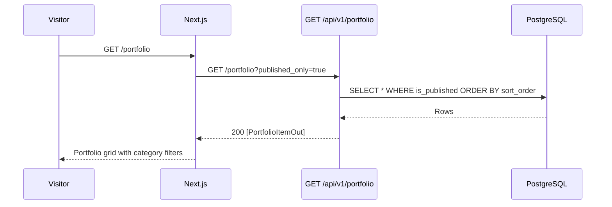

# Portfolio API

| Field | Value |
|-------|-------|
| **Document ID** | API-PORT-001 |
| **Product** | Founder Portfolio Platform (FounderOS v1.0) |
| **Base Path** | `/api/v1/portfolio` |
| **Status** | Approved |
| **Last Updated** | 2026-06-29 |
| **Related** | [Products API](./Products_API.md) · [Case Studies](./Blog_API.md) · [Entities — portfolio_items](../09_Database/Entities.md#portfolio_items) |

---

## Purpose

Define the REST API contract for **portfolio project showcase** — curated work samples displayed on `/portfolio`. Portfolio items demonstrate technical breadth, categories, and technology stacks separate from commercial product listings.

## Scope

| In Scope | Out of Scope |
|----------|--------------|
| Public list of published portfolio items | Portfolio item detail page API (v1.0 uses list-only) |
| Admin CRUD on portfolio items | Client testimonial linkage per item |
| Category and technology metadata | GitHub repo auto-sync per item |

## Business Context

Portfolio items establish **founder credibility** alongside products and case studies. They are lighter-weight than products — focused on project title, category, tech stack, and optional external link — and power the `/portfolio` grid and home page highlights.

## Goals

1. Serve sortable portfolio grid for public site.
2. Support category filtering for visitor exploration.
3. Enable admin content management with publish/draft workflow.
4. Align with case studies (deep narratives) without duplicating their schema.

## Functional Requirements

| ID | Requirement | Priority |
|----|-------------|----------|
| FR-PORT-001 | List published items ordered by `sort_order` | P0 |
| FR-PORT-002 | Admin create portfolio item | P0 |
| FR-PORT-003 | Admin update by `item_id` | P0 |
| FR-PORT-004 | Admin delete by `item_id` | P0 |
| FR-PORT-005 | Filter by `category` (v1.0 target) | P1 |
| FR-PORT-006 | Get by slug public endpoint (v1.0 target) | P2 |

## Non-functional Requirements

| ID | Requirement | Target |
|----|-------------|--------|
| NFR-PORT-001 | List p95 latency | < 150ms |
| NFR-PORT-002 | Max items per tenant | 100 |
| NFR-PORT-003 | Technologies field | Comma-separated string, max 500 chars |

## User Stories

| ID | As a… | I want… | So that… |
|----|-------|---------|----------|
| US-PORT-001 | Visitor | to browse portfolio by category | I can find relevant work samples |
| US-PORT-002 | Recruiter | to see technologies used | I can assess skills |
| US-PORT-003 | Admin | to reorder portfolio items | I control visual priority |
| US-PORT-004 | Admin | to link to live project URL | visitors can explore demos |

## UX Requirements

- Grid cards: image, title, category badge, technology chips.
- Hover reveals short description; click opens `project_url` in new tab if set.
- Filter chips by category on portfolio page (client-side or API filter).
- Admin: inline publish toggle and sort order field.

## Technical Considerations

### API Conventions

See [Authentication API](./Authentication_API.md) for global standards.

| Convention | Value |
|------------|-------|
| Default sort | `sort_order:asc` |
| Public filter | `published_only=true` (default) |
| Technologies format | Comma-separated: `"Python,FastAPI,Next.js"` |

### Endpoints

| Method | Path | Auth | Permission | Description |
|--------|------|------|------------|-------------|
| `GET` | `/api/v1/portfolio` | Public | — | List portfolio items |
| `GET` | `/api/v1/portfolio/{slug}` | Public | — | Get item by slug (v1.0 target) |
| `POST` | `/api/v1/portfolio` | Bearer | `portfolio:write` | Create item |
| `PUT` | `/api/v1/portfolio/{item_id}` | Bearer | `portfolio:write` | Update item |
| `DELETE` | `/api/v1/portfolio/{item_id}` | Bearer | `portfolio:write` | Delete item |

### Query Parameters — `GET /portfolio`

| Param | Type | Default | Description |
|-------|------|---------|-------------|
| `published_only` | boolean | `true` | Filter published items |
| `category` | string | — | Exact category match (v1.0 target) |
| `page` | integer | `1` | Pagination (v1.0 target) |
| `page_size` | integer | `20` | Page size (v1.0 target) |
| `sort` | string | `sort_order:asc` | Sort expression |

### Schemas

#### `PortfolioItemOut`

| Field | Type | Nullable | Description |
|-------|------|----------|-------------|
| `id` | integer | No | Primary key |
| `slug` | string | No | URL identifier (unique) |
| `title` | string | No | Project title (max 300) |
| `category` | string | No | e.g., "Enterprise SaaS", "Data Platform" |
| `description` | string | No | Short project summary |
| `technologies` | string | No | Comma-separated tech list |
| `image_url` | string | Yes | Thumbnail/cover image URL |
| `project_url` | string | Yes | External demo or repo link |
| `is_published` | boolean | No | Public visibility |
| `sort_order` | integer | No | Display order |
| `created_at` | datetime | No | ISO 8601 UTC |

#### `PortfolioItemCreate` / `PortfolioItemUpdate`

`Create` requires all base fields. `Update` accepts any subset (partial).

### Sequence — Public Portfolio Load

### Relationship to Case Studies

| Aspect | Portfolio Item | Case Study |
|--------|----------------|------------|
| Page | `/portfolio` | `/case-studies/[slug]` |
| Depth | Short card | Full narrative + metrics |
| API prefix | `/portfolio` | `/case-studies` |
| Slug detail | v1.0 target | Implemented |

## Security Considerations

- Public endpoints never expose unpublished items when `published_only=true`.
- `project_url` validated as HTTPS URL on write (v1.0 target).
- Image URLs allowlisted domains or media library references (v1.0 target).
- Admin mutations require JWT + `portfolio:write`.

## Acceptance Criteria

- [ ] List returns items in `sort_order` ascending.
- [ ] Unpublished items hidden from public list by default.
- [ ] CRUD operations persist all fields correctly.
- [ ] Delete returns `{"ok": true}`.
- [ ] `404` on update/delete of non-existent `item_id`.
- [ ] Frontend `api.portfolio.list()` renders grid without errors.

## Future Enhancements

| Version | Enhancement |
|---------|-------------|
| v1.0 | `GET /portfolio/{slug}` detail endpoint |
| v1.5 | Link portfolio item to case study (`case_study_id` FK) |
| v1.5 | Soft delete with `deleted_at` |
| v2.0 | Auto-import from GitHub pinned repos |

## Open Questions

| ID | Question | Impact | Owner |
|----|----------|--------|-------|
| OQ-PORT-01 | Dedicated detail page vs. external link only? | Medium | PM |
| OQ-PORT-02 | Technologies as comma-string vs. JSON array? | Low | Backend |
| OQ-PORT-03 | Merge portfolio and case studies in v2.0? | Medium | Architecture |

---

**See also:** [ERD](../09_Database/ERD.md) · [Relationships](../09_Database/Relationships.md)
