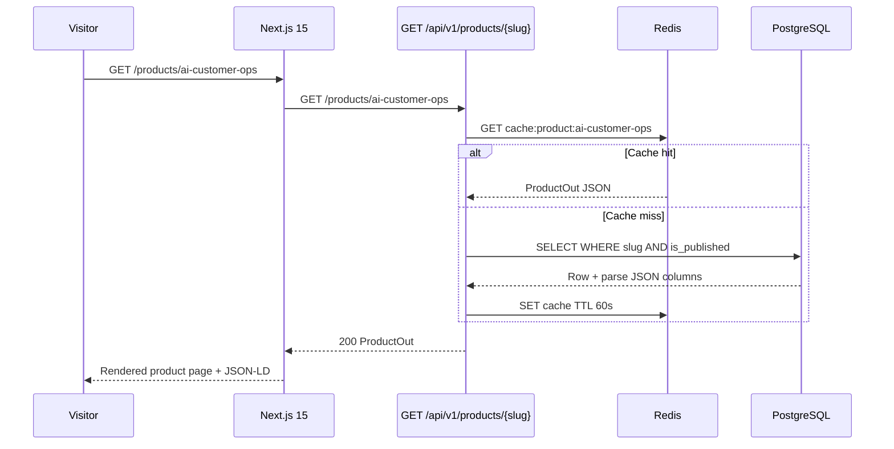
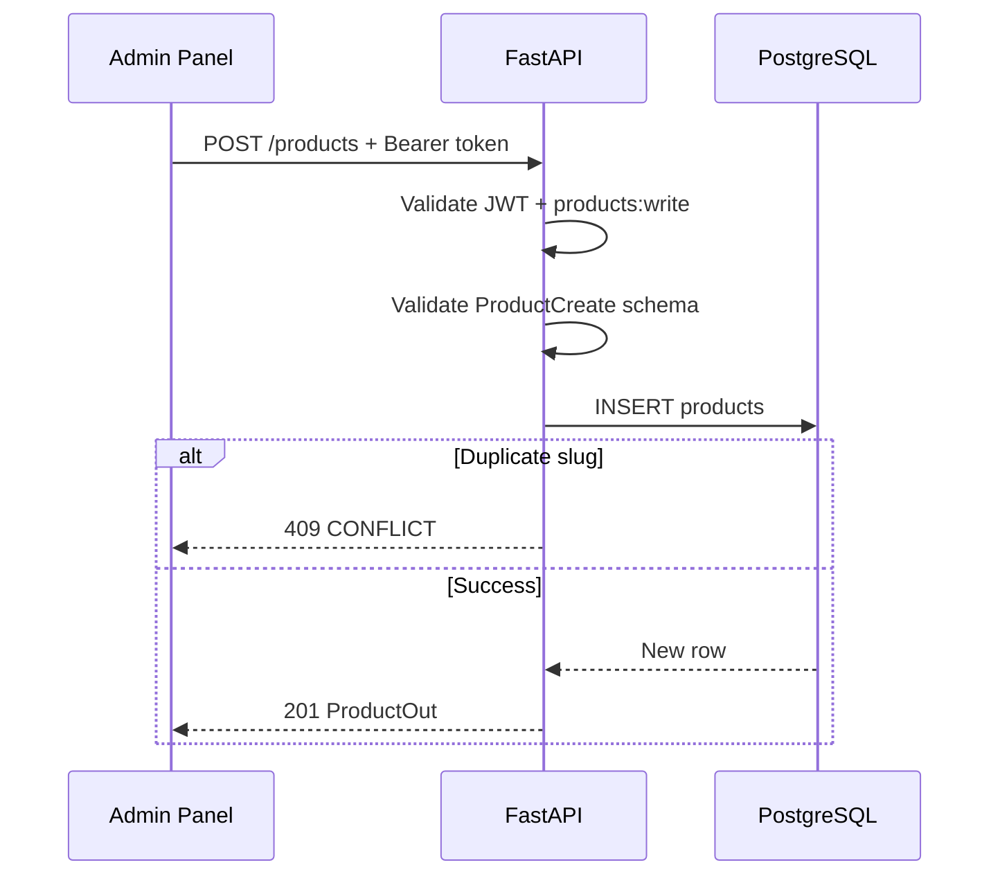

# Products API

| Field | Value |
|-------|-------|
| **Document ID** | API-PROD-001 |
| **Product** | Founder Portfolio Platform (FounderOS v1.0) |
| **Base Path** | `/api/v1/products` |
| **Status** | Approved |
| **Last Updated** | 2026-06-29 |
| **Related** | [Authentication API](./Authentication_API.md) · [Portfolio API](./Portfolio_API.md) · [Entities — products](../09_Database/Entities.md#products) |

---

## Purpose

Define the REST API contract for **product showcase management** — the flagship commercial offering surface of FounderOS. Products represent licensable SaaS platforms, tools, or services displayed on `/products` and `/products/[slug]`.

## Scope

| In Scope | Out of Scope |
|----------|--------------|
| Public read of published products | E-commerce checkout / payments |
| Admin CRUD (create, update, delete) | Product versioning / changelog API |
| Flagship product designation | License key generation |
| JSON-structured features, domains, architecture, screenshots | Multi-currency pricing tables |

## Business Context

FounderOS targets **founders licensing enterprise software**. The Products API powers the primary revenue narrative: showcase AI/SaaS products with architecture diagrams, feature lists, target domains, and screenshots. The flagship product is highlighted on the home page and enterprise acquisition flows.

## Goals

1. Serve product catalog for Next.js 15 SSR/ISR pages with sub-300ms p95 latency.
2. Support rich structured content (features array, architecture layers) without schema migrations per product.
3. Enable admin ordering via `sort_order` and flagship flag.
4. Enforce slug uniqueness for SEO-friendly URLs.

## Functional Requirements

| ID | Requirement | Priority |
|----|-------------|----------|
| FR-PROD-001 | List published products sorted by `sort_order` | P0 |
| FR-PROD-002 | Get single product by slug (published only for public) | P0 |
| FR-PROD-003 | Admin create product with full schema | P0 |
| FR-PROD-004 | Admin update product (partial PATCH semantics via PUT) | P0 |
| FR-PROD-005 | Admin hard delete product | P0 |
| FR-PROD-006 | Filter `published_only` on list (default `true`) | P0 |
| FR-PROD-007 | Paginated list with search (v1.0 target) | P1 |

## Non-functional Requirements

| ID | Requirement | Target |
|----|-------------|--------|
| NFR-PROD-001 | List endpoint p95 | < 200ms |
| NFR-PROD-002 | Cache TTL (Redis) | 60s public list |
| NFR-PROD-003 | Max products per tenant | 50 (v1.0 soft limit) |
| NFR-PROD-004 | Slug max length | 100 characters |

## User Stories

| ID | As a… | I want… | So that… |
|----|-------|---------|----------|
| US-PROD-001 | Visitor | to browse all published products | I can evaluate licensing options |
| US-PROD-002 | Enterprise buyer | to view architecture and features | I can assess technical fit |
| US-PROD-003 | Admin | to mark one product as flagship | it appears prominently on home |
| US-PROD-004 | Admin | to unpublish a product | it is hidden without deletion |

## UX Requirements

- Product cards show name, tagline, flagship badge on list page.
- Detail page renders features as icon grid, architecture as layered diagram, screenshots as carousel.
- Empty state when no products published: friendly CTA to contact.
- Admin table supports drag-reorder (client updates `sort_order` via API).

## Technical Considerations

### API Conventions

See [Authentication API](./Authentication_API.md) for versioning (`/api/v1`), error format, pagination, filtering, and sorting standards.

**Resource-specific defaults:**

| Convention | Value |
|------------|-------|
| Default sort | `sort_order:asc`, then `name:asc` |
| Public filter | `published_only=true` (default) |
| Admin list | `published_only=false` to include drafts |
| Slug pattern | `^[a-z0-9]+(?:-[a-z0-9]+)*$` |

### Endpoints

| Method | Path | Auth | Permission | Description |
|--------|------|------|------------|-------------|
| `GET` | `/api/v1/products` | Public | — | List products |
| `GET` | `/api/v1/products/{slug}` | Public | — | Get product by slug |
| `POST` | `/api/v1/products` | Bearer | `products:write` | Create product |
| `PUT` | `/api/v1/products/{product_id}` | Bearer | `products:write` | Update product |
| `DELETE` | `/api/v1/products/{product_id}` | Bearer | `products:write` | Delete product |

### Query Parameters — `GET /products`

| Param | Type | Default | Description |
|-------|------|---------|-------------|
| `published_only` | boolean | `true` | Exclude unpublished when `true` |
| `page` | integer | `1` | Page number (v1.0 target) |
| `page_size` | integer | `20` | Items per page (v1.0 target) |
| `q` | string | — | Search name/tagline (v1.0 target) |
| `sort` | string | `sort_order:asc` | Sort field and direction |
| `is_flagship` | boolean | — | Filter flagship only (v1.0 target) |

### Schemas

#### `ProductOut` (response)

| Field | Type | Description |
|-------|------|-------------|
| `id` | string (UUID) | Primary key |
| `slug` | string | URL-safe unique identifier |
| `name` | string | Display name (max 200) |
| `tagline` | string | Short pitch (max 500) |
| `description` | string | Full HTML/Markdown description |
| `features` | array of objects | `[{title, description, icon}]` |
| `domains` | string[] | Target industry verticals |
| `architecture` | object | `{layers: [{name, components[]}]}` |
| `screenshots` | string[] | Image URLs |
| `is_flagship` | boolean | Highlight on home page |
| `is_published` | boolean | Public visibility |
| `sort_order` | integer | Display order (lower first) |
| `created_at` | datetime | ISO 8601 UTC |
| `updated_at` | datetime | ISO 8601 UTC |

#### `ProductCreate` (request — all fields required unless defaulted)

Same fields as `ProductOut` except `id`, `created_at`, `updated_at`.

#### `ProductUpdate` (request — all fields optional)

Partial update; omitted fields unchanged. JSON fields (`features`, `domains`, `architecture`, `screenshots`) replace entirely when provided.

#### Example `features` item

```json
{
  "title": "AI-Powered Ticket Routing",
  "description": "Intelligent classification with 94% accuracy.",
  "icon": "route"
}
```

### Sequence — Public Product Detail



### Sequence — Admin Create



## Security Considerations

- Public reads expose only `is_published=true` records.
- Mutations require valid JWT; RBAC `products:write` enforced (v1.0 target).
- `description` and `features` sanitized on output (XSS prevention in admin-rendered HTML).
- Slug validation prevents path traversal or reserved words (`admin`, `api`).
- Rate limit public list: 60 req/min/IP.

## Acceptance Criteria

- [ ] Public list returns only published products in `sort_order`.
- [ ] Unpublished product returns `404` on public slug GET.
- [ ] Admin CRUD round-trip preserves JSON fields correctly.
- [ ] Duplicate slug on create returns `409`.
- [ ] Delete returns `{"ok": true}`.
- [ ] Next.js `api.products.list()` and `api.products.get(slug)` work against live API.
- [ ] Redis cache invalidates on product mutation (v1.0 target).

## Future Enhancements

| Version | Enhancement |
|---------|-------------|
| v1.5 | Soft delete (`deleted_at`), product drafts with preview token |
| v2.0 | Pricing tiers, licensing inquiry CTA per product |
| v2.0 | Product analytics (views, CTA clicks) |
| v2.5 | A/B test headlines per product |

## Open Questions

| ID | Question | Impact | Owner |
|----|----------|--------|-------|
| OQ-PROD-01 | Single flagship enforced at DB or application layer? | Medium | Backend |
| OQ-PROD-02 | `description` field: HTML vs. Markdown storage? | High | PM |
| OQ-PROD-03 | Architecture diagram: JSON only vs. optional image upload? | Low | Design |

---

**See also:** [Products page spec](../05_Pages/Products.md) · [Indexes — products](../09_Database/Indexes.md#products)
