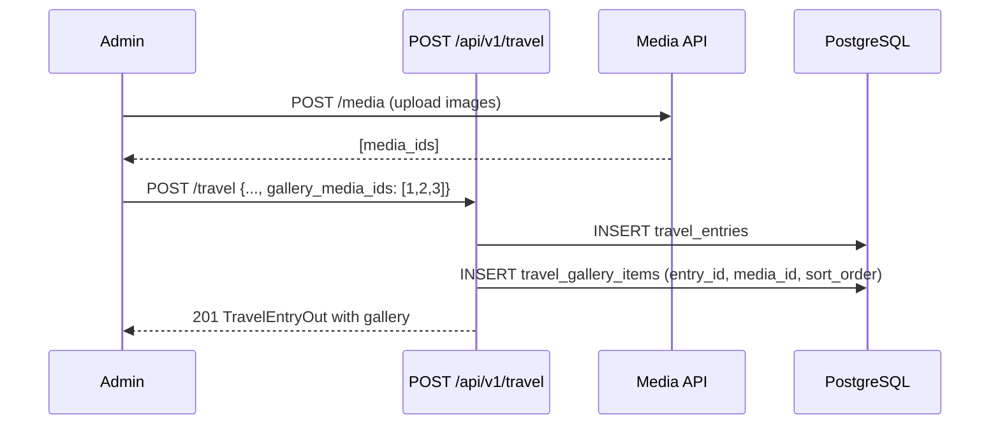
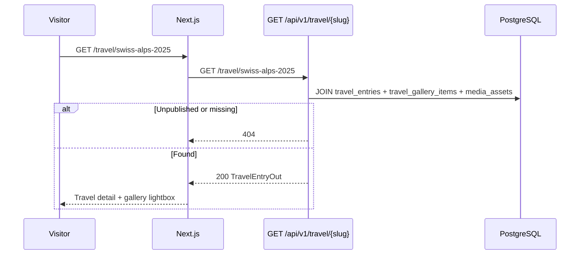

# Travel API

| Field | Value |
|-------|-------|
| **Document ID** | API-TRAV-001 |
| **Product** | Founder Portfolio Platform (FounderOS v1.0) |
| **Base Path** | `/api/v1/travel` |
| **Status** | Approved (Specification) |
| **Last Updated** | 2026-06-29 |
| **Related** | [Media API](./Media_API.md) · [YouTube API](./YouTube_API.md) · [Entities — travel_entries](../09_Database/Entities.md#travel_entries) |

---

## Purpose

Define the REST API contract for **travel creator content** — location-based travel log entries with photo galleries, categories, and optional map coordinates displayed on `/travel`. Powers the creator/travel-blogger market segment of FounderOS.

## Scope

| In Scope | Out of Scope |
|----------|--------------|
| Travel log CRUD (admin) | Real-time GPS tracking |
| Public list and detail by slug | Booking/reservation integrations |
| Category filtering (adventure, food, culture, etc.) | Multi-language content (v2.0) |
| Gallery image associations via Media API | Interactive Mapbox map (optional v1.0) |
| Geo coordinates (lat/lng) storage | User-generated travel comments |

## Business Context

FounderOS serves **travel creators and YouTubers** alongside SaaS founders. The Travel API enables curated travel logs that complement [YouTube API](./YouTube_API.md) video embeds on the `/travel` and `/media` pages, creating a unified creator presence.

## Goals

1. Model travel entries as first-class content with location, date, and gallery.
2. Support category-based browsing and chronological ordering.
3. Integrate with [Media API](./Media_API.md) for gallery images.
4. Enable optional map visualization from stored coordinates.

## Functional Requirements

| ID | Requirement | Priority |
|----|-------------|----------|
| FR-TRAV-001 | List published travel entries | P0 |
| FR-TRAV-002 | Get entry by slug with gallery images | P0 |
| FR-TRAV-003 | Admin create/update/delete entries | P0 |
| FR-TRAV-004 | Filter by `category` | P1 |
| FR-TRAV-005 | Filter by date range (`visited_after`, `visited_before`) | P1 |
| FR-TRAV-006 | Associate multiple media assets as gallery | P0 |
| FR-TRAV-007 | Featured entry flag for home/travel hero | P2 |

## Non-functional Requirements

| ID | Requirement | Target |
|----|-------------|--------|
| NFR-TRAV-001 | List p95 latency | < 250ms (includes gallery join) |
| NFR-TRAV-002 | Max gallery images per entry | 50 |
| NFR-TRAV-003 | Max entries per tenant | 500 |
| NFR-TRAV-004 | Coordinate precision | DECIMAL(10,7) |

## User Stories

| ID | As a… | I want… | So that… |
|----|-------|---------|----------|
| US-TRAV-001 | Travel creator | to publish location-based entries | followers explore my journeys |
| US-TRAV-002 | Visitor | to filter by category | I find adventure vs. food content |
| US-TRAV-003 | Visitor | photo galleries per destination | I experience destinations visually |
| US-TRAV-004 | Admin | to set visit date and location | entries sort chronologically |

## UX Requirements

- Travel index: masonry or grid cards with cover image, location, date, category badge.
- Detail page: hero image, narrative, image gallery lightbox, optional static map pin.
- Category filter chips: Adventure, Food, Culture, Nature, Urban (configurable).
- Chronological timeline view option on travel index (client-side sort).

## Technical Considerations

### API Conventions

See [Authentication API](./Authentication_API.md).

| Convention | Value |
|------------|-------|
| Default sort | `visited_at:desc`, `sort_order:asc` |
| Categories | Enum: `adventure`, `food`, `culture`, `nature`, `urban`, `other` |
| Slug pattern | `^[a-z0-9]+(?:-[a-z0-9]+)*$` |

### Endpoints

| Method | Path | Auth | Permission | Description |
|--------|------|------|------------|-------------|
| `GET` | `/api/v1/travel` | Public | — | List travel entries |
| `GET` | `/api/v1/travel/{slug}` | Public | — | Get entry with gallery |
| `GET` | `/api/v1/travel/categories` | Public | — | List distinct categories with counts |
| `POST` | `/api/v1/travel` | Bearer | `travel:write` | Create entry |
| `PUT` | `/api/v1/travel/{entry_id}` | Bearer | `travel:write` | Update entry |
| `DELETE` | `/api/v1/travel/{entry_id}` | Bearer | `travel:write` | Delete entry |
| `PUT` | `/api/v1/travel/{entry_id}/gallery` | Bearer | `travel:write` | Replace gallery media IDs |

### Query Parameters — `GET /travel`

| Param | Type | Default | Description |
|-------|------|---------|-------------|
| `published_only` | boolean | `true` | Exclude drafts |
| `category` | string | — | Filter by category enum |
| `visited_after` | date (ISO) | — | Entries on or after date |
| `visited_before` | date (ISO) | — | Entries on or before date |
| `featured` | boolean | — | Featured entries only |
| `page` | integer | `1` | Page number |
| `page_size` | integer | `20` | Items per page |
| `sort` | string | `visited_at:desc` | Sort expression |

### Schemas

#### `TravelEntryOut`

| Field | Type | Nullable | Description |
|-------|------|----------|-------------|
| `id` | integer | No | Primary key |
| `slug` | string | No | URL slug |
| `title` | string | No | Entry title |
| `location_name` | string | No | Display location (e.g., "Zermatt, Switzerland") |
| `country_code` | string | Yes | ISO 3166-1 alpha-2 |
| `latitude` | decimal | Yes | Map pin latitude |
| `longitude` | decimal | Yes | Map pin longitude |
| `category` | string | No | Category enum value |
| `excerpt` | string | No | Short summary |
| `content` | string | No | Full HTML narrative |
| `cover_image_id` | integer | Yes | FK to `media_assets` |
| `cover_image_url` | string | Yes | Resolved URL (read-only) |
| `gallery` | MediaAssetSummary[] | No | Ordered gallery images |
| `visited_at` | date | No | Date of visit |
| `is_featured` | boolean | No | Hero/featured flag |
| `is_published` | boolean | No | Public visibility |
| `sort_order` | integer | No | Manual order override |
| `created_at` | datetime | No | Created |
| `updated_at` | datetime | No | Updated |

#### `MediaAssetSummary` (embedded)

| Field | Type | Description |
|-------|------|-------------|
| `id` | integer | Media asset ID |
| `url` | string | Public URL |
| `alt_text` | string | Accessibility text |
| `caption` | string | Optional caption |
| `sort_order` | integer | Position in gallery |

#### `TravelEntryCreate` / `TravelEntryUpdate`

`Create` requires title, slug, location_name, category, excerpt, content, visited_at. `gallery_media_ids` optional integer array on create/update.

### Gallery Association Sequence

### Public Detail Sequence

## Security Considerations

- Public reads exclude unpublished entries.
- Gallery media IDs validated to exist and belong to tenant media library.
- HTML content sanitized on output.
- Geo coordinates optional; no PII beyond public travel narrative.
- Admin mutations require `travel:write` permission.

## Acceptance Criteria

- [ ] CRUD round-trip with gallery associations.
- [ ] Category filter returns correct subset.
- [ ] Unpublished entry returns 404 on public slug GET.
- [ ] Gallery order preserved via `sort_order`.
- [ ] Date range filters work with `visited_at`.
- [ ] Paginated list returns standard envelope.

## Future Enhancements

| Version | Enhancement |
|---------|-------------|
| v1.5 | Mapbox interactive map aggregation endpoint |
| v1.5 | YouTube video embed per travel entry |
| v2.0 | i18n localized entries |
| v2.5 | GPX track upload and map overlay |

## Open Questions

| ID | Question | Impact | Owner |
|----|----------|--------|-------|
| OQ-TRAV-01 | Mapbox vs. static OpenStreetMap image for v1.0? | Medium | Design |
| OQ-TRAV-02 | Separate `travel_gallery_items` table vs. JSON array? | Medium | Backend |
| OQ-TRAV-03 | Country/region taxonomy: free text vs. ISO codes? | Low | PM |

---

**See also:** [Travel page spec](../05_Pages/Travel.md) · [ERD](../09_Database/ERD.md)
