# Entity Relationship Diagram

| Field | Value |
|-------|-------|
| **Document ID** | DB-ERD-001 |
| **Product** | Founder Portfolio Platform (FounderOS v1.0) |
| **Database** | PostgreSQL 16 |
| **Status** | Approved (Specification) |
| **Last Updated** | 2026-06-29 |
| **Related** | [Entities](./Entities.md) · [Relationships](./Relationships.md) · [Database Architecture](../04_Architecture/Database_Architecture.md) |

---

## Purpose

Provide the authoritative **Entity Relationship Diagram (ERD)** for FounderOS v1.0 — visualizing all PostgreSQL tables, primary keys, and cardinalities for engineering, security review, and onboarding.

## Scope

| In Scope | Out of Scope |
|----------|--------------|
| All v1.0 application tables | Redis cache key schemas |
| PK, FK, and UK notation | Alembic migration files |
| Core content, auth, media, analytics | Data warehouse star schemas |
| Integration cache metadata (v1.1) | Multi-tenant `tenant_id` (v2.0) |

## Business Context

A shared ERD ensures backend, frontend, and documentation stay aligned. Enterprise customers and auditors reference this diagram during technical due diligence.

## Goals

1. Document every persistent entity in one diagram.
2. Show foreign key relationships explicitly.
3. Distinguish content, auth, media, and operational tables.
4. Support incremental v1.1 entity additions without restructure.
5. Link each entity to [Entities](./Entities.md) field tables.

## Functional Requirements

| ID | Requirement | Priority |
|----|-------------|----------|
| FR-ERD-001 | ERD covers all v1.0 tables | P0 |
| FR-ERD-002 | FK relationships documented | P0 |
| FR-ERD-003 | UK (unique key) columns marked | P0 |
| FR-ERD-004 | ERD updated when schema changes | P0 |
| FR-ERD-005 | Mermaid source maintained in repo | P0 |

## Non-functional Requirements

| ID | Requirement | Target |
|----|-------------|--------|
| NFR-ERD-001 | Diagram readability | ≤ 30 entities per view |
| NFR-ERD-002 | Sync with SQLAlchemy models | 100% match |

## User Stories

| ID | As a… | I want… | So that… |
|----|-------|---------|----------|
| US-ERD-001 | Backend dev | to see table relationships | I write correct joins |
| US-ERD-002 | Security reviewer | to audit PII tables | I assess data exposure |
| US-ERD-003 | New engineer | to onboard quickly | I understand the schema |
| US-ERD-004 | Product | to plan v1.1 entities | extensions fit cleanly |

## UX Requirements

- ERD rendered from Mermaid in documentation site.
- Color grouping by domain (content, auth, media, ops) in v1.1 tooling.
- Click-through links from entity names to Entities doc anchors.

## Technical Considerations

### Full ERD — FounderOS v1.0

```mermaid
erDiagram
    users ||--o{ media_assets : uploads
    users }o--|| roles : has
    roles ||--|{ role_permissions : grants
    permissions ||--|{ role_permissions : includes

    media_folders ||--o{ media_assets : contains
    media_assets ||--o{ gallery_album_items : appears_in
    gallery_albums ||--|{ gallery_album_items : contains

    travel_entries ||--o{ travel_entry_media : has
    media_assets ||--o{ travel_entry_media : linked

    products ||--o| media_assets : cover_optional
    blog_posts ||--o| media_assets : cover_optional

    users {
        int id PK
        string email UK
        string hashed_password
        int role_id FK
        boolean is_active
        timestamp last_login_at
        timestamp created_at
        timestamp updated_at
    }

    roles {
        int id PK
        string name UK
        string description
        timestamp created_at
    }

    permissions {
        int id PK
        string code UK
        string description
    }

    role_permissions {
        int role_id FK
        int permission_id FK
    }

    site_settings {
        int id PK
        string key UK
        text value
        string value_type
        boolean is_secret
        string group_name
        timestamp updated_at
    }

    products {
        int id PK
        string slug UK
        string name
        text description
        boolean is_published
        int sort_order
        timestamp created_at
        timestamp updated_at
    }

    blog_posts {
        int id PK
        string slug UK
        string title
        text content
        boolean is_published
        timestamp published_at
        timestamp created_at
        timestamp updated_at
    }

    portfolio_items {
        int id PK
        string slug UK
        string title
        boolean is_published
        int sort_order
        timestamp created_at
    }

    case_studies {
        int id PK
        string slug UK
        string title
        boolean is_published
        int sort_order
        timestamp created_at
    }

    testimonials {
        int id PK
        string name
        boolean is_published
        int sort_order
        timestamp created_at
    }

    travel_entries {
        int id PK
        string slug UK
        string title
        string location
        string category
        decimal latitude
        decimal longitude
        date visited_at
        boolean is_published
        boolean is_featured
        int sort_order
        timestamp created_at
        timestamp updated_at
    }

    travel_entry_media {
        int travel_entry_id FK
        int media_asset_id FK
        int sort_order
    }

    media_folders {
        int id PK
        string name
        int parent_id FK
        timestamp created_at
    }

    media_assets {
        int id PK
        string filename
        string stored_path UK
        string mime_type
        int file_size
        int folder_id FK
        int uploaded_by FK
        timestamp created_at
        timestamp updated_at
    }

    gallery_albums {
        int id PK
        string slug UK
        string title
        boolean is_published
        int cover_media_id FK
        timestamp created_at
        timestamp updated_at
    }

    gallery_album_items {
        int album_id FK
        int media_asset_id FK
        int sort_order
    }

    contact_submissions {
        int id PK
        string email
        boolean is_read
        timestamp created_at
    }

    inquiries {
        int id PK
        string email
        string company
        boolean is_read
        timestamp created_at
    }

    newsletter_subscribers {
        int id PK
        string email UK
        string status
        timestamp consent_at
        timestamp created_at
    }

    search_documents {
        int id PK
        string content_type
        int content_id
        string url UK
        tsvector search_vector
        timestamp published_at
    }

    analytics_events {
        bigint id PK
        string event_type
        string path
        timestamp created_at
    }

    analytics_daily_rollups {
        int id PK
        date rollup_date UK
        int page_views
        int unique_visitors
        int conversions
    }

    notifications {
        int id PK
        int user_id FK
        string notification_type
        boolean is_read
        timestamp created_at
    }

    app_logs {
        bigint id PK
        string level
        string module
        timestamp created_at
    }
```

### Domain Groupings

| Domain | Tables |
|--------|--------|
| Auth & RBAC | `users`, `roles`, `permissions`, `role_permissions` |
| Configuration | `site_settings` |
| Content | `products`, `blog_posts`, `portfolio_items`, `case_studies`, `testimonials`, `travel_entries` |
| Media | `media_folders`, `media_assets`, `gallery_albums`, `gallery_album_items`, `travel_entry_media` |
| Leads | `contact_submissions`, `inquiries`, `newsletter_subscribers` |
| Search | `search_documents` |
| Analytics | `analytics_events`, `analytics_daily_rollups` |
| Operations | `notifications`, `app_logs` |

## Security Considerations

- PII tables: `users`, `contact_submissions`, `inquiries`, `newsletter_subscribers`.
- Secrets in `site_settings` where `is_secret=true` — encrypted at rest.
- No direct public DB access; API layer enforces authorization.
- FK constraints prevent orphan media references on delete (RESTRICT or CASCADE per table).

## Acceptance Criteria

- [ ] ERD includes every table in SQLAlchemy models.
- [ ] All FK relationships match [Relationships](./Relationships.md).
- [ ] UK columns align with [Indexes](./Indexes.md).
- [ ] Mermaid renders without syntax errors.
- [ ] PII tables identified in security review.

## Future Enhancements

| Version | Enhancement |
|---------|-------------|
| v1.1 | `integration_cache_meta`, `content_revisions` |
| v1.5 | `notification_preferences` |
| v2.0 | `tenant_id` on all tables |

## Open Questions

| ID | Question | Owner | Status |
|----|----------|-------|--------|
| OQ-ERD-01 | Split ERD into sub-diagrams by domain? | Docs | Open |
| OQ-ERD-02 | Include `media_assets` in v1.0 or v1.5? | Product | Open |

## Related Documents

- [Entities](./Entities.md)
- [Relationships](./Relationships.md)
- [Indexes](./Indexes.md)
- [Naming Convention](./Naming_Convention.md)
