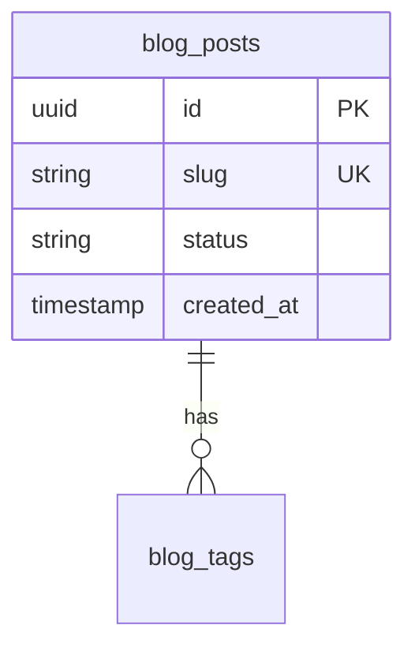

# Database Indexes

| Field | Value |
|-------|-------|
| **Document ID** | DB-IDX-001 |
| **Product** | Founder Portfolio Platform (FounderOS v1.0) |
| **Version** | 1.0 |
| **Status** | Approved |
| **Last Updated** | 2026-06-29 |
| **Owner** | Backend / Data |
| **Related** | [Entities](./Entities.md) · [Relationships](./Relationships.md) · [Naming Convention](./Naming_Convention.md) · [Database Architecture](../04_Architecture/Database_Architecture.md) |

---

## Purpose

Document indexing strategy for PostgreSQL in FounderOS — which indexes exist, why, and query patterns they optimize — balancing read performance with write overhead.

---

## Scope

| In Scope | Out of Scope |
|----------|--------------|
| B-tree, unique, partial, and composite indexes | Full-text search indexes (v1.1) |
| Migration conventions (Alembic) | Query planner tuning per deployment |
| Index monitoring guidelines | |

---

## Business Context

Admin tables paginate and filter by `created_at`, `status`, and `slug`. Public pages fetch published content by slug with soft-delete filters. Missing indexes cause slow admin at scale.

---

## Goals

1. All foreign keys indexed.
2. List endpoints use index-friendly WHERE clauses.
3. No redundant duplicate indexes.
4. Document EXPLAIN expectations for critical queries.

---

## Functional Requirements

| ID | Requirement | Priority |
|----|-------------|----------|
| FR-IDX-001 | Every FK column SHALL have supporting index | P0 |
| FR-IDX-002 | `slug` columns SHALL have unique index where globally unique | P0 |
| FR-IDX-003 | `created_at DESC` index on high-volume tables | P0 |
| FR-IDX-004 | Partial index on `status = 'published'` for content tables | P1 |
| FR-IDX-005 | Indexes created via Alembic migrations only | P0 |
| FR-IDX-006 | Migration SHALL name indexes per naming convention | P0 |

---

## Non-functional Requirements

| ID | Requirement | Target |
|----|-------------|--------|
| NFR-IDX-001 | Admin list query (10k rows) | &lt; 100ms |
| NFR-IDX-002 | Public slug lookup | &lt; 10ms |
| NFR-IDX-003 | Index bloat review | quarterly |

---

## User Stories

| ID | As a… | I want… | So that… |
|----|-------|---------|----------|
| US-IDX-001 | Backend dev | index catalog | I don't miss FK indexes |
| US-IDX-002 | DBA | naming rules | migrations stay consistent |
| US-IDX-003 | Admin user | fast blog list | filtering doesn't lag |

---

## UX Requirements

N/A — infrastructure document. Performance impacts admin table responsiveness per [Tables](../03_Design_System/Tables.md).

---

## Technical Considerations

### Core Index Catalog (v1.0)

| Table | Index | Type | Purpose |
|-------|-------|------|---------|
| `users` | `ix_users_email` | UNIQUE | Login lookup |
| `blog_posts` | `ix_blog_posts_slug` | UNIQUE | Public URL |
| `blog_posts` | `ix_blog_posts_status_published` | PARTIAL | Published lists |
| `blog_posts` | `ix_blog_posts_created_at` | BTREE DESC | Admin sort |
| `products` | `ix_products_slug` | UNIQUE | Product detail |
| `media` | `ix_media_created_at` | BTREE | Gallery sort |
| `audit_logs` | `ix_audit_logs_created_at` | BTREE | Log viewer |
| `audit_logs` | `ix_audit_logs_user_id` | BTREE | Filter by user |
| `contact_submissions` | `ix_contact_created_at` | BTREE | CRM export |

- Use `CONCURRENTLY` for production index adds when supported.
- Monitor with `pg_stat_user_indexes` and `idx_scan`.

---

## Security Considerations

- Indexes on sensitive columns (email) acceptable; no index on password hashes.
- Leaked query plans in logs should not expose PII values.

---

## Acceptance Criteria

- [ ] Index catalog table for v1.0 entities
- [ ] FK indexing policy documented
- [ ] Partial index strategy for published content
- [ ] Naming cross-link to Naming Convention
- [ ] Alembic migration requirement stated

---

## Future Enhancements

- GIN indexes for JSONB metadata search
- pg_trgm for fuzzy title search
- Automated unused index detection job

---

## Open Questions

| # | Question | Owner |
|---|----------|-------|
| OQ-1 | Composite index (status, created_at) vs partial? | Backend |
| OQ-2 | Index all tenant_id ahead of multi-tenant? | Architecture |
| OQ-3 | BRIN for audit_logs time series? | DBA |
