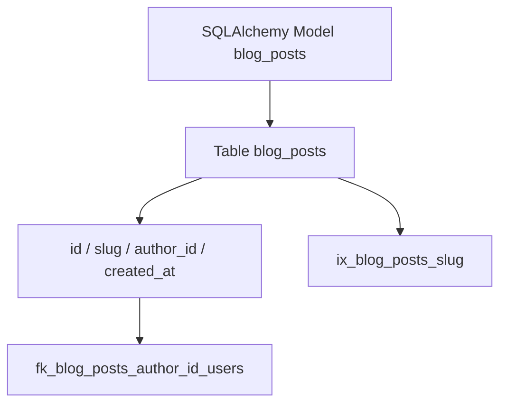

# Database Naming Convention

| Field | Value |
|-------|-------|
| **Document ID** | DB-NC-001 |
| **Product** | Founder Portfolio Platform (FounderOS v1.0) |
| **Version** | 1.0 |
| **Status** | Approved |
| **Last Updated** | 2026-06-29 |
| **Owner** | Backend / Data |
| **Related** | [Entities](./Entities.md) · [Relationships](./Relationships.md) · [Indexes](./Indexes.md) · [ERD](./ERD.md) |

---

## Purpose

Establish consistent naming conventions for PostgreSQL tables, columns, indexes, constraints, and Alembic migrations in FounderOS — improving readability, tooling compatibility, and multi-developer collaboration.

---

## Scope

| In Scope | Out of Scope |
|----------|--------------|
| Table and column naming | ORM Python class naming (see Backend Architecture) |
| Index, constraint, and FK names | Redis key naming |
| Enum and schema naming | |

---

## Business Context

SQLAlchemy models map to snake_case PostgreSQL identifiers. Consistent naming enables automated ERD generation, safer migrations, and prepares for `tenant_id` column standardization in multi-tenant v1.5.

---

## Goals

1. 100% snake_case in database layer.
2. Predictable index names for grep and migrations.
3. No reserved word collisions.
4. Alembic revision messages describe change clearly.

---

## Functional Requirements

| ID | Requirement | Priority |
|----|-------------|----------|
| FR-NC-001 | Tables SHALL be plural snake_case (`blog_posts`) | P0 |
| FR-NC-002 | Columns SHALL be snake_case singular (`user_id`) | P0 |
| FR-NC-003 | PK column SHALL be `id` UUID v4 default | P0 |
| FR-NC-004 | FK columns SHALL be `{table_singular}_id` | P0 |
| FR-NC-005 | Timestamps SHALL be `created_at`, `updated_at` UTC | P0 |
| FR-NC-006 | Soft delete SHALL use `deleted_at` nullable timestamp | P1 |
| FR-NC-007 | Indexes SHALL follow `ix_{table}_{columns}` | P0 |
| FR-NC-008 | Unique constraints SHALL be `uq_{table}_{columns}` | P0 |

---

## Non-functional Requirements

| ID | Requirement | Target |
|----|-------------|--------|
| NFR-NC-001 | Max identifier length | 63 chars (PostgreSQL) |
| NFR-NC-002 | Migration file naming | `YYYYMMDD_HHMM_description.py` |

---

## User Stories

| ID | As a… | I want… | So that… |
|----|-------|---------|----------|
| US-NC-001 | Backend dev | naming cheat sheet | models match DB |
| US-NC-002 | Reviewer | predictable index names | PRs are easy to audit |
| US-NC-003 | DBA | standard timestamps | queries are consistent |

---

## UX Requirements

N/A — developer-facing conventions. Impacts API field naming consistency exposed to frontend.

---

## Technical Considerations

### Naming Reference

| Object | Pattern | Example |
|--------|---------|---------|
| Table | plural_snake | `contact_submissions` |
| Junction | `{a}_{b}` alphabetical | `blog_post_tags` |
| Boolean | `is_` or `has_` prefix | `is_published` |
| Enum type | `{domain}_{name}_enum` | `content_status_enum` |
| Index | `ix_{table}_{col}` | `ix_blog_posts_slug` |
| FK constraint | `fk_{table}_{ref_table}` | `fk_blog_posts_author_id_users` |
| Check | `ck_{table}_{rule}` | `ck_products_price_non_negative` |

### Alembic

- Revisions: `alembic revision -m "add_blog_posts_status_index"`
- Never edit applied migrations; add new revision.
- Seed data scripts in `scripts/seed/` not migrations.

---

## Security Considerations

- No table names revealing security mechanism details (`honeypot_users` discouraged).
- Sensitive columns named generically in logs (`password_hash` not `password`).

---

## Acceptance Criteria

- [ ] Table, column, index, constraint patterns documented
- [ ] Timestamp and soft-delete standards defined
- [ ] FK naming pattern with examples
- [ ] Alembic migration naming guidance
- [ ] Cross-links to Entities and Indexes

---

## Future Enhancements

- `tenant_id` on all tenant-scoped tables
- Schema per tenant (enterprise isolation)
- Lint script for naming in CI

---

## Open Questions

| # | Question | Owner |
|---|----------|-------|
| OQ-1 | Prefix all tables with `fos_` namespace? | Backend |
| OQ-2 | `published_at` vs boolean `is_published`? | Product |
| OQ-3 | UUID v7 for time-sortable IDs? | Architecture |
