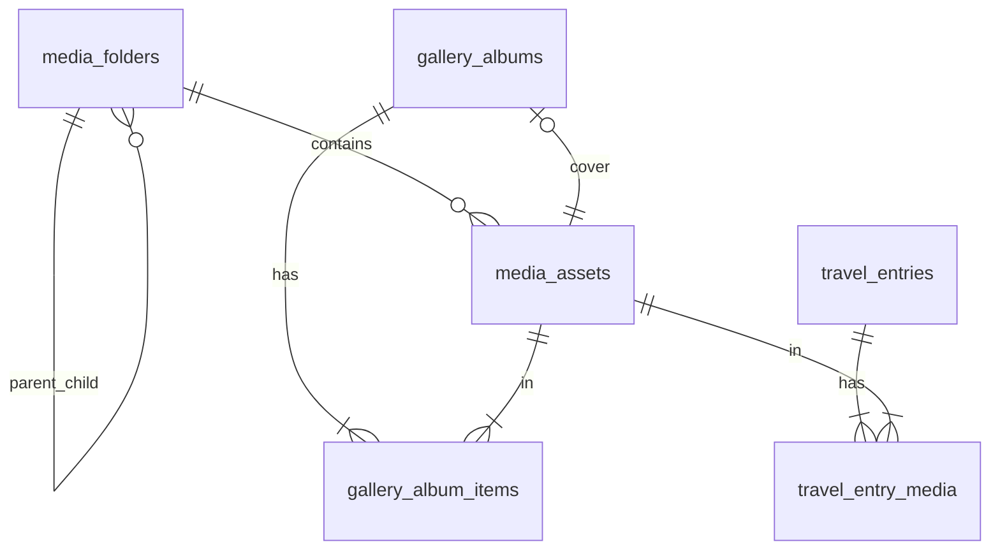
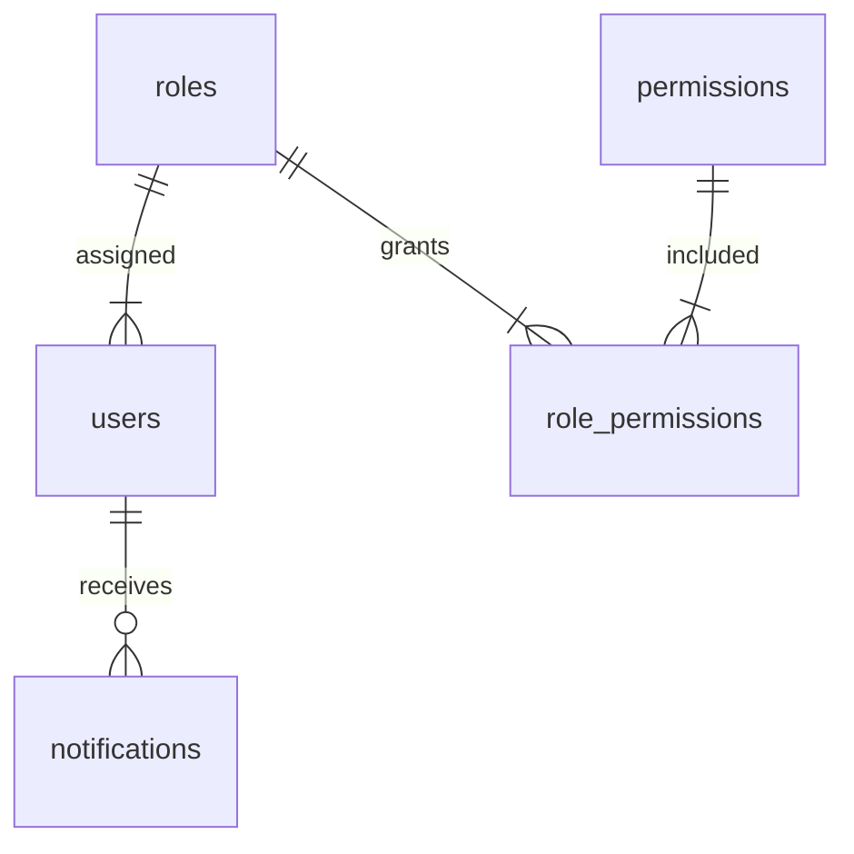

# Database Relationships

| Field | Value |
|-------|-------|
| **Document ID** | DB-REL-001 |
| **Product** | Founder Portfolio Platform (FounderOS v1.0) |
| **Database** | PostgreSQL 16 |
| **Status** | Approved (Specification) |
| **Last Updated** | 2026-06-29 |
| **Related** | [ERD](./ERD.md) · [Entities](./Entities.md) · [Indexes](./Indexes.md) |

---

## Purpose

Document all **foreign key relationships**, cardinalities, referential integrity rules, and cascade behaviors between FounderOS v1.0 database entities.

## Scope

| In Scope | Out of Scope |
|----------|--------------|
| FK definitions and ON DELETE/UPDATE actions | Application-level soft references |
| Cardinality notation (1:1, 1:N, M:N) | ORM relationship declarations |
| Join table patterns | Cross-database relationships |
| Orphan prevention rules | Eventual consistency patterns |

## Business Context

Explicit relationship documentation prevents data integrity bugs—especially around media deletion, user deactivation, and content publishing workflows.

## Goals

1. List every FK with source, target, and cardinality.
2. Define ON DELETE behavior per relationship.
3. Document M:N join table patterns.
4. Identify optional vs. required relationships.
5. Align with [ERD](./ERD.md) diagram.

## Functional Requirements

| ID | Requirement | Priority |
|----|-------------|----------|
| FR-REL-001 | Every FK documented | P0 |
| FR-REL-002 | ON DELETE action specified | P0 |
| FR-REL-003 | M:N join tables identified | P0 |
| FR-REL-004 | Cardinality stated per relationship | P0 |

## Non-functional Requirements

| ID | Requirement | Target |
|----|-------------|--------|
| NFR-REL-001 | FK constraint check overhead | < 1 ms per insert |
| NFR-REL-002 | No circular FK dependencies | Enforced at design |

## User Stories

| ID | As a… | I want… | So that… |
|----|-------|---------|----------|
| US-REL-001 | Backend dev | FK cascade rules | deletes behave correctly |
| US-REL-002 | DBA | relationship reference | migrations are safe |
| US-REL-003 | QA | orphan scenarios | test cases are complete |

## UX Requirements

- Relationship tables grouped by domain in documentation.
- Cascade behavior highlighted for destructive operations (media delete).
- Cross-links to entity definitions.

## Technical Considerations

### Relationship Summary Table

| Parent Table | Child Table | FK Column | Cardinality | ON DELETE | Description |
|--------------|-------------|-----------|-------------|-----------|-------------|
| `roles` | `users` | `users.role_id` | 1:N | RESTRICT | Each user has one role; role cannot delete if users exist |
| `roles` | `role_permissions` | `role_permissions.role_id` | 1:N | CASCADE | Permissions removed when role deleted |
| `permissions` | `role_permissions` | `role_permissions.permission_id` | 1:N | CASCADE | Join rows removed when permission deleted |
| `users` | `media_assets` | `media_assets.uploaded_by` | 1:N | SET NULL | Uploader nullable on user delete |
| `users` | `notifications` | `notifications.user_id` | 1:N | CASCADE | Notifications removed with user |
| `media_folders` | `media_folders` | `media_folders.parent_id` | 1:N | CASCADE | Self-referential folder tree |
| `media_folders` | `media_assets` | `media_assets.folder_id` | 1:N | SET NULL | Assets move to root on folder delete |
| `media_assets` | `gallery_album_items` | `gallery_album_items.media_asset_id` | 1:N | RESTRICT | Cannot delete media in use by album |
| `gallery_albums` | `gallery_album_items` | `gallery_album_items.album_id` | 1:N | CASCADE | Items removed when album deleted |
| `media_assets` | `gallery_albums` | `gallery_albums.cover_media_id` | 1:1 | SET NULL | Cover cleared if media deleted |
| `travel_entries` | `travel_entry_media` | `travel_entry_media.travel_entry_id` | 1:N | CASCADE | Gallery links removed with entry |
| `media_assets` | `travel_entry_media` | `travel_entry_media.media_asset_id` | 1:N | RESTRICT | Cannot delete media linked to travel |
| `media_assets` | `travel_entry_media` | — | M:N | — | Via join table `travel_entry_media` |
| `media_assets` | `gallery_album_items` | — | M:N | — | Via join table `gallery_album_items` |
| `roles` | `role_permissions` | — | M:N | — | Via join table `role_permissions` |

### Cardinality Diagram — Media Domain

### Cardinality Diagram — Auth Domain

### Referential Integrity Rules

| Rule ID | Rule | Rationale |
|---------|------|-----------|
| REL-RULE-01 | Media in active albums cannot be deleted | Prevents broken gallery pages |
| REL-RULE-02 | Media linked to travel entries cannot be deleted | Prevents broken travel galleries |
| REL-RULE-03 | System roles cannot be deleted | RBAC stability |
| REL-RULE-04 | Last `super_admin` user cannot be deactivated | Lockout prevention (app layer) |
| REL-RULE-05 | Folder delete moves assets to root, not delete assets | Safer folder management |

### Soft References (No FK)

These relationships use URL strings without FK constraints in v1.0:

| Source Table | Column | Target | Notes |
|--------------|--------|--------|-------|
| `blog_posts` | `cover_image` | `media_assets.url` | URL string; migrate to FK v1.5 |
| `products` | `screenshots` | `media_assets.url` | JSON array of URLs |
| `case_studies` | `cover_image` | `media_assets.url` | URL string |
| `portfolio_items` | `image_url` | `media_assets.url` | URL string |
| `search_documents` | `content_id` | Various content tables | Polymorphic; no FK |

### Polymorphic Relationships

| Table | Pattern | Resolution |
|-------|---------|------------|
| `search_documents` | `content_type` + `content_id` | Application resolves to source table |
| `analytics_events` | `path` only | No content FK; path-based aggregation |

## Security Considerations

- CASCADE deletes on `notifications` prevent orphaned user data.
- RESTRICT on media prevents accidental content breakage — requires explicit unlink first.
- No FK from public submissions to `users` — submissions are anonymous.
- Role deletion RESTRICT prevents accidental RBAC lockout.

## Acceptance Criteria

- [ ] Every FK in PostgreSQL matches this document.
- [ ] ON DELETE behaviors tested for media and user deletion.
- [ ] M:N join tables have composite PKs.
- [ ] Soft references documented for migration planning.
- [ ] ERD cardinalities match relationship table.

## Future Enhancements

| Version | Enhancement |
|---------|-------------|
| v1.5 | FK from `blog_posts.cover_image` to `media_assets.id` |
| v1.5 | `content_revisions` FK to content tables |
| v2.0 | `tenant_id` FK to `tenants` on all tables |

## Open Questions

| ID | Question | Owner | Status |
|----|----------|-------|--------|
| OQ-REL-01 | CASCADE vs RESTRICT on album delete with published pages? | Product | Open |
| OQ-REL-02 | FK enforcement for cover_image URLs in v1.0? | Backend | Open |

## Related Documents

- [ERD](./ERD.md)
- [Entities](./Entities.md)
- [Indexes](./Indexes.md)
