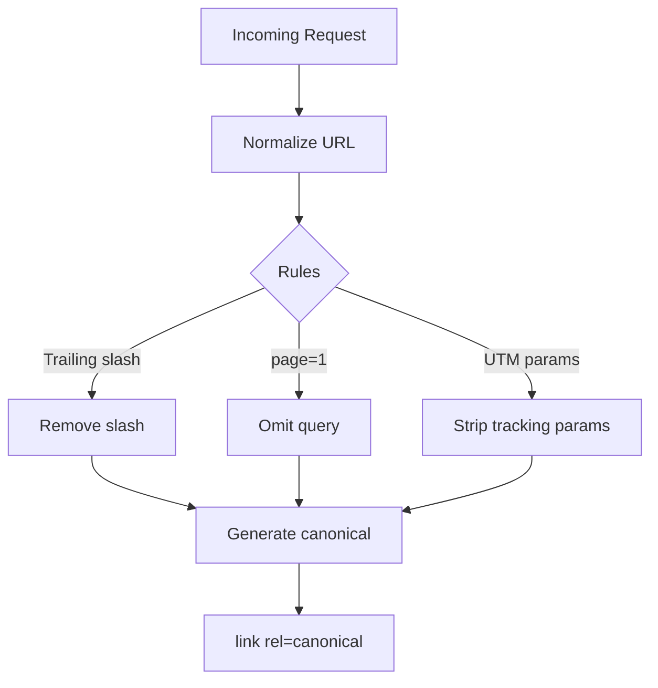

# Canonical URLs

| Field | Value |
|-------|-------|
| **Document ID** | SEO-006 |
| **Product** | Founder Portfolio Platform (FounderOS v1.0) |
| **Status** | Approved |
| **Last Updated** | 2026-06-29 |
| **Related** | [Metadata](./Metadata.md) · [Technical_SEO](./Technical_SEO.md) · [Sitemap](./Sitemap.md) |

---

## Purpose

Define canonical URL policy for FounderOS v1.0 to consolidate ranking signals, prevent duplicate content penalties, and ensure search engines index the preferred URL for every public page and entity.

## Scope

| In Scope | Out of Scope |
|----------|--------------|
| `<link rel="canonical">` implementation | Cross-domain canonicals (white-label variants) |
| Canonical generation for dynamic routes | hreflang alternate URLs (v1.5) |
| Pagination and filter canonical rules | |
| Slug change redirects (301) | |

## Business Context

FounderOS generates multiple URL variants through pagination, trailing slashes, query parameters, and preview URLs. Without canonical tags, search engines may split ranking signals across duplicates — harming product and blog visibility. Canonical policy is essential for white-label deployments where `SITE_URL` varies per tenant.

## Goals

| # | Goal | Success Metric |
|---|------|----------------|
| G1 | Every indexable page has self-referencing canonical | 100% coverage |
| G2 | Zero conflicting canonicals in sitemap vs HTML | Audit pass |
| G3 | Pagination canonicals point to correct page | No duplicate page 1 URLs |
| G4 | Slug changes trigger 301 + canonical update | No 404 chains |

## Functional Requirements

| ID | Requirement | Priority |
|----|-------------|----------|
| FR-CAN-001 | `<link rel="canonical" href="...">` in `<head>` of all public pages | P0 |
| FR-CAN-002 | Canonical uses absolute HTTPS URL from `SITE_URL` env | P0 |
| FR-CAN-003 | Canonical excludes query params except approved pagination (`?page=N`) | P0 |
| FR-CAN-004 | Page 1 canonical omits `?page=1` — canonical is clean URL | P0 |
| FR-CAN-005 | Trailing slash policy: no trailing slash on canonical | P0 |
| FR-CAN-006 | Lowercase canonical URLs enforced | P0 |
| FR-CAN-007 | Admin can override canonical URL per entity (advanced) | P2 |
| FR-CAN-008 | `noindex` pages still include canonical (self-referencing) | P1 |
| FR-CAN-009 | WWW vs non-WWW: single preferred host via redirect + canonical | P0 |
| FR-CAN-010 | Slug changes create 301 redirect; new slug is canonical | P0 |

## Non-functional Requirements

| ID | Requirement | Target |
|----|-------------|--------|
| NFR-CAN-001 | Canonical matches sitemap `<loc>` exactly | 100% |
| NFR-CAN-002 | Canonical generation latency | < 10ms |
| NFR-CAN-003 | Redirect chain length on slug change | Max 1 hop |

## User Stories

| ID | As a… | I want… | So that… |
|----|-------|---------|----------|
| US-CAN-001 | SEO specialist | one canonical URL per product | ranking isn't diluted |
| US-CAN-002 | Admin | old product URLs to redirect after slug change | bookmarks and backlinks work |
| US-CAN-003 | DevOps | SITE_URL to drive all canonicals | white-label deploys are correct |

## UX Requirements

- No visible UX impact — canonical is HTML-only.
- Admin slug change warns: "Previous URL will 301 redirect to new slug."
- SEO audit in admin flags pages where canonical differs from current URL (misconfiguration).

## Technical Considerations

### Canonical Resolution

### URL Normalization Rules

| Input | Canonical |
|-------|-----------|
| `https://example.com/products/` | `https://example.com/products` |
| `https://example.com/blog?page=1` | `https://example.com/blog` |
| `https://example.com/blog?page=2` | `https://example.com/blog?page=2` |
| `https://example.com/blog?utm_source=twitter` | `https://example.com/blog` |
| `https://www.example.com/about` | `https://example.com/about` (if apex preferred) |

### Stripped Query Parameters

| Parameter | Action |
|-----------|--------|
| `utm_*` | Strip from canonical |
| `ref`, `source` | Strip |
| `page` | Keep if > 1 |
| `sort`, `filter` | Strip (v1.0 has no public filters) |

### Implementation

- Next.js: `alternates: { canonical: url }` in `generateMetadata`.
- `SITE_URL` environment variable on Vercel — no trailing slash.
- Sitemap generation uses same canonical builder function.
- Redirect table in PostgreSQL: `redirects(old_path, new_path, status_code)`.

### Cross-Domain (v1.0)

Single domain per deployment. Cross-domain canonical not used in v1.0.

## Security Considerations

- Canonical URLs must not point to external domains (open redirect prevention).
- Admin canonical override validated: same host as `SITE_URL` only.
- Preview/staging URLs must not leak into production canonicals.

## Acceptance Criteria

- [ ] `curl -s URL | grep canonical` returns correct absolute URL on all P0 pages
- [ ] Sitemap `<loc>` matches HTML canonical for every entry
- [ ] Pagination page 2 canonical includes `?page=2`; page 1 does not
- [ ] Slug change: old URL returns 301 to new URL
- [ ] UTM parameters stripped from canonical
- [ ] WWW redirect configured; canonical uses preferred host
- [ ] Search Console shows no "Duplicate without user-selected canonical" for P0 pages

## Future Enhancements

| Version | Enhancement |
|---------|-------------|
| v1.5 | hreflang + canonical coordination |
| v2.0 | Cross-tenant canonical for marketplace listings |
| v2.5 | Canonical suggestions from SEO audit tool |

## Open Questions

| ID | Question | Impact | Decision By |
|----|----------|--------|-------------|
| OQ-CAN-001 | Apex vs www — which is preferred default? | Medium | Week 1 |
| OQ-CAN-002 | Paginated blog: self-canonical per page vs page 1 only? | Medium | Week 2 — Recommend self-canonical per page |

## Related Documents

- [Metadata](./Metadata.md)
- [Sitemap](./Sitemap.md)
- [Technical_SEO](./Technical_SEO.md)
- [Robots](./Robots.md)
