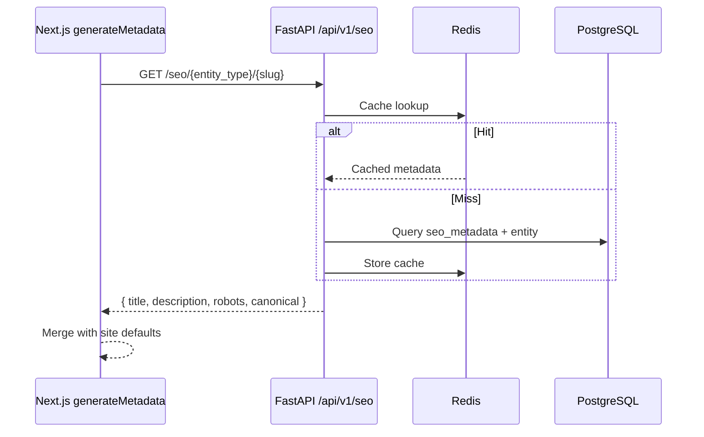

# Metadata

| Field | Value |
|-------|-------|
| **Document ID** | SEO-003 |
| **Product** | Founder Portfolio Platform (FounderOS v1.0) |
| **Status** | Approved |
| **Last Updated** | 2026-06-29 |
| **Related** | [OpenGraph](./OpenGraph.md) · [Twitter_Cards](./Twitter_Cards.md) · [Canonical](./Canonical.md) · [Technical_SEO](./Technical_SEO.md) |

---

## Purpose

Define HTML metadata standards — title tags, meta descriptions, robots directives, and Next.js 15 `generateMetadata` patterns — for all FounderOS public and admin routes.

## Scope

| In Scope | Out of Scope |
|----------|--------------|
| `<title>`, meta description, robots, viewport | Social tags (see [OpenGraph](./OpenGraph.md)) |
| Next.js Metadata API implementation | Email metadata |
| Admin SEO module field mapping | AMP pages |
| Fallback and template patterns | |

## Business Context

Metadata is the **primary SERP presentation layer**. For FounderOS tenants competing for "founder name + product" and enterprise-intent queries, compelling titles and descriptions directly affect click-through rate. Admin-editable metadata enables non-technical founders to optimize without developer involvement.

## Goals

| # | Goal | Success Metric |
|---|------|----------------|
| G1 | Unique title + description per indexable page | 0 duplicates in audit |
| G2 | Admin-configurable per entity | 100% CMS entities support SEO fields |
| G3 | Consistent title template | Brand suffix on all pages |
| G4 | Fallback chain prevents empty metadata | No blank titles in production |

## Functional Requirements

| ID | Requirement | Priority |
|----|-------------|----------|
| FR-MD-001 | Title format: `{Page Title} \| {Site Name}` (max 60 chars visible) | P0 |
| FR-MD-002 | Meta description: 150–160 chars recommended, max 320 | P0 |
| FR-MD-003 | `generateMetadata` in Next.js 15 App Router for all public routes | P0 |
| FR-MD-004 | Dynamic metadata from FastAPI SEO endpoint for slug routes | P0 |
| FR-MD-005 | Default metadata from site settings when entity fields empty | P0 |
| FR-MD-006 | `robots` meta tag supports `noindex`, `nofollow` per page | P1 |
| FR-MD-007 | `viewport` and `theme-color` in root layout | P0 |
| FR-MD-008 | `charset=utf-8` and `lang` attribute on `<html>` | P0 |
| FR-MD-009 | Admin routes: `noindex, nofollow` on all `/admin/*` | P0 |
| FR-MD-010 | Metadata API fields stored in PostgreSQL per entity | P0 |

## Non-functional Requirements

| ID | Requirement | Target |
|----|-------------|--------|
| NFR-MD-001 | Metadata fetch adds < 50ms to page TTFB | p95 |
| NFR-MD-002 | Title truncation handles gracefully | No mid-word cut in SERP |
| NFR-MD-003 | Metadata cache TTL | 300s Redis + ISR alignment |

## User Stories

| ID | As a… | I want… | So that… |
|----|-------|---------|----------|
| US-MD-001 | Admin | to edit title and description per blog post | I optimize for target keywords |
| US-MD-002 | Admin | SEO preview before publish | I see how Google will display my page |
| US-MD-003 | Visitor | descriptive tab titles | I identify pages in browser tabs |
| US-MD-004 | Founder | site-wide default description | new pages have sensible SEO defaults |

## UX Requirements

- Admin SEO form shows character count with green/yellow/red indicators (title: 50–60, description: 150–160).
- Live SERP snippet preview in admin panel.
- Auto-populate title from entity name (product title, post title) — editable.
- Warning if title or description duplicates another published page.

## Technical Considerations

### Metadata Resolution Flow

### Database Fields (per entity)

| Field | Type | Required | Default |
|-------|------|----------|---------|
| `seo_title` | string(70) | No | Entity title |
| `seo_description` | string(320) | No | Entity excerpt |
| `robots_index` | boolean | No | `true` |
| `robots_follow` | boolean | No | `true` |
| `canonical_url` | string | No | Auto-generated |

### Next.js Metadata Object

| Property | Source |
|----------|--------|
| `title` | SEO API or template |
| `description` | SEO API |
| `robots` | SEO API flags |
| `alternates.canonical` | [Canonical](./Canonical.md) |
| `openGraph` | [OpenGraph](./OpenGraph.md) |
| `twitter` | [Twitter_Cards](./Twitter_Cards.md) |

### Page Defaults

| Route | Default Title Source |
|-------|---------------------|
| `/` | Site Settings `home_seo_title` |
| `/products` | `"Products \| {Site Name}"` |
| `/blog` | `"Blog \| {Site Name}"` |
| `/404` | `"Page Not Found \| {Site Name}"` + `noindex` |

## Security Considerations

- Sanitize all user-provided metadata before HTML injection.
- Admin metadata API requires JWT + `seo:write` permission.
- No sensitive data in meta descriptions (internal project names, unreleased features).

## Acceptance Criteria

- [ ] Every public page has unique `<title>` and `meta name="description"`
- [ ] `view-source` shows metadata in initial HTML (not client-injected)
- [ ] Admin can update metadata and see changes after revalidation (< 5 min)
- [ ] `/admin/*` pages have `noindex, nofollow`
- [ ] Character count validation prevents titles > 70 chars in admin
- [ ] Lighthouse SEO audit passes metadata checks
- [ ] Fallback chain tested: empty SEO fields → entity title → site default

## Future Enhancements

| Version | Enhancement |
|---------|-------------|
| v1.5 | Bulk metadata editor in admin |
| v1.5 | AI-suggested titles and descriptions |
| v2.0 | Per-locale metadata fields |
| v2.5 | A/B testing metadata variants |

## Open Questions

| ID | Question | Impact | Decision By |
|----|----------|--------|-------------|
| OQ-MD-001 | Title separator: `\|` vs `—` vs `-`? | Low | Week 1 |
| OQ-MD-002 | Include category/tag in auto-generated titles? | Medium | Week 2 |
| OQ-MD-003 | `keywords` meta tag — omit (deprecated) or support? | Low | Week 1 — Recommend omit |

## Related Documents

- [OpenGraph](./OpenGraph.md)
- [Twitter_Cards](./Twitter_Cards.md)
- [Canonical](./Canonical.md)
- [Structured_Data](./Structured_Data.md)
- [SEO Admin](../07_Admin/SEO.md)
- [SEO API](../08_API/SEO_API.md)
