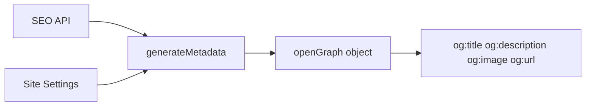

# Open Graph

| Field | Value |
|-------|-------|
| **Document ID** | SEO-004 |
| **Product** | Founder Portfolio Platform (FounderOS v1.0) |
| **Status** | Approved |
| **Last Updated** | 2026-06-29 |
| **Related** | [Metadata](./Metadata.md) · [Twitter_Cards](./Twitter_Cards.md) · [Structured_Data](./Structured_Data.md) |

---

## Purpose

Define Open Graph (OG) protocol implementation for FounderOS v1.0 to ensure correct link previews on LinkedIn, Facebook, Slack, Discord, and other OG-consuming platforms when founders share products, blog posts, and enterprise pages.

## Scope

| In Scope | Out of Scope |
|----------|--------------|
| `og:*` meta tags via Next.js Metadata API | Facebook App ID / domain verification (optional v1.5) |
| OG image generation and sizing | oEmbed provider endpoints |
| Per-entity OG overrides in admin | Video OG for self-hosted video (v1.5) |
| Default OG image from site branding | |

## Business Context

Founders distribute content primarily on **LinkedIn and Twitter/X**. Broken or missing OG tags produce ugly link previews — reducing share engagement and undermining professional credibility. Enterprise and acquisition pages shared in M&A conversations must render polished previews with logo, title, and description.

## Goals

| # | Goal | Success Metric |
|---|------|----------------|
| G1 | Valid OG tags on all shareable public pages | Passes LinkedIn Post Inspector |
| G2 | OG images at recommended dimensions | 1200×630px, < 8MB |
| G3 | Admin-uploadable default and per-entity OG images | CMS integration |
| G4 | Consistent branding in social previews | Logo/colors match design system |

## Functional Requirements

| ID | Requirement | Priority |
|----|-------------|----------|
| FR-OG-001 | `og:title`, `og:description`, `og:url`, `og:type` on all public pages | P0 |
| FR-OG-002 | `og:image` with absolute HTTPS URL, width, height | P0 |
| FR-OG-003 | `og:site_name` from site settings | P0 |
| FR-OG-004 | `og:locale` set to `en_US` (v1.0) | P0 |
| FR-OG-005 | `og:type` = `website` for static pages, `article` for blog posts | P0 |
| FR-OG-006 | `article:published_time` and `article:author` for blog posts | P1 |
| FR-OG-007 | Per-entity `og_image` field in CMS with fallback to featured image | P0 |
| FR-OG-008 | Default OG image in site settings (founder logo or branded card) | P0 |
| FR-OG-009 | Dynamic OG image route optional via Next.js `ImageResponse` (v1.5) | P2 |

## Non-functional Requirements

| ID | Requirement | Target |
|----|-------------|--------|
| NFR-OG-001 | OG image file size | < 1MB recommended |
| NFR-OG-001 | OG image dimensions | 1200×630px (1.91:1) |
| NFR-OG-003 | OG image CDN delivery | Cloudflare cached |
| NFR-OG-004 | Image format | JPEG or PNG; WebP with fallback |

## User Stories

| ID | As a… | I want… | So that… |
|----|-------|---------|----------|
| US-OG-001 | Founder | blog links to show featured image on LinkedIn | shares look professional |
| US-OG-002 | Admin | to upload custom OG image per product | product launches have branded previews |
| US-OG-003 | Marketing lead | acquisition page preview with company branding | M&A outreach looks credible |
| US-OG-004 | Visitor | consistent preview when sharing any page | the brand is recognizable |

## UX Requirements

- Admin media picker for OG image with dimension guidance (1200×630 overlay).
- Preview card in admin SEO panel mimicking LinkedIn/Facebook preview layout.
- Warning if OG image aspect ratio deviates significantly from 1.91:1.
- Featured image auto-used as OG image unless override set.

## Technical Considerations

### OG Tag Matrix

| Page Type | `og:type` | Image Source | Extra Tags |
|-----------|-----------|--------------|------------|
| Home | `website` | Site default OG | — |
| Product detail | `website` | Product `og_image` or hero | `product:brand` (optional) |
| Blog post | `article` | Post featured image | `article:published_time` |
| Portfolio item | `website` | Item thumbnail | — |
| Enterprise | `website` | Site default or custom | — |

### Implementation (Next.js 15)



```typescript
// Pattern — documentation reference only
openGraph: {
  title: seo.title,
  description: seo.description,
  url: canonicalUrl,
  siteName: site.name,
  images: [{ url: ogImageUrl, width: 1200, height: 630, alt: seo.title }],
  locale: 'en_US',
  type: pageType,
}
```

### Image URL Requirements

- Absolute URLs only: `https://{domain}/media/{path}` or CDN URL.
- Cloudflare caching headers: `Cache-Control: public, max-age=31536000, immutable` for hashed assets.
- Avoid query-string image URLs when possible (some crawlers strip params).

### Validation Tools

- [LinkedIn Post Inspector](https://www.linkedin.com/post-inspector/)
- [Facebook Sharing Debugger](https://developers.facebook.com/tools/debug/)
- [opengraph.xyz](https://www.opengraph.xyz/)

## Security Considerations

- OG images must not contain confidential information (unreleased product names in staging).
- Staging/preview environments should use `noindex` and separate OG images or `robots` block.
- User-uploaded OG images validated for type and size per [Validation](../11_Security/Validation.md).

## Acceptance Criteria

- [ ] LinkedIn Post Inspector shows correct title, description, image for Home, Blog, Product
- [ ] All `og:image` URLs return 200 with correct content-type
- [ ] `og:url` matches canonical URL
- [ ] Blog posts show `article` type with published date
- [ ] Default OG image configured and used when entity has no image
- [ ] Admin can override OG image and verify in preview tool within 5 minutes

## Future Enhancements

| Version | Enhancement |
|---------|-------------|
| v1.5 | `@vercel/og` dynamic OG image generation |
| v1.5 | `og:video` for media page embeds |
| v2.0 | Locale-specific `og:locale:alternate` |
| v2.5 | OG image templates per content type |

## Open Questions

| ID | Question | Impact | Decision By |
|----|----------|--------|-------------|
| OQ-OG-001 | Dynamic OG images at launch or static uploads only? | Medium | Week 4 |
| OQ-OG-002 | Facebook `fb:app_id` — required for Insights? | Low | Post-launch |
| OQ-OG-003 | Multiple `og:image` for different aspect ratios? | Low | v1.5 |

## Related Documents

- [Metadata](./Metadata.md)
- [Twitter_Cards](./Twitter_Cards.md)
- [Media Manager](../06_Modules/Media_Manager.md)
- [Brand Guidelines](../01_Brand/Brand_Guidelines.md)
