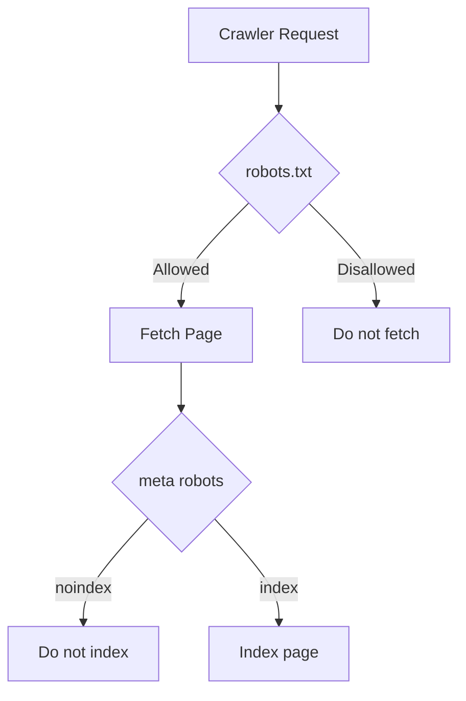

# Robots.txt

| Field | Value |
|-------|-------|
| **Document ID** | SEO-007 |
| **Product** | Founder Portfolio Platform (FounderOS v1.0) |
| **Status** | Approved |
| **Last Updated** | 2026-06-29 |
| **Related** | [Sitemap](./Sitemap.md) · [Metadata](./Metadata.md) · [Technical_SEO](./Technical_SEO.md) |

---

## Purpose

Define `robots.txt` generation, crawl directives, and coordination with meta robots tags for FounderOS v1.0 to control search engine and social crawler access while maximizing indexation of valuable public content.

## Scope

| In Scope | Out of Scope |
|----------|--------------|
| Dynamic `/robots.txt` route | Per-bot custom rules beyond documented set |
| Allow/disallow path rules | Crawl-delay (non-Google standard) |
| Sitemap reference in robots.txt | Subdomain robots for API |
| Coordination with `noindex` meta | |

## Business Context

`robots.txt` is the first file crawlers fetch. Incorrect rules can block entire sites from indexing or expose admin paths to crawlers. FounderOS must block `/admin`, `/api`, and staging paths while allowing full crawl of the 18 public pages and media assets needed for rich results.

## Goals

| # | Goal | Success Metric |
|---|------|----------------|
| G1 | Public content fully crawlable | No unintended Disallow |
| G2 | Admin and API paths blocked | `/admin` not in index |
| G3 | Sitemap referenced in robots.txt | Valid Sitemap directive |
| G4 | Social crawlers allowed for OG images | Twitterbot/Facebook allowed |

## Functional Requirements

| ID | Requirement | Priority |
|----|-------------|----------|
| FR-ROB-001 | Serve `robots.txt` at `https://{domain}/robots.txt` | P0 |
| FR-ROB-002 | `User-agent: *` with documented Allow/Disallow rules | P0 |
| FR-ROB-003 | `Sitemap: https://{domain}/sitemap.xml` directive | P0 |
| FR-ROB-004 | Disallow `/admin/` and `/api/` | P0 |
| FR-ROB-005 | Allow `/` and all public routes | P0 |
| FR-ROB-006 | Explicit Allow for social bots on public paths | P1 |
| FR-ROB-007 | Staging/preview: `Disallow: /` when `ROBOTS_NOINDEX=true` | P0 |
| FR-ROB-008 | Generated dynamically from Next.js route or static file | P0 |
| FR-ROB-009 | `Content-Type: text/plain; charset=utf-8` | P0 |

## Non-functional Requirements

| ID | Requirement | Target |
|----|-------------|--------|
| NFR-ROB-001 | robots.txt response time | < 50ms |
| NFR-ROB-002 | File size | < 500 bytes (v1.0) |
| NFR-ROB-003 | Availability | 99.9% (same as public site) |

## User Stories

| ID | As a… | I want… | So that… |
|----|-------|---------|----------|
| US-ROB-001 | DevOps | staging blocked from Google | preview content isn't indexed |
| US-ROB-002 | SEO specialist | sitemap linked in robots.txt | crawlers discover all URLs |
| US-ROB-003 | Security lead | admin paths disallowed | admin UI isn't crawled |

## UX Requirements

- No end-user UX — crawlers only.
- Admin settings show current robots.txt preview (read-only).
- Environment badge in admin when `ROBOTS_NOINDEX` is active.

## Technical Considerations

### Production robots.txt Template

```
User-agent: *
Allow: /
Disallow: /admin/
Disallow: /api/

User-agent: Googlebot
Allow: /

User-agent: Twitterbot
Allow: /

User-agent: facebookexternalhit
Allow: /

Sitemap: https://example.com/sitemap.xml
```

### Staging robots.txt Template

```
User-agent: *
Disallow: /
```

### Path Rules Matrix

| Path | robots.txt | meta robots | Indexed? |
|------|------------|-------------|----------|
| `/` | Allow | index | Yes |
| `/products/*` | Allow | index | Yes |
| `/admin/*` | Disallow | noindex | No |
| `/api/*` | Disallow | N/A | No |
| `/not-found` | Allow | noindex | No |



### Implementation Options

| Approach | Pros | Cons |
|----------|------|------|
| `app/robots.ts` (Next.js MetadataRoute) | Type-safe, env-aware | Vercel only |
| Static `public/robots.txt` | Simple | No env branching |
| **Recommended:** `robots.ts` with `ROBOTS_NOINDEX` env | Staging/production split | — |

### robots.txt vs meta robots

- `robots.txt` Disallow prevents **crawling** — URL may still appear in SERPs without snippet.
- `noindex` meta prevents **indexing** — preferred for pages that should not appear in search.
- Admin uses both: Disallow `/admin/` + `noindex` on admin layout.

## Security Considerations

- robots.txt is not access control — admin must require authentication regardless.
- Do not list sensitive paths in robots.txt (security through obscurity fails — use auth).
- API must not rely on robots.txt for protection.

## Acceptance Criteria

- [ ] `curl https://{domain}/robots.txt` returns 200 with correct rules
- [ ] Sitemap URL in robots.txt is valid and accessible
- [ ] Staging with `ROBOTS_NOINDEX=true` returns `Disallow: /`
- [ ] Google Search Console robots.txt tester shows no errors
- [ ] `/admin/` not indexed in Search Console
- [ ] Public pages crawlable per URL Inspection tool

## Future Enhancements

| Version | Enhancement |
|---------|-------------|
| v1.5 | Admin UI to add custom Disallow rules |
| v2.0 | Per-tenant robots in multi-tenant mode |
| v2.5 | Crawl budget monitoring integration |

## Open Questions

| ID | Question | Impact | Decision By |
|----|----------|--------|-------------|
| OQ-ROB-001 | Disallow `/media/private/` path for future private assets? | Low | v1.5 |
| OQ-ROB-002 | Allow `/_next/static/` explicitly? | Low | Week 2 — Not required |

## Related Documents

- [Sitemap](./Sitemap.md)
- [Metadata](./Metadata.md)
- [Canonical](./Canonical.md)
- [Technical_SEO](./Technical_SEO.md)
