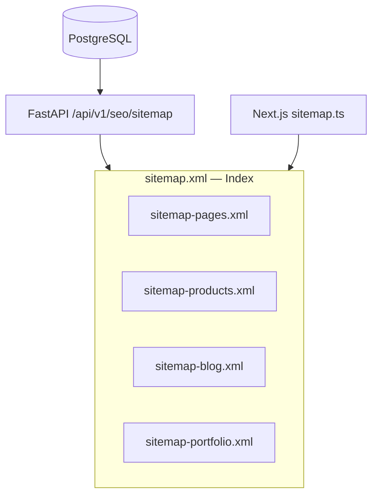

# Sitemap

| Field | Value |
|-------|-------|
| **Document ID** | SEO-008 |
| **Product** | Founder Portfolio Platform (FounderOS v1.0) |
| **Status** | Approved |
| **Last Updated** | 2026-06-29 |
| **Related** | [Robots](./Robots.md) · [Canonical](./Canonical.md) · [Technical_SEO](./Technical_SEO.md) |

---

## Purpose

Define XML sitemap generation, structure, and submission strategy for FounderOS v1.0 to ensure search engines discover and prioritize all indexable public URLs including dynamic entity pages.

## Scope

| In Scope | Out of Scope |
|----------|--------------|
| `/sitemap.xml` index and child sitemaps | Image/video/news sitemaps (v1.5) |
| Static pages + dynamic entities | Sitemap ping automation to all engines |
| `lastmod`, `changefreq`, `priority` fields | Multi-tenant sitemap federation (v2.0) |
| On-demand regeneration on publish | |

## Business Context

FounderOS has 18 static routes plus unbounded dynamic content (products, blog posts, portfolio items, case studies). A comprehensive sitemap accelerates discovery of new product launches and blog content — critical for inbound marketing and enterprise visibility.

## Goals

| # | Goal | Success Metric |
|---|------|----------------|
| G1 | All indexable URLs in sitemap | 100% coverage vs crawl audit |
| G2 | Sitemap validates against XML schema | Zero errors in Search Console |
| G3 | `lastmod` reflects actual publish/update time | Accurate within 1 hour |
| G4 | Scales to 10,000 URLs without timeout | Generation < 5s |

## Functional Requirements

| ID | Requirement | Priority |
|----|-------------|----------|
| FR-SM-001 | Serve `/sitemap.xml` at site root | P0 |
| FR-SM-002 | Include all 18 static public routes | P0 |
| FR-SM-003 | Include published products, blog posts, portfolio items, case studies | P0 |
| FR-SM-004 | Exclude draft, archived, and `noindex` entities | P0 |
| FR-SM-005 | Exclude `/admin/*`, `/api/*`, 404 | P0 |
| FR-SM-006 | `<loc>` uses canonical absolute HTTPS URLs | P0 |
| FR-SM-007 | `<lastmod>` in W3C datetime format (ISO 8601) | P0 |
| FR-SM-008 | Sitemap index when URLs > 1,000 (split by type) | P1 |
| FR-SM-009 | Regenerate on entity publish via webhook revalidation | P1 |
| FR-SM-010 | Referenced in [Robots](./Robots.md) | P0 |

## Non-functional Requirements

| ID | Requirement | Target |
|----|-------------|--------|
| NFR-SM-001 | Max URLs per sitemap file | 50,000 (Google limit) |
| NFR-SM-002 | Max sitemap file size | 50MB uncompressed |
| NFR-SM-003 | Generation time (10K URLs) | < 5s |
| NFR-SM-004 | Cache TTL | 3600s with on-demand invalidation |

## User Stories

| ID | As a… | I want… | So that… |
|----|-------|---------|----------|
| US-SM-001 | Admin | new blog posts in sitemap within minutes of publish | Google indexes quickly |
| US-SM-002 | SEO specialist | accurate lastmod dates | crawlers prioritize fresh content |
| US-SM-003 | DevOps | sitemap auto-generated | no manual maintenance |

## UX Requirements

- No public UX — XML for crawlers only.
- Admin SEO dashboard shows sitemap URL count and last generated timestamp.
- Manual "Regenerate Sitemap" button in admin (triggers cache bust).

## Technical Considerations

### Sitemap Architecture



### URL Inclusion Rules

| Content Type | Include When | Priority | changefreq |
|--------------|--------------|----------|------------|
| Home | Always | 1.0 | daily |
| Products list | Always | 0.9 | weekly |
| Product detail | `status=published` | 0.8 | weekly |
| Blog list | Always | 0.9 | daily |
| Blog post | `status=published` | 0.7 | monthly |
| Portfolio item | `status=published` | 0.7 | monthly |
| Legal pages | Always | 0.3 | yearly |

### Implementation (Next.js 15)

- `app/sitemap.ts` exports `MetadataRoute.Sitemap` or fetches from API.
- Hybrid: static routes in Next.js; dynamic entities from FastAPI aggregated endpoint.
- `lastmod` from entity `updated_at` timestamp.

### Example Entry

```xml
<url>
  <loc>https://example.com/products/founderos-platform</loc>
  <lastmod>2026-06-29T10:00:00+00:00</lastmod>
  <changefreq>weekly</changefreq>
  <priority>0.8</priority>
</url>
```

### Submission

- Submit `https://{domain}/sitemap.xml` in Google Search Console.
- Bing Webmaster Tools submission (manual v1.0).
- Optional: ping `https://www.google.com/ping?sitemap=...` on major publish events.

## Security Considerations

- Sitemap must not include admin, API, or authenticated preview URLs.
- Unpublished/draft content excluded even if URL is guessable.
- Rate limit sitemap generation endpoint to prevent abuse.

## Acceptance Criteria

- [ ] `/sitemap.xml` returns 200 with valid XML content-type
- [ ] Google Search Console sitemap status: "Success"
- [ ] All published products and blog posts appear in sitemap
- [ ] Draft posts excluded
- [ ] `<loc>` URLs match [Canonical](./Canonical.md) URLs exactly
- [ ] `lastmod` updates within 1 hour of entity edit
- [ ] Sitemap index used when total URLs > 1,000
- [ ] Referenced in robots.txt

## Future Enhancements

| Version | Enhancement |
|---------|-------------|
| v1.5 | Image sitemap for media gallery |
| v1.5 | Auto-ping search engines on publish |
| v2.0 | Per-tenant sitemaps in multi-tenant SaaS |
| v2.5 | News sitemap for blog breaking posts |

## Open Questions

| ID | Question | Impact | Decision By |
|----|----------|--------|-------------|
| OQ-SM-001 | `changefreq` and `priority` — include or omit (Google ignores)? | Low | Week 2 — Include for Bing |
| OQ-SM-002 | Sitemap generated on Vercel vs FastAPI? | Medium | Week 3 — Hybrid recommended |

## Related Documents

- [Robots](./Robots.md)
- [Canonical](./Canonical.md)
- [Technical_SEO](./Technical_SEO.md)
- [SEO API](../08_API/SEO_API.md)
