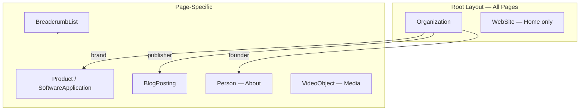

# Structured Data

| Field | Value |
|-------|-------|
| **Document ID** | SEO-002 |
| **Product** | Founder Portfolio Platform (FounderOS v1.0) |
| **Status** | Approved |
| **Last Updated** | 2026-06-29 |
| **Related** | [Schema](./Schema.md) · [Metadata](./Metadata.md) · [Technical_SEO](./Technical_SEO.md) |

---

## Purpose

Specify JSON-LD structured data requirements for FounderOS v1.0 to enable rich search results, knowledge panel eligibility, and enhanced SERP presentation for founders, products, articles, and organization entities.

## Scope

| In Scope | Out of Scope |
|----------|--------------|
| JSON-LD format and placement | Microdata or RDFa formats |
| Schema.org types per page | Custom schema extensions |
| Validation and testing procedures | Google Merchant Center feeds |
| Admin overrides for organization data | FAQ schema for all pages (selective) |

## Business Context

Structured data is a **trust and visibility multiplier** for FounderOS tenants:

- **Organization** schema establishes founder/company identity in search.
- **Product** schema surfaces software products in rich results.
- **Article** schema improves blog post presentation.
- **Person** schema links founder credibility to the brand.

Enterprise buyers and acquirers often validate companies via search — rich results increase perceived legitimacy.

## Goals

| # | Goal | Success Metric |
|---|------|----------------|
| G1 | Valid JSON-LD on all applicable pages | 0 errors in Rich Results Test |
| G2 | Consistent organization entity across site | Single `@id` for Organization |
| G3 | Dynamic schema from CMS/API data | No hardcoded product names in code |
| G4 | Admin-configurable organization fields | Founder name, logo, social profiles editable |

## Functional Requirements

| ID | Requirement | Priority |
|----|-------------|----------|
| FR-SD-001 | JSON-LD embedded in `<script type="application/ld+json">` in page `<head>` | P0 |
| FR-SD-002 | Organization schema on all pages via root layout | P0 |
| FR-SD-003 | WebSite + SearchAction on home page | P1 |
| FR-SD-004 | Product schema on `/products/[slug]` | P0 |
| FR-SD-005 | Article/BlogPosting schema on `/blog/[slug]` | P0 |
| FR-SD-006 | BreadcrumbList on all nested pages | P0 |
| FR-SD-007 | Person schema on `/about` linked to Organization | P1 |
| FR-SD-008 | VideoObject schema on `/media` for YouTube embeds | P1 |
| FR-SD-009 | SoftwareApplication schema for SaaS products (when applicable) | P1 |
| FR-SD-010 | Aggregate schema graph with `@graph` when multiple types per page | P0 |

## Non-functional Requirements

| ID | Requirement | Target |
|----|-------------|--------|
| NFR-SD-001 | JSON-LD payload size per page | < 10KB |
| NFR-SD-002 | Schema generation latency | < 50ms (server-side) |
| NFR-SD-003 | Schema.org version compliance | Latest stable vocabulary |
| NFR-SD-004 | No invalid required properties per Google guidelines | 100% compliance |

## User Stories

| ID | As a… | I want… | So that… |
|----|-------|---------|----------|
| US-SD-001 | Founder | my company to appear as an Organization in search | buyers recognize my brand |
| US-SD-002 | Admin | product schema auto-generated from product fields | I don't write JSON manually |
| US-SD-003 | Visitor | blog posts to show article rich results | I trust the content source |
| US-SD-004 | SEO specialist | breadcrumbs in SERPs | navigation is clear in search |

## UX Requirements

- Structured data is invisible to users — no UI impact.
- Admin SEO panel shows schema preview (read-only JSON) for validation.
- Missing required fields show admin warnings before publish (e.g., product without image).
- Breadcrumb UI must match BreadcrumbList schema positions exactly.

## Technical Considerations

### Schema Graph Architecture

### Page-to-Schema Mapping

| Page | Schema Types | Data Source |
|------|--------------|-------------|
| `/` | Organization, WebSite, SearchAction | Site Settings API |
| `/about` | Person, Organization | CMS + Site Settings |
| `/products/[slug]` | Product, BreadcrumbList | Products API |
| `/blog/[slug]` | BlogPosting, BreadcrumbList | Blog API |
| `/portfolio` | ItemList, CreativeWork (items) | Portfolio API |
| `/media` | VideoObject, ItemList | Media + YouTube API |
| `/contact` | ContactPage, Organization | Site Settings |
| `/enterprise` | WebPage, Organization | CMS |

### Implementation Pattern (Next.js 15)

- `generateMetadata` + dedicated `JsonLd` server component.
- Schema built from typed objects — serialized with `JSON.stringify`.
- Single `@graph` array when multiple entities on one page.
- `@id` URLs use canonical absolute URLs: `https://{domain}/#organization`.

### Validation Checklist

- [ ] [Google Rich Results Test](https://search.google.com/test/rich-results)
- [ ] [Schema.org Validator](https://validator.schema.org/)
- [ ] Search Console Enhancements report monitored weekly

See [Schema](./Schema.md) for full property definitions per type.

## Security Considerations

- JSON-LD must escape user-generated content (titles, descriptions) to prevent script injection.
- No PII in public schema (email addresses use `contactPoint` with business email only).
- Admin-only fields never leak into public schema payloads.

## Acceptance Criteria

- [ ] Rich Results Test passes for Home, Product detail, Blog post, About
- [ ] Organization `@id` consistent across all pages
- [ ] BreadcrumbList positions match visible breadcrumb UI
- [ ] Product schema includes `name`, `description`, `image`, `url` at minimum
- [ ] BlogPosting includes `datePublished`, `dateModified`, `author`, `publisher`
- [ ] No duplicate conflicting schema types on same page
- [ ] Schema regenerates on CMS publish without redeploy (SSR/ISR revalidation)

## Future Enhancements

| Version | Enhancement |
|---------|-------------|
| v1.5 | FAQPage schema for enterprise/acquisition pages |
| v1.5 | Review/Rating schema for testimonials |
| v2.0 | Event schema for launches/webinars |
| v2.5 | HowTo schema for product documentation |

## Open Questions

| ID | Question | Impact | Decision By |
|----|----------|--------|-------------|
| OQ-SD-001 | SoftwareApplication vs Product for SaaS listings? | Medium | Week 2 |
| OQ-SD-002 | Include `price` in Product schema without e-commerce? | Low | Week 3 |
| OQ-SD-003 | SearchAction — site search not in v1.0; omit or stub? | Low | Week 1 |

## Related Documents

- [Schema](./Schema.md)
- [Metadata](./Metadata.md)
- [OpenGraph](./OpenGraph.md)
- [SEO Module](../06_Modules/SEO.md)
