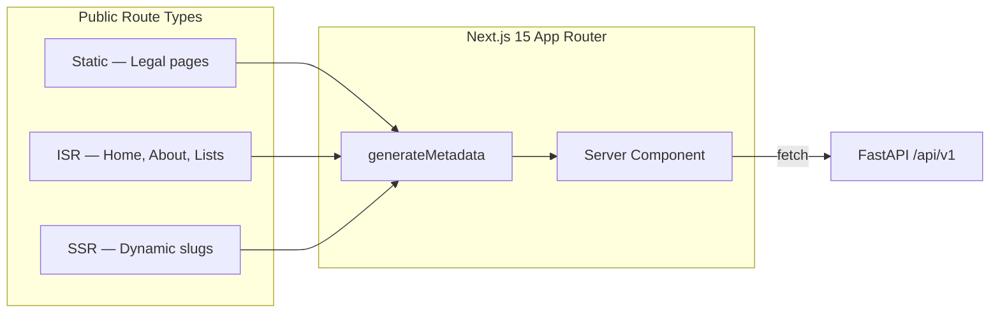

# Technical SEO

| Field | Value |
|-------|-------|
| **Document ID** | SEO-001 |
| **Product** | Founder Portfolio Platform (FounderOS v1.0) |
| **Status** | Approved |
| **Last Updated** | 2026-06-29 |
| **Related** | [Metadata](./Metadata.md) · [Sitemap](./Sitemap.md) · [Structured_Data](./Structured_Data.md) · [Robots](./Robots.md) |

---

## Purpose

Define the technical SEO foundation for FounderOS v1.0 — crawlability, indexability, rendering strategy, URL architecture, and performance signals that enable founders and SaaS companies to rank for branded and commercial-intent queries.

## Scope

| In Scope | Out of Scope |
|----------|--------------|
| Crawl/index strategy for all 18 public pages | Paid search (SEM) campaigns |
| SSR/ISR rendering requirements for Next.js 15 | Third-party SEO agency workflows |
| URL structure, redirects, and canonical policy | Multi-language hreflang (v1.5) |
| Core Web Vitals targets and measurement | Content marketing keyword strategy |
| Integration with admin SEO module | Automated backlink building |

## Business Context

FounderOS is a **commercial identity platform** — not a hobby blog. Technical SEO directly impacts:

1. **Inbound enterprise leads** — acquisition and enterprise pages must be indexable and fast.
2. **Product discovery** — product and portfolio pages compete for branded and category queries.
3. **Credibility signals** — valid structured data, sitemaps, and HTTPS reinforce trust.
4. **White-label resale** — each tenant deployment inherits the same SEO architecture.

Poor technical SEO undermines the platform's value proposition for founders selling products, licensing software, or seeking acquisition.

## Goals

| # | Goal | Success Metric |
|---|------|----------------|
| G1 | All public pages crawlable and indexable | 100% coverage in Search Console |
| G2 | Core Web Vitals pass on mobile | LCP < 2.5s, INP < 200ms, CLS < 0.1 |
| G3 | Zero critical SEO rendering issues | No JS-only content for primary page body |
| G4 | Clean URL architecture | No duplicate URLs without canonical |
| G5 | Admin-configurable SEO without code changes | SEO module covers all public routes |

## Functional Requirements

| ID | Requirement | Priority |
|----|-------------|----------|
| FR-SEO-001 | All public pages use Next.js 15 SSR or ISR — no client-only rendering for primary content | P0 |
| FR-SEO-002 | Each page exposes unique `<title>`, meta description, and canonical URL | P0 |
| FR-SEO-003 | Dynamic routes (`/products/[slug]`, `/blog/[slug]`) generate per-entity metadata from API | P0 |
| FR-SEO-004 | `/sitemap.xml` and `/robots.txt` served at site root | P0 |
| FR-SEO-005 | JSON-LD structured data on applicable pages per [Structured_Data](./Structured_Data.md) | P0 |
| FR-SEO-006 | 301 redirects for changed slugs stored in database and applied at edge | P1 |
| FR-SEO-007 | `noindex` supported per page via admin SEO module | P1 |
| FR-SEO-008 | Trailing slash policy enforced consistently (no trailing slash) | P0 |
| FR-SEO-009 | Pagination uses `rel="next"` / `rel="prev"` on blog and portfolio list pages | P1 |
| FR-SEO-010 | Image `alt` text required on CMS-uploaded media | P0 |

## Non-functional Requirements

| ID | Requirement | Target |
|----|-------------|--------|
| NFR-SEO-001 | Time to First Byte (TTFB) via Cloudflare + Vercel | < 200ms p95 |
| NFR-SEO-002 | HTML document size (initial) | < 100KB uncompressed |
| NFR-SEO-003 | Crawl budget efficiency | No orphan pages; max 3 clicks from home |
| NFR-SEO-004 | Sitemap generation latency | < 5s for 10,000 URLs |
| NFR-SEO-005 | SEO metadata API response | < 100ms p95 |

## User Stories

| ID | As a… | I want… | So that… |
|----|-------|---------|----------|
| US-SEO-001 | Founder (admin) | to configure SEO metadata per page without code | my site ranks for target keywords |
| US-SEO-002 | Visitor | pages to load instantly on mobile | I engage with content |
| US-SEO-003 | Search engine crawler | clean HTML with semantic structure | I index content accurately |
| US-SEO-004 | Enterprise buyer | acquisition page indexed for branded queries | I can find the company via search |
| US-SEO-005 | DevOps engineer | sitemap and robots auto-generated | I don't manually maintain SEO files |

## UX Requirements

- **No SEO-visible content hidden behind interactions** — tab panels and accordions must render primary content in initial HTML.
- **Breadcrumb navigation** visible on nested pages (products, blog, portfolio) with matching BreadcrumbList schema.
- **404 page** returns HTTP 404 with helpful navigation — not a soft 404 with 200 status.
- **Loading states** must not cause layout shift affecting CLS scores.
- **Admin SEO preview** shows approximate Google snippet rendering before publish.

## Technical Considerations

### Rendering Strategy

| Route Pattern | Strategy | Revalidation |
|---------------|----------|--------------|
| `/`, `/about`, `/enterprise` | ISR | 3600s |
| `/products`, `/blog`, `/portfolio` | ISR | 600s |
| `/products/[slug]`, `/blog/[slug]` | SSR + on-demand revalidation | On publish |
| `/privacy`, `/terms`, `/cookie-policy` | Static | On CMS update |

### URL Architecture

| Rule | Implementation |
|------|----------------|
| Lowercase only | Middleware redirect |
| Hyphenated slugs | Enforced at CMS publish |
| No query params for content | Pagination uses `/blog?page=2` with canonical to page 1 when `page=1` |
| HTTPS only | Cloudflare redirect + HSTS |

### Internal Linking

- Header and footer navigation link to all primary sections.
- Related products/posts linked on detail pages.
- Sitemap supplements but does not replace internal links.

### Cross-References

- Metadata implementation: [Metadata](./Metadata.md)
- Canonical policy: [Canonical](./Canonical.md)
- Schema types: [Schema](./Schema.md)
- Admin SEO module: [../07_Admin/SEO.md](../07_Admin/SEO.md)
- SEO API: [../08_API/SEO_API.md](../08_API/SEO_API.md)

## Security Considerations

- SEO endpoints (`/sitemap.xml`, `/robots.txt`) are public — must not expose admin routes or API keys.
- `noindex` on admin paths (`/admin/*`) enforced at middleware and `robots.txt`.
- Open redirect vulnerabilities prevented in slug redirect table — only internal paths allowed.
- User-generated content in meta descriptions sanitized to prevent XSS in `<meta>` tags.

## Acceptance Criteria

- [ ] Google Search Console shows zero "Crawled — currently not indexed" for P0 pages
- [ ] All 18 public pages return 200 with unique titles and descriptions
- [ ] Lighthouse SEO score ≥ 95 on Home, Products, Blog
- [ ] Mobile Core Web Vitals pass in CrUX field data (or lab proxy after 28 days)
- [ ] `sitemap.xml` validates at [Google Search Console](https://search.google.com/search-console)
- [ ] No duplicate titles or descriptions across public pages
- [ ] Admin can set `noindex` and verify via `curl -I` or Rich Results Test
- [ ] 404 returns HTTP 404 status code
- [ ] Structured data passes Google Rich Results Test on applicable pages

## Future Enhancements

| Version | Enhancement |
|---------|-------------|
| v1.5 | hreflang tags for multi-language tenants |
| v1.5 | Automated broken link checker in admin |
| v2.0 | Per-tenant sitemap in multi-tenant mode |
| v2.0 | SEO score dashboard with actionable recommendations |
| v2.5 | AI-assisted meta description generation |

## Open Questions

| ID | Question | Impact | Decision By |
|----|----------|--------|-------------|
| OQ-SEO-001 | ISR revalidation: time-based vs. webhook-only? | Medium | Week 3 |
| OQ-SEO-002 | Blog pagination: `/blog/page/2` vs `?page=2`? | Low | Week 2 |
| OQ-SEO-003 | Include draft preview URLs with `noindex` for stakeholder review? | Medium | Week 4 |
| OQ-SEO-004 | Submit sitemap to Bing/Yandex automatically? | Low | Post-launch |

## Related Documents

- [PROJECT_SCOPE.md](../../PROJECT_SCOPE.md)
- [System_Architecture.md](../04_Architecture/System_Architecture.md)
- [Frontend_Architecture.md](../04_Architecture/Frontend_Architecture.md)
- [SEO Module](../06_Modules/SEO.md)
