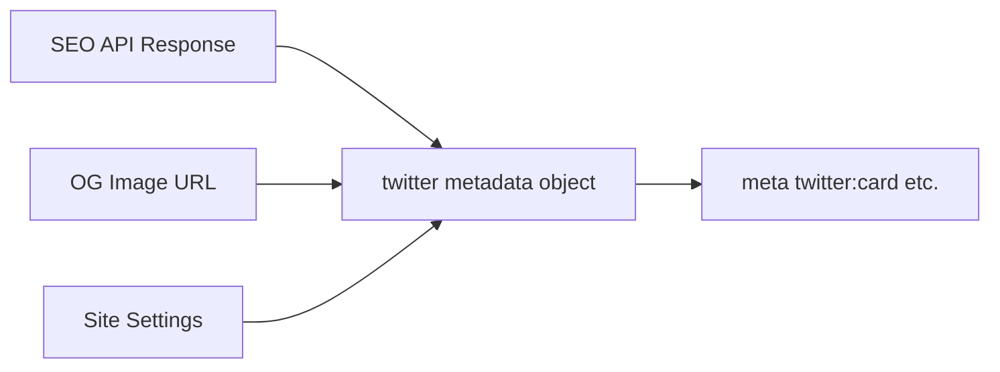

# Twitter Cards

| Field | Value |
|-------|-------|
| **Document ID** | SEO-005 |
| **Product** | Founder Portfolio Platform (FounderOS v1.0) |
| **Status** | Approved |
| **Last Updated** | 2026-06-29 |
| **Related** | [OpenGraph](./OpenGraph.md) · [Metadata](./Metadata.md) |

---

## Purpose

Define Twitter/X Card meta tag implementation for FounderOS v1.0 to ensure rich link previews when founders and visitors share platform content on X (Twitter).

## Scope

| In Scope | Out of Scope |
|----------|--------------|
| `twitter:card`, `twitter:title`, `twitter:description`, `twitter:image` | Twitter/X API integration for auto-posting |
| Next.js Metadata `twitter` object | Twitter analytics pixels |
| Fallback to Open Graph tags | Twitter Player Cards for video |

## Business Context

X remains a primary distribution channel for founders, SaaS builders, and tech entrepreneurs. Twitter Cards complement Open Graph — X's crawler prefers explicit `twitter:*` tags. Professional card previews increase engagement on product launches, blog posts, and acquisition announcements.

## Goals

| # | Goal | Success Metric |
|---|------|----------------|
| G1 | `summary_large_image` cards on all shareable pages | Card Validator passes |
| G2 | Consistent with OG metadata | Title/description/image match |
| G3 | Founder Twitter handle in `twitter:site` | Configurable in site settings |
| G4 | Zero card rendering failures | No fallback to plain URL links |

## Functional Requirements

| ID | Requirement | Priority |
|----|-------------|----------|
| FR-TW-001 | `twitter:card` = `summary_large_image` for all public content pages | P0 |
| FR-TW-002 | `twitter:title` mirrors page title (may truncate at 70 chars) | P0 |
| FR-TW-003 | `twitter:description` mirrors meta description | P0 |
| FR-TW-004 | `twitter:image` absolute HTTPS URL, min 300×157, recommended 1200×630 | P0 |
| FR-TW-005 | `twitter:site` = `@founderhandle` from site settings | P1 |
| FR-TW-006 | `twitter:creator` = founder's X handle on blog posts | P1 |
| FR-TW-007 | Implemented via Next.js `metadata.twitter` object | P0 |
| FR-TW-008 | Fallback: X reads OG tags if twitter tags absent — both set explicitly | P0 |

## Non-functional Requirements

| ID | Requirement | Target |
|----|-------------|--------|
| NFR-TW-001 | Image accessible to X crawler (no bot blocking) | Allow `Twitterbot` in robots |
| NFR-TW-002 | Card metadata in initial HTML | Server-rendered |
| NFR-TW-003 | Image load time for crawler | < 3s |

## User Stories

| ID | As a… | I want… | So that… |
|----|-------|---------|----------|
| US-TW-001 | Founder | my product launch tweet to show large image card | engagement increases |
| US-TW-002 | Admin | to set site Twitter handle once | all pages credit the account |
| US-TW-003 | Visitor | shared blog links to render rich previews | I trust the source |

## UX Requirements

- Admin site settings include Twitter handle field with `@` prefix validation.
- SEO preview panel shows Twitter card mockup alongside LinkedIn OG preview.
- Blog author Twitter handle optional field — populates `twitter:creator`.

## Technical Considerations

### Tag Mapping

| Twitter Tag | Source |
|-------------|--------|
| `twitter:card` | Static: `summary_large_image` |
| `twitter:title` | SEO API `title` |
| `twitter:description` | SEO API `description` |
| `twitter:image` | OG image URL (shared) |
| `twitter:site` | Site Settings `twitter_handle` |
| `twitter:creator` | Post author or founder handle |

### Next.js Metadata Pattern



### X Card Validator

- Validate at [Twitter Card Validator](https://cards-dev.twitter.com/validator) (or current X developer tool).
- Re-validate after OG image URL changes — X caches aggressively.

### Robots Compatibility

Ensure `Twitterbot` is not blocked in [Robots](./Robots.md):

```
User-agent: Twitterbot
Allow: /
```

## Security Considerations

- Twitter handle fields validated: alphanumeric + underscore only, max 15 chars.
- No tokens or API keys in twitter meta tags.
- Staging environments should not be shared publicly with production card metadata.

## Acceptance Criteria

- [ ] X Card Validator shows `summary_large_image` for Home, Blog, Product pages
- [ ] `twitter:image` returns 200 with image/jpeg or image/png
- [ ] `twitter:site` populated when handle configured in admin
- [ ] Blog posts show `twitter:creator` when author handle set
- [ ] Metadata matches Open Graph title/description/image
- [ ] Twitterbot not blocked in robots.txt

## Future Enhancements

| Version | Enhancement |
|---------|-------------|
| v1.5 | `summary` card fallback for text-only pages |
| v2.0 | Player Card for embedded product demos |
| v2.5 | Auto-post to X on blog publish (API integration) |

## Open Questions

| ID | Question | Impact | Decision By |
|----|----------|--------|-------------|
| OQ-TW-001 | `summary` vs `summary_large_image` for legal pages? | Low | Week 2 — Recommend large for consistency |
| OQ-TW-002 | Per-post `twitter:creator` vs always founder? | Low | Week 2 |

## Related Documents

- [OpenGraph](./OpenGraph.md)
- [Metadata](./Metadata.md)
- [Robots](./Robots.md)
- [Settings Module](../06_Modules/Settings.md)
