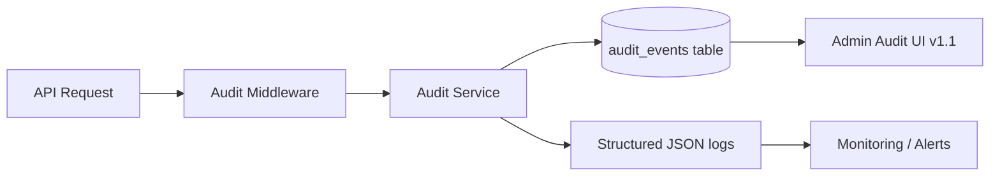
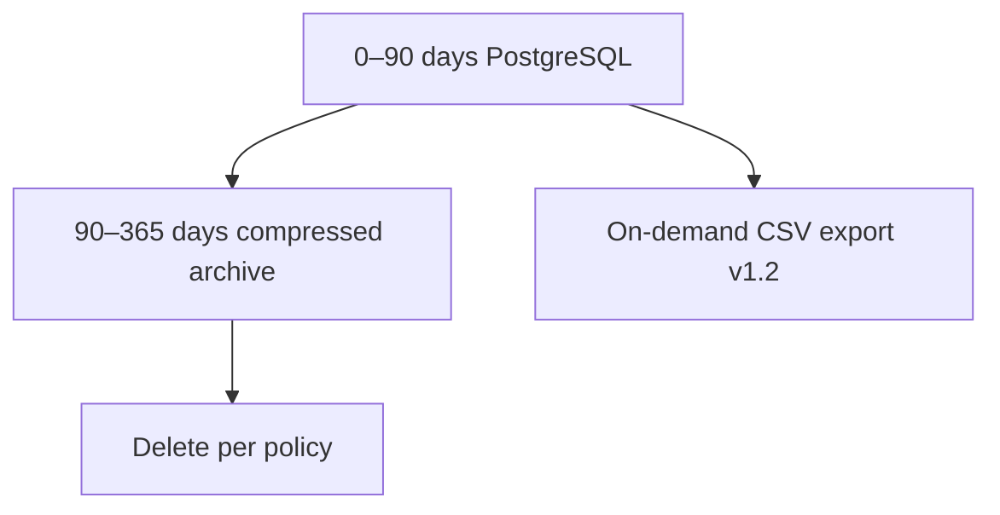

# Security Audit Logging

| Field | Value |
|-------|-------|
| **Document ID** | SEC-AUD-001 |
| **Product** | Founder Portfolio Platform (FounderOS v1.0) |
| **Status** | Approved |
| **Last Updated** | 2026-06-29 |
| **Related** | [Authentication](./Authentication.md) · [Authorization](./Authorization.md) · [Compliance](./Compliance.md) |

---

## Purpose

Define audit logging requirements for FounderOS v1.0 — capturing security-relevant events, admin actions, and system anomalies with sufficient detail for forensic investigation, compliance reporting, and operational monitoring across white-label deployments.

## Scope

| In Scope | Out of Scope |
|----------|--------------|
| Authentication and authorization events | Full application debug logging |
| Admin content mutations (who/when/what) | Real-time SIEM integration (v1.2) |
| Rate limit and WAF trigger events | Log shipping to tenant-owned SIEM (v2.0) |
| Configuration changes | PII-heavy access logs retention policy (see [Compliance](./Compliance.md)) |
| Audit log retention and access controls | Immutable blockchain audit (not planned) |

## Business Context

Enterprise buyers and white-label agencies require evidence that admin actions on products, pricing, and inquiry data are traceable. Audit logs support GDPR accountability, internal investigations, and differentiation of FounderOS as a commercial-grade platform versus personal portfolio templates.

## Goals

| # | Goal | Success Metric |
|---|------|----------------|
| G1 | Log 100% of auth success/failure events | Verified in integration tests |
| G2 | Log all admin write operations with actor ID | Complete mutation coverage |
| G3 | Tamper-resistant storage | Append-only table + restricted access |
| G4 | Searchable by actor, action, resource, time | Admin audit UI (v1.1) |
| G5 | Correlation IDs across frontend → API → DB | End-to-end trace in support tickets |

## Functional Requirements

| ID | Requirement | Priority |
|----|-------------|----------|
| FR-SEC-AUD-001 | System SHALL log login success and failure with IP and user-agent | P0 |
| FR-SEC-AUD-002 | System SHALL log logout and token refresh events | P0 |
| FR-SEC-AUD-003 | System SHALL log 403 authorization denials | P0 |
| FR-SEC-AUD-004 | System SHALL log admin CRUD on products, blog, portfolio, settings | P0 |
| FR-SEC-AUD-005 | System SHALL log role and permission changes | P0 |
| FR-SEC-AUD-006 | System SHALL include `request_id` on all audit entries | P0 |
| FR-SEC-AUD-007 | System SHALL NOT log passwords, tokens, or secrets | P0 |
| FR-SEC-AUD-008 | Audit logs SHALL be readable only by `audit.read` permission | P0 |
| FR-SEC-AUD-009 | System SHALL log rate limit threshold breaches | P1 |
| FR-SEC-AUD-010 | System SHALL retain audit logs minimum 90 days (configurable) | P1 |

## Non-functional Requirements

| ID | Requirement | Target |
|----|-------------|--------|
| NFR-SEC-AUD-001 | Audit write latency | &lt; 5 ms async |
| NFR-SEC-AUD-002 | Audit log availability | 99.9% |
| NFR-SEC-AUD-003 | Storage growth estimate | ~50 MB/month per tenant |
| NFR-SEC-AUD-004 | Query p95 (admin UI v1.1) | &lt; 500 ms |

## User Stories

| ID | As a… | I want… | So that… |
|----|-------|---------|----------|
| US-SEC-AUD-001 | super_admin | see who changed product pricing | I investigate discrepancies |
| US-SEC-AUD-002 | Security auditor | export auth failure logs | I assess brute-force risk |
| US-SEC-AUD-003 | Support engineer | trace request_id across logs | I debug user reports |
| US-SEC-AUD-004 | Compliance officer | 90-day retention proof | GDPR audits pass |
| US-SEC-AUD-005 | Founder | alerts on role changes | I detect unauthorized access |

## UX Requirements

- Audit log admin UI (v1.1): filterable table by date, actor, action, resource type.
- No display of sensitive before/after values (e.g., password hashes).
- Export to CSV restricted to `audit.read` + `audit.export` (v1.2).
- Failed login spike notification to founder email (v1.1).

## Technical Considerations

### Audit Event Pipeline

### Event Taxonomy

| Category | Action Examples | Severity |
|----------|-----------------|----------|
| `auth` | `login.success`, `login.failure`, `logout`, `refresh` | INFO / WARN |
| `authz` | `access.denied` | WARN |
| `content` | `product.create`, `blog.update`, `media.delete` | INFO |
| `admin` | `user.role_change`, `settings.update` | WARN |
| `security` | `rate_limit.exceeded`, `csp.violation` | WARN |
| `system` | `backup.completed`, `deploy.started` | INFO |

### Audit Record Schema

| Field | Type | Description |
|-------|------|-------------|
| `id` | UUID | Unique event ID |
| `timestamp` | ISO 8601 UTC | Event time |
| `actor_id` | integer / null | User ID; null for anonymous |
| `actor_email` | string / null | Denormalized for display |
| `action` | string | Namespaced action key |
| `resource_type` | string | e.g., `product`, `user` |
| `resource_id` | string / null | Target entity ID |
| `ip_address` | string | Client IP (Cloudflare-trusted) |
| `user_agent` | string | Truncated to 512 chars |
| `request_id` | string | Correlation ID |
| `metadata` | JSON | Non-sensitive diff summary |
| `outcome` | enum | `success`, `failure` |

### What NOT to Log

| Data | Reason |
|------|--------|
| Passwords and tokens | Credential exposure |
| Full inquiry message bodies | PII minimization |
| Authorization headers | Token leak |
| Credit card data | Not collected in v1.0 |
| Session cookies | Session hijack risk |

### Retention and Archival

## Security Considerations

- Audit table append-only for application role; no DELETE grant for app user.
- `super_admin` audit views logged recursively (meta-audit).
- Align retention with [Compliance](./Compliance.md) GDPR schedules.
- Ship structured logs to [Monitoring](../13_Deployment/Monitoring.md) for alerting.
- Separate application logs from audit logs to prevent accidental PII mixing.

## Acceptance Criteria

- [ ] Login success/failure creates audit row within 5 seconds.
- [ ] Admin product update logs actor, resource_id, and action.
- [ ] 403 responses create `authz.access.denied` audit entry.
- [ ] No passwords or tokens appear in audit table or JSON logs.
- [ ] Only users with `audit.read` can query audit API.
- [ ] `request_id` present on audit row and HTTP response header.
- [ ] 90-day retention job documented and tested.

## Future Enhancements

| Enhancement | Target Version | Reference |
|-------------|----------------|-----------|
| Admin audit log UI | v1.1 | [Enterprise Features](../14_Future/Enterprise_Features.md) |
| SIEM export (Syslog, S3) | v1.2 | [Monitoring](../13_Deployment/Monitoring.md) |
| Immutable audit with hash chain | v2.0 | [Compliance](./Compliance.md) |
| Per-tenant audit isolation | v2.0 | [Multi Tenant](../14_Future/Multi_Tenant.md) |

## Open Questions

| ID | Question | Owner | Status |
|----|----------|-------|--------|
| OQ-SEC-AUD-001 | Store audit in PostgreSQL vs separate log store? | Backend | Open |
| OQ-SEC-AUD-002 | Log before/after JSON diffs for settings? | Product | Open |
| OQ-SEC-AUD-003 | Real-time Slack alert on role change? | DevOps | v1.1 |

---

## Related Documents

- [Authentication](./Authentication.md)
- [Authorization](./Authorization.md)
- [Rate Limits](./Rate_Limits.md)
- [Compliance](./Compliance.md)
- [Monitoring](../13_Deployment/Monitoring.md)
- [Database Architecture](../04_Architecture/Database_Architecture.md)
- [Backend Architecture](../04_Architecture/Backend_Architecture.md)
