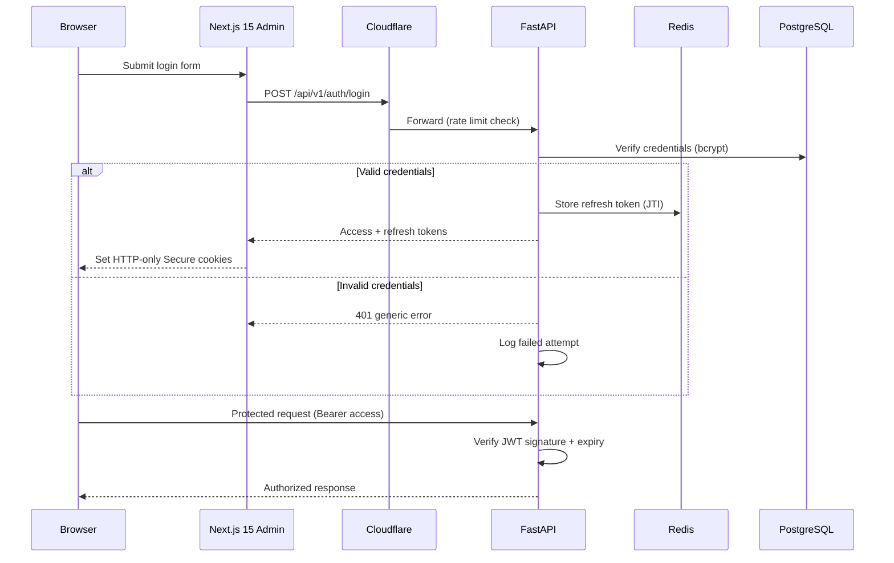
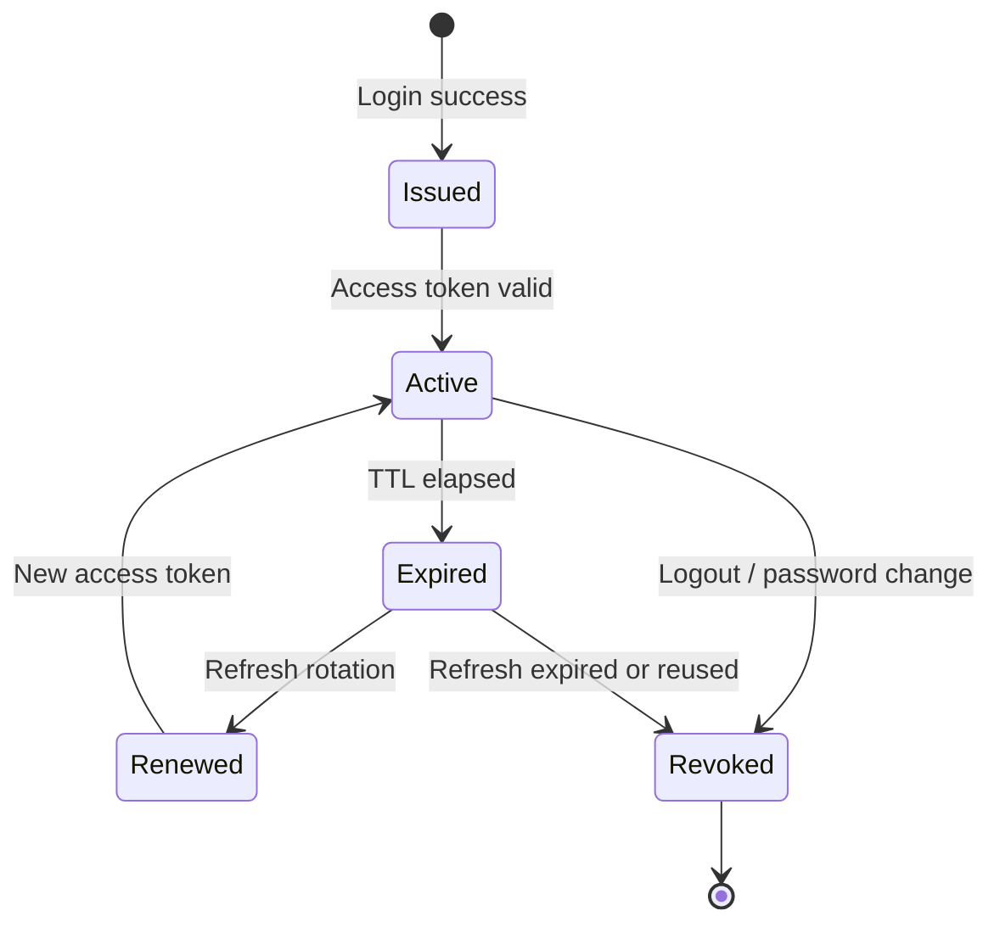

# Authentication Security

| Field | Value |
|-------|-------|
| **Document ID** | SEC-AUTH-001 |
| **Product** | Founder Portfolio Platform (FounderOS v1.0) |
| **Status** | Approved |
| **Last Updated** | 2026-06-29 |
| **Related** | [Authorization](./Authorization.md) · [Secrets](./Secrets.md) · [Rate Limits](./Rate_Limits.md) · [Authentication Module](../06_Modules/Authentication.md) |

---

## Purpose

Define the security architecture, controls, and operational requirements for identity verification and session management across FounderOS v1.0 — covering admin login, JWT lifecycle, token storage, and threat mitigations for white-label deployments.

## Scope

| In Scope | Out of Scope |
|----------|--------------|
| Admin email/password authentication | Public visitor registration |
| JWT access and refresh token security | OAuth social login (v1.1) |
| Token storage and transport policies | SAML/OIDC enterprise SSO (v2.0) |
| Brute-force and credential-stuffing defenses | Multi-factor authentication (v1.2) |
| Bootstrap admin provisioning | Customer-facing auth portals |

## Business Context

FounderOS is deployed as a white-label founder platform where each tenant's admin boundary protects monetizable CMS capabilities, lead data, and enterprise inquiry pipelines. Authentication failures directly impact tenant trust, regulatory posture, and platform reputation. Security controls must be consistent across Vercel-hosted frontends and Hostinger-hosted APIs.

## Goals

| # | Goal | Success Metric |
|---|------|----------------|
| G1 | Stateless, horizontally scalable admin auth | Zero server-side session affinity required |
| G2 | OWASP-aligned credential handling | Pass security review checklist |
| G3 | Uniform controls across white-label tenants | Same auth policy in all deployment guides |
| G4 | Observable auth events | 100% login attempts logged with correlation ID |
| G5 | Minimal attack surface on public routes | Only `/auth/*` endpoints unauthenticated |

## Functional Requirements

| ID | Requirement | Priority |
|----|-------------|----------|
| FR-SEC-AUTH-001 | System SHALL authenticate admins via email and password only in v1.0 | P0 |
| FR-SEC-AUTH-002 | System SHALL issue short-lived JWT access tokens (default 30 min TTL) | P0 |
| FR-SEC-AUTH-003 | System SHALL issue refresh tokens with rotation on each use | P0 |
| FR-SEC-AUTH-004 | System SHALL store refresh tokens in Redis with explicit revocation | P0 |
| FR-SEC-AUTH-005 | System SHALL hash passwords with bcrypt cost ≥ 12 | P0 |
| FR-SEC-AUTH-006 | System SHALL reject inactive accounts without user enumeration | P0 |
| FR-SEC-AUTH-007 | System SHALL invalidate all refresh tokens on password change | P1 |
| FR-SEC-AUTH-008 | System SHALL support bootstrap of first admin on tenant provisioning | P0 |
| FR-SEC-AUTH-009 | System SHALL rate-limit login attempts per [Rate Limits](./Rate_Limits.md) | P0 |
| FR-SEC-AUTH-010 | System SHALL bind JWT claims to user ID, roles, and permissions | P0 |

## Non-functional Requirements

| ID | Requirement | Target |
|----|-------------|--------|
| NFR-SEC-AUTH-001 | Login API p95 latency | &lt; 200 ms |
| NFR-SEC-AUTH-002 | Token verification overhead per request | &lt; 5 ms |
| NFR-SEC-AUTH-003 | Auth subsystem availability | 99.9% monthly |
| NFR-SEC-AUTH-004 | Maximum concurrent refresh operations | 500/s per tenant |
| NFR-SEC-AUTH-005 | Token signing algorithm | HS256 (v1.0); RS256 (v2.0) |

## User Stories

| ID | As a… | I want… | So that… |
|----|-------|---------|----------|
| US-SEC-AUTH-001 | Platform operator | secure bootstrap of first admin | tenants are operable on day one |
| US-SEC-AUTH-002 | Admin user | HTTP-only cookie refresh storage | tokens are not accessible to XSS |
| US-SEC-AUTH-003 | Security auditor | failed login attempts in audit logs | I detect brute-force patterns |
| US-SEC-AUTH-004 | DevOps engineer | rotatable JWT secrets via env vars | I can respond to key compromise |
| US-SEC-AUTH-005 | White-label licensee | identical auth hardening as reference deploy | my brand inherits platform security |

## UX Requirements

- Login page at `/admin/login` with inline validation; no field-level hints on credential failure.
- Generic error message ("Invalid credentials") on all authentication failures.
- Session expiry modal in admin shell with one-click re-authentication path.
- "Remember me" extends refresh token TTL within configured maximum (7 days).
- Loading and disabled states during authentication requests to prevent double-submit.

## Technical Considerations

### Authentication Flow

### Token Lifecycle

### Token Policy Matrix

| Token Type | Storage (Browser) | TTL (Default) | Rotation | Revocation |
|------------|-------------------|---------------|----------|------------|
| Access JWT | Memory / Authorization header | 30 minutes | On refresh | Implicit via expiry |
| Refresh token | HTTP-only Secure cookie | 7 days (remember me) / 24 hours | Every refresh use | Redis delete on logout |
| Bootstrap token | One-time env / CLI | Single use | N/A | Auto-invalidate |

### Stack Integration

| Layer | Technology | Security Role |
|-------|------------|---------------|
| Frontend | Next.js 15 middleware | Route protection, cookie handling |
| API | FastAPI + JWT library | Issue, verify, refresh |
| Cache | Redis 7 | Refresh token store, login rate limits |
| Database | PostgreSQL 16 | User credentials, active flag |
| Edge | Cloudflare WAF | IP reputation, bot mitigation |

### Threat Model Summary

| Threat | Mitigation | Reference |
|--------|------------|-----------|
| Brute-force login | Rate limiting + optional lockout | [Rate Limits](./Rate_Limits.md) |
| Credential stuffing | Generic errors, WAF, rate limits | [Rate Limits](./Rate_Limits.md) |
| XSS token theft | HTTP-only cookies for refresh | This document |
| Token replay | Refresh rotation + JTI revocation | [Secrets](./Secrets.md) |
| User enumeration | Uniform error responses | [Validation](./Validation.md) |
| MITM | TLS 1.2+ end-to-end | [Encryption](./Encryption.md) |

## Security Considerations

- Never log passwords, raw tokens, or refresh token values.
- JWT `SECRET_KEY` managed per [Secrets](./Secrets.md); rotate on compromise with overlap window.
- Access tokens must not be persisted in `localStorage` in production admin clients.
- Failed login events forwarded to [Audit](./Audit.md) with IP, user-agent, and correlation ID.
- Bootstrap credentials must be changed on first login in production deployments.
- See [Authorization](./Authorization.md) for permission enforcement after authentication.

## Acceptance Criteria

- [ ] Valid credentials return token pair; invalid return 401 with generic message.
- [ ] Refresh token rotation invalidates previous JTI on successful refresh.
- [ ] Logout revokes refresh token in Redis; subsequent refresh returns 401.
- [ ] Inactive users cannot authenticate regardless of credential validity.
- [ ] Login rate limiting triggers 429 per [Rate Limits](./Rate_Limits.md) thresholds.
- [ ] Password change revokes all outstanding refresh tokens for the user.
- [ ] Auth events appear in [Audit](./Audit.md) logs within 5 seconds.

## Future Enhancements

| Enhancement | Target Version | Reference |
|-------------|----------------|-----------|
| Password reset via email | v1.1 | [Authentication Module](../06_Modules/Authentication.md) |
| TOTP multi-factor authentication | v1.2 | [Enterprise Features](../14_Future/Enterprise_Features.md) |
| RS256 asymmetric signing | v2.0 | [Multi Tenant](../14_Future/Multi_Tenant.md) |
| OIDC/SAML enterprise SSO | v2.0 | [Enterprise Features](../14_Future/Enterprise_Features.md) |
| API key auth for integrations | v2.0 | [Plugin System](../14_Future/Plugin_System.md) |

## Open Questions

| ID | Question | Owner | Status |
|----|----------|-------|--------|
| OQ-SEC-AUTH-001 | RS256 vs HS256 for multi-service v2.0? | Security | Open |
| OQ-SEC-AUTH-002 | Per-tenant JWT secret in multi-tenant mode? | Platform Eng | Deferred |
| OQ-SEC-AUTH-003 | Account lockout duration after threshold failures? | Product | Open |

---

## Related Documents

- [Authorization](./Authorization.md)
- [Validation](./Validation.md)
- [Rate Limits](./Rate_Limits.md)
- [Secrets](./Secrets.md)
- [Encryption](./Encryption.md)
- [Audit](./Audit.md)
- [Authentication Module](../06_Modules/Authentication.md)
- [Authentication API](../08_API/Authentication_API.md)
- [Backend Architecture](../04_Architecture/Backend_Architecture.md)
- [Compliance](./Compliance.md)
