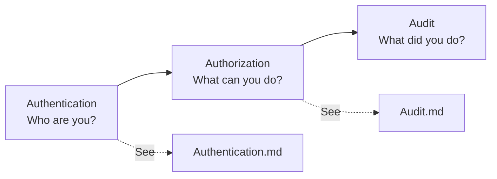

# Authorization Security

| Field | Value |
|-------|-------|
| **Document ID** | SEC-AUTHZ-001 |
| **Product** | Founder Portfolio Platform (FounderOS v1.0) |
| **Status** | Approved |
| **Last Updated** | 2026-06-29 |
| **Related** | [Authentication](./Authentication.md) · [Validation](./Validation.md) · [Audit](./Audit.md) |

---

## Purpose

Define role-based access control (RBAC), permission enforcement, and authorization policies for FounderOS v1.0 — ensuring admin users and API consumers can only perform actions aligned with their assigned roles across white-label deployments.

## Scope

| In Scope | Out of Scope |
|----------|--------------|
| RBAC model (roles, permissions) | Attribute-based access control (ABAC) |
| API route-level authorization | Row-level multi-tenant isolation (v2.0) |
| Admin UI route guards | External IAM integration (v2.0) |
| Permission inheritance and defaults | Fine-grained field-level ACLs |
| Service-to-service auth boundaries | Customer portal permissions |

## Business Context

FounderOS tenants often delegate content management to editors, marketers, and agency staff while restricting billing, user management, and site settings to founders or super admins. Authorization must be predictable, auditable, and consistent between the Next.js admin shell and FastAPI backend to prevent privilege escalation in commercial deployments.

## Goals

| # | Goal | Success Metric |
|---|------|----------------|
| G1 | Deny-by-default on all mutating API routes | Zero unprotected write endpoints |
| G2 | Flattened permissions in JWT for O(1) checks | Permission check &lt; 1 ms |
| G3 | Role templates for common tenant personas | 4 default roles shipped in v1.0 |
| G4 | Auditable authorization denials | 100% 403 events logged |
| G5 | White-label parity | Same RBAC model in all deployments |

## Functional Requirements

| ID | Requirement | Priority |
|----|-------------|----------|
| FR-SEC-AUTHZ-001 | System SHALL enforce RBAC on all `/api/v1/admin/*` routes | P0 |
| FR-SEC-AUTHZ-002 | System SHALL embed flattened permissions in JWT access token | P0 |
| FR-SEC-AUTHZ-003 | System SHALL support `super_admin`, `admin`, `editor`, `viewer` default roles | P0 |
| FR-SEC-AUTHZ-004 | System SHALL return 403 with stable error code on permission denial | P0 |
| FR-SEC-AUTHZ-005 | System SHALL protect Next.js admin routes via middleware permission checks | P0 |
| FR-SEC-AUTHZ-006 | System SHALL allow custom role creation with permission subsets (v1.1) | P2 |
| FR-SEC-AUTHZ-007 | System SHALL prevent privilege escalation via self-role modification | P0 |
| FR-SEC-AUTHZ-008 | System SHALL re-fetch permissions on token refresh | P0 |

## Non-functional Requirements

| ID | Requirement | Target |
|----|-------------|--------|
| NFR-SEC-AUTHZ-001 | Authorization check overhead | &lt; 1 ms per request |
| NFR-SEC-AUTHZ-002 | Permission catalog size | ≤ 100 keys in v1.0 |
| NFR-SEC-AUTHZ-003 | Role assignment propagation | Effective on next token refresh |
| NFR-SEC-AUTHZ-004 | Authorization denial log latency | &lt; 5 seconds |

## User Stories

| ID | As a… | I want… | So that… |
|----|-------|---------|----------|
| US-SEC-AUTHZ-001 | Founder | editors to publish blog posts but not change billing | I delegate safely |
| US-SEC-AUTHZ-002 | Editor | write access to content modules only | I cannot alter site settings |
| US-SEC-AUTHZ-003 | Viewer | read-only admin access | I can review without risk |
| US-SEC-AUTHZ-004 | Security auditor | logs of all 403 denials | I detect misuse attempts |
| US-SEC-AUTHZ-005 | Agency operator | role templates per client deployment | onboarding is repeatable |

## UX Requirements

- Admin navigation hides modules the user lacks permission to access (not merely disabled).
- Unauthorized deep-links show a dedicated "Access Denied" page with support contact.
- Role badges visible in admin header and user management screens.
- Permission changes require `super_admin` confirmation with audit trail.

## Technical Considerations

### Authorization Decision Flow

```mermaid
flowchart TD
    A[Incoming API Request] --> B{Valid JWT?}
    B -->|No| C[401 Unauthorized]
    B -->|Yes| D{Route requires permission?}
    D -->|No| E[Allow — public or authenticated read]
    D -->|Yes| F{Permission in JWT claims?}
    F -->|No| G[403 Forbidden + Audit Log]
    F -->|Yes| H[Execute Handler]
    H --> I[Optional: Resource ownership check]
    I --> J[200 Response]
```

### Default Role Matrix

| Permission Domain | super_admin | admin | editor | viewer |
|-------------------|:-----------:|:-----:|:------:|:------:|
| Site settings | ✓ | ✓ | — | — |
| User management | ✓ | — | — | — |
| Products CRUD | ✓ | ✓ | ✓ | read |
| Blog CRUD | ✓ | ✓ | ✓ | read |
| Portfolio CRUD | ✓ | ✓ | ✓ | read |
| Media upload | ✓ | ✓ | ✓ | — |
| Contact/inquiry read | ✓ | ✓ | — | read |
| Audit log read | ✓ | — | — | — |
| API keys (v2.0) | ✓ | — | — | — |

### Permission Namespace Convention

| Prefix | Domain | Example Keys |
|--------|--------|--------------|
| `content.` | CMS modules | `content.blog.write`, `content.products.publish` |
| `settings.` | Site configuration | `settings.branding.write`, `settings.seo.write` |
| `admin.` | User/role management | `admin.users.write`, `admin.roles.write` |
| `inquiry.` | Lead management | `inquiry.read`, `inquiry.export` |
| `audit.` | Compliance | `audit.read` |

### Layer Enforcement Map

| Layer | Enforcement Mechanism | Failure Mode |
|-------|----------------------|--------------|
| Cloudflare | WAF, IP allowlists (optional) | Block at edge |
| FastAPI | Route dependency + permission decorator | 403 JSON |
| Next.js middleware | JWT decode + route permission map | Redirect to /admin/denied |
| Admin components | Conditional render by permission hook | Hidden UI |

### Authorization vs Authentication

## Security Considerations

- Deny by default: new endpoints must declare required permissions before merge.
- JWT permission claims are a snapshot; critical operations may force live DB permission re-check.
- `super_admin` role assignable only by existing `super_admin` or bootstrap process.
- Horizontal privilege escalation tests required in [Integration Testing](../12_Testing/Integration_Testing.md).
- Authorization failures must not leak resource existence (consistent 403 for hidden resources).

## Acceptance Criteria

- [ ] All admin mutating routes return 403 without required permission.
- [ ] Next.js admin routes inaccessible via direct URL without permission.
- [ ] Role changes take effect on next token refresh (documented SLA).
- [ ] Self-elevation attempts (user modifying own role) return 403 and audit entry.
- [ ] Default role matrix implemented and documented.
- [ ] 403 events logged per [Audit](./Audit.md) specification.

## Future Enhancements

| Enhancement | Target Version | Reference |
|-------------|----------------|-----------|
| Custom roles UI | v1.1 | [Enterprise Features](../14_Future/Enterprise_Features.md) |
| Row-level tenant isolation | v2.0 | [Multi Tenant](../14_Future/Multi_Tenant.md) |
| ABAC for enterprise contracts | v2.1 | [Enterprise Features](../14_Future/Enterprise_Features.md) |
| Scoped API keys per integration | v2.0 | [Plugin System](../14_Future/Plugin_System.md) |

## Open Questions

| ID | Question | Owner | Status |
|----|----------|-------|--------|
| OQ-SEC-AUTHZ-001 | Live DB permission check on every request vs JWT snapshot? | Backend Lead | Open |
| OQ-SEC-AUTHZ-002 | Agency multi-user seats in v1.0 or v1.1? | Product | Open |
| OQ-SEC-AUTHZ-003 | Export permission separate from read for GDPR workflows? | Compliance | Open |

---

## Related Documents

- [Authentication](./Authentication.md)
- [Validation](./Validation.md)
- [Audit](./Audit.md)
- [Authentication Module](../06_Modules/Authentication.md)
- [Authentication API](../08_API/Authentication_API.md)
- [Backend Architecture](../04_Architecture/Backend_Architecture.md)
- [Compliance](./Compliance.md)
