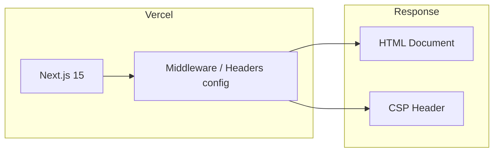
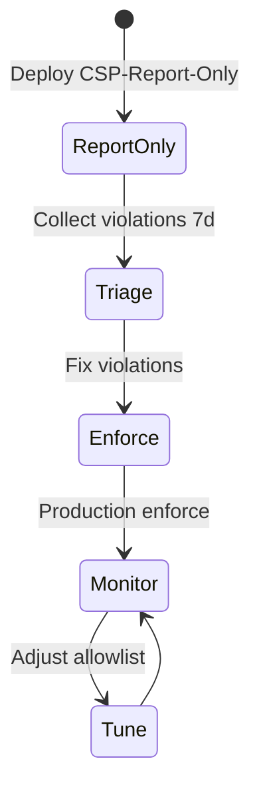

# Content Security Policy

| Field | Value |
|-------|-------|
| **Document ID** | SEC-CSP-001 |
| **Product** | Founder Portfolio Platform (FounderOS v1.0) |
| **Status** | Approved |
| **Last Updated** | 2026-06-29 |
| **Related** | [Headers](./Headers.md) · [Validation](./Validation.md) · [Frontend Architecture](../04_Architecture/Frontend_Architecture.md) |

---

## Purpose

Define the Content Security Policy (CSP) for FounderOS v1.0 — specifying allowed script, style, image, font, and connect sources for the Next.js 15 public site and admin shell to mitigate XSS, data exfiltration, and unauthorized resource loading.

## Scope

| In Scope | Out of Scope |
|----------|--------------|
| CSP directives for production and staging | Subresource Integrity (SRI) for all third-party scripts |
| Report-only vs enforce modes | Third-party admin plugin CSP (v2.0) |
| Nonce strategy for inline scripts (if any) | Mobile WebView CSP variants |
| Media and CDN allowlists | Email template HTML CSP |
| Admin vs public policy differences | Browser extension interactions |

## Business Context

FounderOS white-label sites embed founder branding, analytics (optional), YouTube embeds, and Cloudflare R2 media. A strict CSP prevents compromised CMS content or third-party scripts from stealing admin sessions or exfiltrating enterprise inquiry data — critical for enterprise buyer trust.

## Goals

| # | Goal | Success Metric |
|---|------|----------------|
| G1 | Enforce CSP in production | `Content-Security-Policy` header on all HTML |
| G2 | Zero `unsafe-inline` scripts in public pages | Lighthouse CSP audit pass |
| G3 | Document all third-party origins | Complete allowlist table |
| G4 | Staged rollout via Report-Only | 7-day report-only before enforce |
| G5 | Admin CSP stricter than public | Separate policy documented |

## Functional Requirements

| ID | Requirement | Priority |
|----|-------------|----------|
| FR-SEC-CSP-001 | System SHALL send CSP header on all HTML responses | P0 |
| FR-SEC-CSP-002 | Public CSP SHALL disallow `unsafe-eval` | P0 |
| FR-SEC-CSP-003 | `script-src` SHALL use nonces or strict hashes for required inline | P0 |
| FR-SEC-CSP-004 | `img-src` SHALL allow self, data:, and CDN origins | P0 |
| FR-SEC-CSP-005 | `connect-src` SHALL allow API origin and analytics (if enabled) | P0 |
| FR-SEC-CSP-006 | `frame-src` SHALL allow YouTube embed domain only | P1 |
| FR-SEC-CSP-007 | `object-src` SHALL be `'none'` | P0 |
| FR-SEC-CSP-008 | `base-uri` SHALL be `'self'` | P0 |
| FR-SEC-CSP-009 | CSP violations SHALL be reportable to logging endpoint (optional) | P2 |
| FR-SEC-CSP-010 | Admin routes MAY use stricter `connect-src` than public | P1 |

## Non-functional Requirements

| ID | Requirement | Target |
|----|-------------|--------|
| NFR-SEC-CSP-001 | CSP header size | &lt; 4 KB |
| NFR-SEC-CSP-002 | Policy parse impact | Negligible (browser-side) |
| NFR-SEC-CSP-003 | Report-Only monitoring period | 7 days minimum before enforce |

## User Stories

| ID | As a… | I want… | So that… |
|----|-------|---------|----------|
| US-SEC-CSP-001 | Security engineer | strict script allowlist | XSS impact is contained |
| US-SEC-CSP-002 | Frontend dev | documented CDN origins | I add assets without CSP breaks |
| US-SEC-CSP-003 | Founder | YouTube embeds to work | media content displays |
| US-SEC-CSP-004 | DevOps | Report-Only staging | I catch violations before enforce |
| US-SEC-CSP-005 | Compliance auditor | CSP aligned with OWASP | audit checklist passes |

## UX Requirements

- CSP violations must not break core navigation or contact forms in production.
- Broken third-party embeds show accessible fallback with "Content blocked" message.
- Admin panel must not load external scripts except documented allowlist.
- Visual regression tests cover pages with YouTube and R2 media after CSP enforce.

## Technical Considerations

### CSP Delivery Architecture

### Public Site Directive Matrix

| Directive | Allowed Sources | Rationale |
|-----------|-----------------|-----------|
| `default-src` | `'self'` | Baseline restrict |
| `script-src` | `'self'` + nonce | Next.js bundled scripts |
| `style-src` | `'self'` `'unsafe-inline'` | Tailwind runtime (review v1.1) |
| `img-src` | `'self'` data: `https://*.r2.dev` CDN | Media and placeholders |
| `font-src` | `'self'` | Self-hosted fonts |
| `connect-src` | `'self'` API origin | API fetches |
| `frame-src` | `https://www.youtube.com` | Video embeds |
| `media-src` | `'self'` CDN | Video/audio assets |
| `object-src` | `'none'` | Block plugins |
| `base-uri` | `'self'` | Prevent base hijack |
| `form-action` | `'self'` | Form submission targets |
| `frame-ancestors` | `'none'` | Clickjacking defense |
| `upgrade-insecure-requests` | — | Force HTTPS |

### Admin vs Public Policy

| Directive | Public Site | Admin Shell |
|-----------|-------------|-------------|
| `script-src` | Self + nonce | Self + nonce (stricter) |
| `connect-src` | API + CDN | API only |
| `frame-src` | YouTube | `'none'` |
| `img-src` | Self + CDN | Self + CDN |

### Rollout Phases

### Third-Party Origin Registry

| Service | Origin | Directives | Optional |
|---------|--------|------------|----------|
| Cloudflare R2 CDN | Tenant CDN domain | `img-src`, `media-src` | No |
| YouTube | `youtube.com`, `youtube-nocookie.com` | `frame-src` | No |
| Vercel Analytics | `vitals.vercel-insights.com` | `connect-src` | Yes |
| Google Fonts (if used) | `fonts.googleapis.com` | `style-src`, `font-src` | Prefer self-host |

## Security Considerations

- Pair CSP with [Headers](./Headers.md) (`X-Frame-Options`, `X-Content-Type-Options`).
- Rich text CMS output must not rely on inline scripts — see [Validation](./Validation.md).
- Review `'unsafe-inline'` in `style-src` for removal in v1.1 via compiled CSS.
- CSP is not a substitute for input sanitization; defense in depth required.
- Document tenant-specific CDN domains in white-label deployment checklist.

## Acceptance Criteria

- [ ] CSP header present on all production HTML responses.
- [ ] No console CSP violations on home, product, blog, contact pages.
- [ ] YouTube embeds render under enforced policy.
- [ ] Admin shell loads without CSP violations.
- [ ] `object-src 'none'` and `base-uri 'self'` enforced.
- [ ] Report-Only phase completed with zero critical violations.
- [ ] Policy documented in [Environment](../13_Deployment/Environment.md) config reference.

## Future Enhancements

| Enhancement | Target Version | Reference |
|-------------|----------------|-----------|
| Remove `unsafe-inline` from style-src | v1.1 | [Frontend Architecture](../04_Architecture/Frontend_Architecture.md) |
| Per-tenant CSP profiles | v2.0 | [White Label](../14_Future/White_Label.md) |
| CSP violation reporting dashboard | v1.2 | [Monitoring](../13_Deployment/Monitoring.md) |
| Plugin CSP sandbox | v2.0 | [Plugin System](../14_Future/Plugin_System.md) |

## Open Questions

| ID | Question | Owner | Status |
|----|----------|-------|--------|
| OQ-SEC-CSP-001 | Keep `'unsafe-inline'` style-src for Tailwind v1.0? | Frontend | Open |
| OQ-SEC-CSP-002 | CSP reporting endpoint on FastAPI or external? | DevOps | Open |
| OQ-SEC-CSP-003 | `strict-dynamic` adoption timeline? | Security | Open |

---

## Related Documents

- [Headers](./Headers.md)
- [Validation](./Validation.md)
- [Encryption](./Encryption.md)
- [Frontend Architecture](../04_Architecture/Frontend_Architecture.md)
- [Cloudflare](../13_Deployment/Cloudflare.md)
- [Environment](../13_Deployment/Environment.md)
- [Accessibility Testing](../12_Testing/Accessibility_Testing.md)
