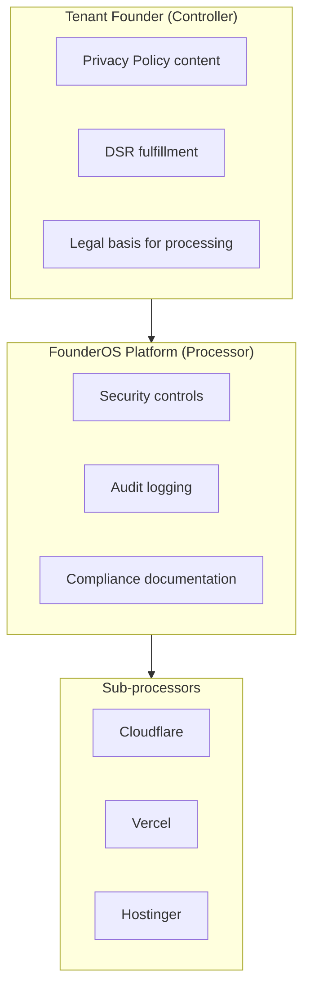
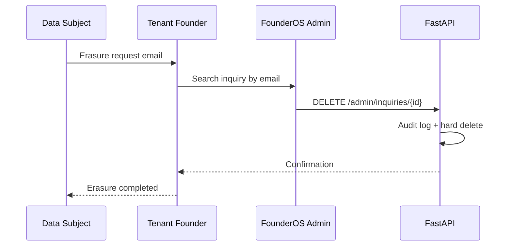

# Security Compliance

| Field | Value |
|-------|-------|
| **Document ID** | SEC-COMP-001 |
| **Product** | Founder Portfolio Platform (FounderOS v1.0) |
| **Status** | Approved |
| **Last Updated** | 2026-06-29 |
| **Related** | [Audit](./Audit.md) · [Encryption](./Encryption.md) · [Validation](./Validation.md) |

---

## Purpose

Document compliance posture, regulatory alignment, and data protection obligations for FounderOS v1.0 — providing white-label tenants and enterprise buyers with a clear map of controls against GDPR, privacy-by-design principles, and common security questionnaire frameworks.

## Scope

| In Scope | Out of Scope |
|----------|--------------|
| GDPR-aligned data handling for EU visitors | SOC 2 Type II certification (v2.0) |
| Privacy policy and cookie consent requirements | HIPAA compliance (not applicable) |
| Data subject rights workflow (access, erasure) | PCI-DSS (no card processing in v1.0) |
| Sub-processor registry | Legal contract templates |
| Data retention schedules | ISO 27001 certification |
| Compliance control mapping | Country-specific laws beyond GDPR baseline |

## Business Context

FounderOS targets founders selling to enterprise buyers globally. White-label licensees inherit compliance responsibilities for visitor data collected via contact forms, enterprise inquiries, and analytics. Platform documentation must clarify shared responsibility between FounderOS operator, tenant founder, and infrastructure providers (Cloudflare, Vercel, Hostinger).

## Goals

| # | Goal | Success Metric |
|---|------|----------------|
| G1 | GDPR baseline controls documented | Privacy questionnaire answerable |
| G2 | Clear shared responsibility model | Tenant onboarding checklist complete |
| G3 | Data minimization on forms | Only required PII fields collected |
| G4 | Documented retention and erasure | DSR workflow tested annually |
| G5 | Sub-processor transparency | Public sub-processor list maintained |

## Functional Requirements

| ID | Requirement | Priority |
|----|-------------|----------|
| FR-SEC-COMP-001 | Platform SHALL provide privacy policy and cookie policy page templates | P0 |
| FR-SEC-COMP-002 | Contact/inquiry forms SHALL link to privacy policy | P0 |
| FR-SEC-COMP-003 | System SHALL support inquiry data export for data subject requests | P1 |
| FR-SEC-COMP-004 | System SHALL support inquiry data deletion for erasure requests | P1 |
| FR-SEC-COMP-005 | Cookie consent banner SHALL block non-essential cookies until consent (EU) | P1 |
| FR-SEC-COMP-006 | System SHALL document all sub-processors | P0 |
| FR-SEC-COMP-007 | Audit logs SHALL support accountability principle per [Audit](./Audit.md) | P0 |
| FR-SEC-COMP-008 | PII fields SHALL be encrypted in transit per [Encryption](./Encryption.md) | P0 |
| FR-SEC-COMP-009 | Admin access to inquiry PII SHALL require `inquiry.read` permission | P0 |
| FR-SEC-COMP-010 | Data retention job SHALL purge expired inquiries per schedule | P1 |

## Non-functional Requirements

| ID | Requirement | Target |
|----|-------------|--------|
| NFR-SEC-COMP-001 | DSR response time | ≤ 30 days (GDPR statutory) |
| NFR-SEC-COMP-002 | Inquiry data retention default | 24 months |
| NFR-SEC-COMP-003 | Audit log retention | 90 days minimum |
| NFR-SEC-COMP-004 | Breach notification internal SLA | 24 hours to platform lead |

## User Stories

| ID | As a… | I want… | So that… |
|----|-------|---------|----------|
| US-SEC-COMP-001 | EU visitor | cookie consent before tracking | my privacy choices are respected |
| US-SEC-COMP-002 | Data subject | request deletion of my inquiry | GDPR erasure right is honored |
| US-SEC-COMP-003 | Founder (tenant) | compliance documentation pack | I answer enterprise security forms |
| US-SEC-COMP-004 | DPO | sub-processor list | I complete ROPA entries |
| US-SEC-COMP-005 | Enterprise buyer | evidence of encryption and audit | procurement security review passes |

## UX Requirements

- Cookie banner accessible (keyboard, screen reader) with accept/reject/customize.
- Privacy policy linked in footer on all public pages.
- Admin inquiry delete requires confirmation with reason code for audit.
- No pre-checked marketing consent checkboxes on forms.

## Technical Considerations

### Shared Responsibility Model

### GDPR Control Mapping

| GDPR Article | Requirement | FounderOS Control | Owner |
|--------------|-------------|-------------------|-------|
| Art. 5 | Data minimization | Minimal form fields | Tenant + Platform |
| Art. 6 | Lawful basis | Tenant configures purpose | Tenant |
| Art. 13 | Transparency | Privacy policy template | Tenant |
| Art. 15 | Right of access | Inquiry export (v1.1) | Tenant |
| Art. 17 | Right to erasure | Inquiry delete API | Tenant |
| Art. 25 | Privacy by design | [Validation](./Validation.md), [Encryption](./Encryption.md) | Platform |
| Art. 30 | Records of processing | Sub-processor doc | Platform |
| Art. 32 | Security of processing | Full [11_Security](./Authentication.md) suite | Platform |
| Art. 33 | Breach notification | Incident runbook | Shared |

### Sub-Processor Registry

| Provider | Service | Data Processed | Region |
|----------|---------|----------------|--------|
| Cloudflare | CDN, WAF, DNS, R2 | IP, request metadata, media | Global |
| Vercel | Frontend hosting | Build logs, request metadata | US/EU |
| Hostinger | VPS hosting | All API and DB data | EU (configurable) |
| GitHub API | Integration | Public repo metadata | US |
| YouTube API | Integration | Public video metadata | US |

### Data Retention Schedule

| Data Type | Default Retention | Purge Method |
|-----------|-------------------|--------------|
| Contact/inquiry submissions | 24 months | Scheduled job + manual DSR |
| Audit logs | 90 days hot; 1 year archive | Automated |
| Application logs | 30 days | Log rotation |
| Session refresh tokens | TTL-based | Redis expiry |
| Media assets | Until deleted by admin | Manual + cascade rules |
| Analytics (if enabled) | Per vendor policy | Tenant configures |

### Data Subject Request Workflow

## Security Considerations

- Tenants are data controllers; platform provides processor-grade controls.
- Breach response runbook linked from [Disaster Recovery](../13_Deployment/Disaster_Recovery.md).
- Cross-border transfers: document SCCs for US sub-processors where applicable.
- Do not use inquiry data for platform marketing without separate consent.
- Annual compliance review against OWASP ASVS Level 1 checklist.

## Acceptance Criteria

- [ ] Privacy and cookie policy pages render on all tenant deployments.
- [ ] Cookie consent blocks non-essential scripts until acceptance (EU geo).
- [ ] Sub-processor list published and versioned.
- [ ] Inquiry delete removes PII from primary DB and creates audit entry.
- [ ] Retention job documented in [Backup](../13_Deployment/Backup.md) / ops runbook.
- [ ] Shared responsibility matrix included in enterprise sales pack.
- [ ] Security questionnaire template maps to [11_Security](./Authentication.md) docs.

## Future Enhancements

| Enhancement | Target Version | Reference |
|-------------|----------------|-----------|
| SOC 2 Type II preparation | v2.0 | [Enterprise Features](../14_Future/Enterprise_Features.md) |
| Automated DSR portal | v1.2 | [Enterprise Features](../14_Future/Enterprise_Features.md) |
| EU data residency option | v2.0 | [Multi Tenant](../14_Future/Multi_Tenant.md) |
| Field-level PII encryption | v1.2 | [Encryption](./Encryption.md) |

## Open Questions

| ID | Question | Owner | Status |
|----|----------|-------|--------|
| OQ-SEC-COMP-001 | GeoIP-based cookie banner vs global show? | Product | Open |
| OQ-SEC-COMP-002 | DPA template for white-label tenants? | Legal | Open |
| OQ-SEC-COMP-003 | Default inquiry retention 12 vs 24 months? | Product | Open |

---

## Related Documents

- [Audit](./Audit.md)
- [Encryption](./Encryption.md)
- [Validation](./Validation.md)
- [Secrets](./Secrets.md)
- [Authentication](./Authentication.md)
- [Backup](../13_Deployment/Backup.md)
- [Disaster Recovery](../13_Deployment/Disaster_Recovery.md)
- [Enterprise Features](../14_Future/Enterprise_Features.md)
