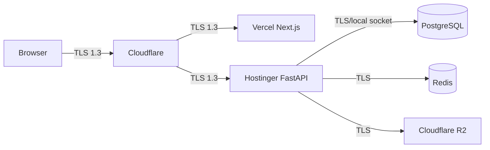
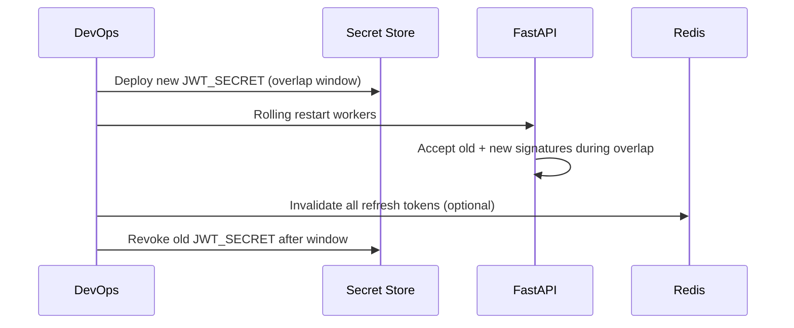

# Encryption

| Field | Value |
|-------|-------|
| **Document ID** | SEC-ENC-001 |
| **Product** | Founder Portfolio Platform (FounderOS v1.0) |
| **Status** | Approved |
| **Last Updated** | 2026-06-29 |
| **Related** | [Secrets](./Secrets.md) · [Headers](./Headers.md) · [Compliance](./Compliance.md) |

---

## Purpose

Define encryption requirements for data in transit and at rest across FounderOS v1.0 — covering TLS configuration, database encryption, password hashing, token signing, and backup encryption for white-label deployments on Cloudflare, Vercel, and Hostinger.

## Scope

| In Scope | Out of Scope |
|----------|--------------|
| TLS 1.2+ for all public traffic | HSM integration (v2.0 enterprise) |
| PostgreSQL at-rest encryption | Field-level encryption for PII (v1.2) |
| Password hashing (bcrypt) | End-to-end encrypted messaging |
| JWT signing keys | Client-side encryption of CMS content |
| Backup encryption | Quantum-resistant algorithms |
| Redis TLS in production | Full-disk encryption vendor SLAs |

## Business Context

FounderOS stores founder credentials, enterprise inquiry data, and commercial product metadata. Encryption controls are mandatory for enterprise procurement questionnaires, GDPR-aligned data handling, and white-label licensees who inherit the platform's security baseline without operating their own crypto infrastructure.

## Goals

| # | Goal | Success Metric |
|---|------|----------------|
| G1 | TLS 1.2+ on all external connections | 100% HTTPS traffic |
| G2 | Encrypted data at rest on VPS and managed DB | Provider encryption enabled |
| G3 | Industry-standard password hashing | bcrypt cost ≥ 12 |
| G4 | Encrypted backups with separate key | Backup restore drill passes |
| G5 | Documented key rotation procedures | Runbook in [Secrets](./Secrets.md) |

## Functional Requirements

| ID | Requirement | Priority |
|----|-------------|----------|
| FR-SEC-ENC-001 | All public endpoints SHALL be served over HTTPS | P0 |
| FR-SEC-ENC-002 | TLS minimum version SHALL be 1.2; prefer 1.3 | P0 |
| FR-SEC-ENC-003 | Passwords SHALL be hashed with bcrypt cost ≥ 12 | P0 |
| FR-SEC-ENC-004 | JWT SHALL be signed with HS256 and strong secret (v1.0) | P0 |
| FR-SEC-ENC-005 | PostgreSQL data directory SHALL use provider at-rest encryption | P0 |
| FR-SEC-ENC-006 | Redis production connections SHALL use TLS | P1 |
| FR-SEC-ENC-007 | Database backups SHALL be encrypted before off-site storage | P0 |
| FR-SEC-ENC-008 | Internal VPS ↔ PostgreSQL traffic SHALL not traverse public internet unencrypted | P0 |
| FR-SEC-ENC-009 | Cloudflare SSL mode SHALL be Full (Strict) | P0 |
| FR-SEC-ENC-010 | Media at rest on R2 SHALL use provider server-side encryption | P1 |

## Non-functional Requirements

| ID | Requirement | Target |
|----|-------------|--------|
| NFR-SEC-ENC-001 | TLS handshake overhead | &lt; 50 ms additional TTFB |
| NFR-SEC-ENC-002 | bcrypt verify time | 200–400 ms (intentional) |
| NFR-SEC-ENC-003 | Backup encryption algorithm | AES-256-GCM |
| NFR-SEC-ENC-004 | Certificate renewal lead time | 30 days before expiry |

## User Stories

| ID | As a… | I want… | So that… |
|----|-------|---------|----------|
| US-SEC-ENC-001 | Enterprise buyer | TLS everywhere | data in transit is protected |
| US-SEC-ENC-002 | Compliance officer | encrypted backups | breach of storage does not expose DB |
| US-SEC-ENC-003 | DevOps | Full Strict Cloudflare SSL | no SSL stripping attacks |
| US-SEC-ENC-004 | Security auditor | documented algorithms | I verify against policy |
| US-SEC-ENC-005 | Platform operator | key rotation runbook | I respond to compromise quickly |

## UX Requirements

- No mixed-content warnings on any production page.
- Certificate expiry alerts routed to ops before user-visible browser warnings.
- Admin users see padlock indicator; no self-signed cert in production.

## Technical Considerations

### Encryption in Transit Topology

### Algorithm Registry

| Use Case | Algorithm | Key Length | Rotation |
|----------|-----------|------------|----------|
| TLS certificates | ECDSA P-256 or RSA 2048+ | — | Auto (Let's Encrypt / Cloudflare) |
| Password storage | bcrypt | cost ≥ 12 | On password change |
| JWT signing (v1.0) | HS256 | ≥ 256 bits | Quarterly or on incident |
| Backup encryption | AES-256-GCM | 256 bits | Annual |
| R2 server-side | AES-256 (provider) | Provider-managed | Provider SLA |
| PostgreSQL at-rest | Provider LUKS / volume encryption | Provider-managed | Provider SLA |

### Data Classification and Encryption

| Data Class | In Transit | At Rest | Notes |
|------------|------------|---------|-------|
| Passwords | TLS + bcrypt hash | Hashed only | Never reversible |
| JWT / refresh tokens | TLS | Redis (encrypted volume) | Short TTL |
| Enterprise inquiries | TLS | PostgreSQL encrypted volume | PII — see [Compliance](./Compliance.md) |
| Public CMS content | TLS | PostgreSQL + CDN | Integrity via HTTPS |
| Audit logs | TLS | PostgreSQL / log store | Tamper-evident (v1.2) |
| Environment secrets | TLS to deploy | Secret manager / env | See [Secrets](./Secrets.md) |

### Key Rotation Flow

## Security Considerations

- Never commit keys to git; enforce via [Secrets](./Secrets.md) policy.
- Disable TLS 1.0/1.1 and weak ciphers on Hostinger reverse proxy.
- Backup encryption keys stored separately from backup files (split custody).
- JWT secrets must meet entropy requirements (cryptographically random, ≥ 32 bytes).
- Document Cloudflare SSL mode in [Cloudflare](../13_Deployment/Cloudflare.md) deployment guide.

## Acceptance Criteria

- [ ] SSL Labs grade A or A+ on production domain.
- [ ] No mixed content on Lighthouse audit.
- [ ] Passwords stored as bcrypt hashes only (verified in DB audit).
- [ ] Backups encrypted and restorable per [Backup](../13_Deployment/Backup.md).
- [ ] Cloudflare SSL mode set to Full (Strict).
- [ ] Redis TLS enabled in production compose profile.
- [ ] Key rotation runbook tested in staging annually.

## Future Enhancements

| Enhancement | Target Version | Reference |
|-------------|----------------|-----------|
| RS256 JWT with key pair | v2.0 | [Authentication](./Authentication.md) |
| Field-level PII encryption | v1.2 | [Compliance](./Compliance.md) |
| HSM / KMS integration | v2.0 | [Enterprise Features](../14_Future/Enterprise_Features.md) |
| mTLS internal services | v2.1 | [System Architecture](../04_Architecture/System_Architecture.md) |

## Open Questions

| ID | Question | Owner | Status |
|----|----------|-------|--------|
| OQ-SEC-ENC-001 | Managed PostgreSQL (Neon) vs VPS-local encryption? | DevOps | Open |
| OQ-SEC-ENC-002 | Encrypt inquiry PII at column level in v1.0? | Compliance | Deferred v1.2 |
| OQ-SEC-ENC-003 | Redis TLS performance impact on VPS? | Backend | Open |

---

## Related Documents

- [Secrets](./Secrets.md)
- [Headers](./Headers.md)
- [Authentication](./Authentication.md)
- [Compliance](./Compliance.md)
- [Cloudflare](../13_Deployment/Cloudflare.md)
- [Backup](../13_Deployment/Backup.md)
- [Hostinger](../13_Deployment/Hostinger.md)
- [Database Architecture](../04_Architecture/Database_Architecture.md)
