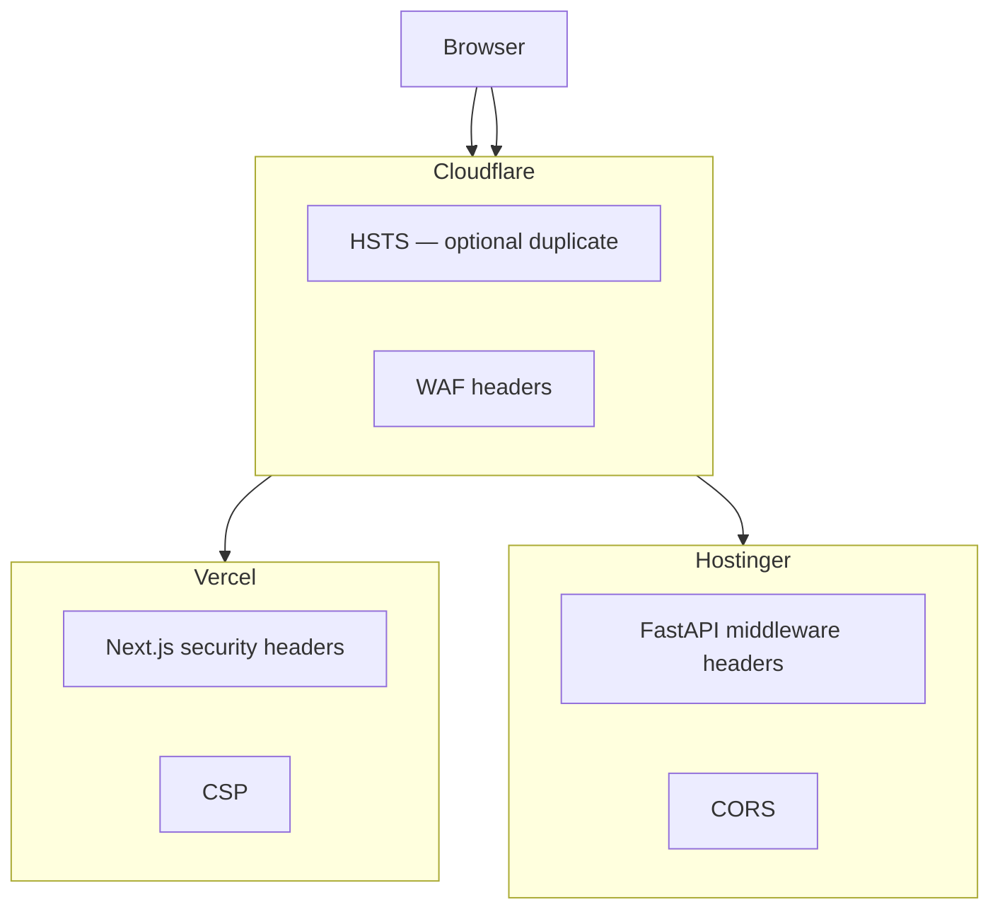

# Security Headers

| Field | Value |
|-------|-------|
| **Document ID** | SEC-HDR-001 |
| **Product** | Founder Portfolio Platform (FounderOS v1.0) |
| **Status** | Approved |
| **Last Updated** | 2026-06-29 |
| **Related** | [CSP](./CSP.md) · [Encryption](./Encryption.md) · [Cloudflare](../13_Deployment/Cloudflare.md) |

---

## Purpose

Specify the HTTP security headers required for FounderOS v1.0 across Vercel (Next.js), Cloudflare edge, and Hostinger (FastAPI) — providing defense-in-depth against clickjacking, MIME sniffing, referrer leakage, and transport downgrade attacks.

## Scope

| In Scope | Out of Scope |
|----------|--------------|
| Response headers for HTML and API | Email client security headers |
| HSTS and TLS-related headers | Certificate procurement process |
| Cross-origin policies (CORP, COOP, COEP) | WebSocket-specific headers (v1.1) |
| Referrer and permissions policies | Legacy browser IE11 support |
| Header configuration per deployment target | CDN cache header strategy (see [Caching](../04_Architecture/Caching_Strategy.md)) |

## Business Context

Enterprise buyers evaluating FounderOS white-label deployments assess security posture via automated scanners (Mozilla Observatory, securityheaders.com). Consistent, correctly scoped headers across frontend and API demonstrate commercial-grade engineering and reduce findings during customer security questionnaires.

## Goals

| # | Goal | Success Metric |
|---|------|----------------|
| G1 | Grade A on security header scanners | Observatory score ≥ A |
| G2 | Headers set at correct layer (edge vs origin) | Documented ownership matrix |
| G3 | No duplicate conflicting headers | Single source per header |
| G4 | API and HTML policies differentiated | Separate tables documented |
| G5 | White-label deployment checklist includes headers | 100% tenant onboarding coverage |

## Functional Requirements

| ID | Requirement | Priority |
|----|-------------|----------|
| FR-SEC-HDR-001 | HTML responses SHALL include `Strict-Transport-Security` | P0 |
| FR-SEC-HDR-002 | HTML responses SHALL include `X-Content-Type-Options: nosniff` | P0 |
| FR-SEC-HDR-003 | HTML responses SHALL include `X-Frame-Options` or CSP `frame-ancestors` | P0 |
| FR-SEC-HDR-004 | HTML responses SHALL include `Referrer-Policy` | P0 |
| FR-SEC-HDR-005 | HTML responses SHALL include `Permissions-Policy` | P1 |
| FR-SEC-HDR-006 | API responses SHALL include `X-Content-Type-Options: nosniff` | P0 |
| FR-SEC-HDR-007 | API SHALL NOT send `Access-Control-Allow-Origin: *` on credentialed routes | P0 |
| FR-SEC-HDR-008 | `Cross-Origin-Opener-Policy: same-origin` on admin routes | P1 |
| FR-SEC-HDR-009 | Remove `X-Powered-By` and server version leaks | P0 |
| FR-SEC-HDR-010 | `Content-Security-Policy` per [CSP](./CSP.md) | P0 |

## Non-functional Requirements

| ID | Requirement | Target |
|----|-------------|--------|
| NFR-SEC-HDR-001 | Total security header overhead | &lt; 2 KB per response |
| NFR-SEC-HDR-002 | HSTS max-age | 31536000 (1 year) |
| NFR-SEC-HDR-003 | Header misconfiguration detection | CI smoke test in pipeline |

## User Stories

| ID | As a… | I want… | So that… |
|----|-------|---------|----------|
| US-SEC-HDR-001 | Security auditor | consistent HSTS | transport downgrade is prevented |
| US-SEC-HDR-002 | Enterprise buyer | clean security scan | procurement security review passes |
| US-SEC-HDR-003 | DevOps | layer ownership matrix | I configure headers without duplication |
| US-SEC-HDR-004 | Frontend dev | Next.js header config documented | preview deploys match production |
| US-SEC-HDR-005 | API consumer | clear CORS headers | browser integration works |

## UX Requirements

- Security headers must not break legitimate embeds (YouTube) or API fetches from admin.
- Referrer policy preserves SEO referrer data for same-origin navigation.
- Permissions policy disables unused browser features (camera, mic, geolocation).

## Technical Considerations

### Header Responsibility Matrix

### HTML Response Headers (Production)

| Header | Value | Set By |
|--------|-------|--------|
| `Strict-Transport-Security` | `max-age=31536000; includeSubDomains; preload` | Vercel / Cloudflare |
| `X-Content-Type-Options` | `nosniff` | Vercel |
| `X-Frame-Options` | `DENY` (or CSP `frame-ancestors`) | Vercel |
| `Referrer-Policy` | `strict-origin-when-cross-origin` | Vercel |
| `Permissions-Policy` | `camera=(), microphone=(), geolocation=()` | Vercel |
| `Content-Security-Policy` | See [CSP](./CSP.md) | Vercel |
| `Cross-Origin-Opener-Policy` | `same-origin` (admin) | Vercel |

### API Response Headers

| Header | Value | Set By |
|--------|-------|--------|
| `X-Content-Type-Options` | `nosniff` | FastAPI middleware |
| `Cache-Control` | Route-specific | FastAPI |
| `Access-Control-Allow-Origin` | Whitelist per env | FastAPI CORS |
| `Access-Control-Allow-Credentials` | `true` (admin origins) | FastAPI CORS |
| `Vary` | `Origin` | FastAPI CORS |

### Headers to Remove or Avoid

| Header | Reason |
|--------|--------|
| `X-Powered-By` | Information disclosure |
| `Server` version details | Fingerprinting |
| `Access-Control-Allow-Origin: *` with credentials | CORS violation |
| Duplicate `Content-Security-Policy` | Unpredictable enforcement |

### CORS Allowlist Model

| Environment | Allowed Origins |
|-------------|-----------------|
| Production | `https://{tenant-domain}`, `https://admin.{tenant-domain}` |
| Staging | Staging Vercel preview URLs + staging API |
| Local | `http://localhost:13000`, `http://127.0.0.1:13000` |

## Security Considerations

- HSTS preload submission requires stable apex domain — document in [Hostinger](../13_Deployment/Hostinger.md) DNS guide.
- Do not set `Cross-Origin-Embedder-Policy: require-corp` without auditing all embeds.
- CORS origins must match [Environment](../13_Deployment/Environment.md) variables exactly.
- Cloudflare "Always Use HTTPS" complements HSTS at edge.
- Pair with [Encryption](./Encryption.md) for TLS version and cipher requirements.

## Acceptance Criteria

- [ ] Mozilla Observatory grade A on production tenant domain.
- [ ] All HTML responses include HSTS, nosniff, referrer-policy.
- [ ] API returns nosniff on JSON responses.
- [ ] No `X-Powered-By` on Vercel or FastAPI responses.
- [ ] CORS allows only whitelisted origins in production.
- [ ] Header ownership documented per layer (no conflicts).
- [ ] CI pipeline includes header smoke test against staging.

## Future Enhancements

| Enhancement | Target Version | Reference |
|-------------|----------------|-----------|
| `Cross-Origin-Resource-Policy` on static assets | v1.1 | [Media Architecture](../04_Architecture/Media_Architecture.md) |
| Automated header regression in E2E | v1.1 | [E2E Testing](../12_Testing/E2E_Testing.md) |
| Per-tenant CORS profiles | v2.0 | [Multi Tenant](../14_Future/Multi_Tenant.md) |
| `Expect-CT` monitoring (if applicable) | Deprecated | — |

## Open Questions

| ID | Question | Owner | Status |
|----|----------|-------|--------|
| OQ-SEC-HDR-001 | HSTS at Cloudflare vs Vercel only? | DevOps | Open |
| OQ-SEC-HDR-002 | COEP required for SharedArrayBuffer use cases? | Frontend | No current need |
| OQ-SEC-HDR-003 | Separate admin subdomain CORS entry? | Platform | Open |

---

## Related Documents

- [CSP](./CSP.md)
- [Encryption](./Encryption.md)
- [Authentication](./Authentication.md)
- [Cloudflare](../13_Deployment/Cloudflare.md)
- [Environment](../13_Deployment/Environment.md)
- [Frontend Architecture](../04_Architecture/Frontend_Architecture.md)
- [Backend Architecture](../04_Architecture/Backend_Architecture.md)
