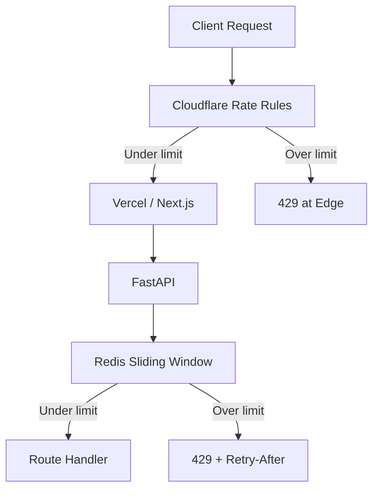
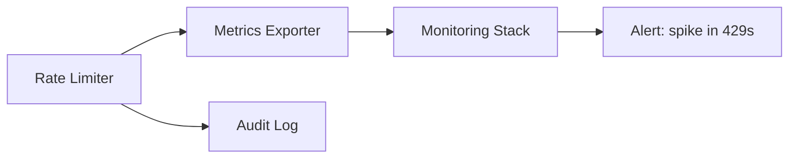

# Rate Limiting

| Field | Value |
|-------|-------|
| **Document ID** | SEC-RATE-001 |
| **Product** | Founder Portfolio Platform (FounderOS v1.0) |
| **Status** | Approved |
| **Last Updated** | 2026-06-29 |
| **Related** | [Authentication](./Authentication.md) · [Validation](./Validation.md) · [Cloudflare](../13_Deployment/Cloudflare.md) |

---

## Purpose

Define rate limiting strategy, thresholds, and enforcement layers for FounderOS v1.0 — protecting authentication endpoints, public forms, and admin APIs from abuse while maintaining acceptable UX for legitimate visitors and operators.

## Scope

| In Scope | Out of Scope |
|----------|--------------|
| Edge rate limits (Cloudflare) | DDoS mitigation runbooks (see [Disaster Recovery](../13_Deployment/Disaster_Recovery.md)) |
| Application rate limits (Redis) | Per-tenant billing metering (v2.0) |
| Login and refresh token throttling | Global CDN cache purge limits |
| Public form submission limits | Third-party API quota management |
| Rate limit response headers | Bot management ML tuning |

## Business Context

White-label FounderOS deployments are public-facing marketing sites vulnerable to credential stuffing, contact form spam, and API scraping. Rate limits protect Hostinger VPS resources, preserve PostgreSQL write capacity, and reduce spam in enterprise inquiry pipelines — directly impacting tenant lead quality and hosting costs.

## Goals

| # | Goal | Success Metric |
|---|------|----------------|
| G1 | Layered limits at edge and application | Two enforcement tiers active |
| G2 | Protect auth endpoints from brute force | &lt; 0.1% successful stuffing in pen test |
| G3 | Standard `429` + `Retry-After` responses | 100% compliance on limited routes |
| G4 | Observable limit hits | Metrics per route and IP |
| G5 | Configurable thresholds per environment | Staging limits 10× production |

## Functional Requirements

| ID | Requirement | Priority |
|----|-------------|----------|
| FR-SEC-RATE-001 | System SHALL rate-limit `POST /auth/login` at 5 req/min per IP | P0 |
| FR-SEC-RATE-002 | System SHALL rate-limit `POST /auth/refresh` at 30 req/min per user | P0 |
| FR-SEC-RATE-003 | System SHALL rate-limit public contact/inquiry at 3 req/min per IP | P0 |
| FR-SEC-RATE-004 | System SHALL rate-limit anonymous read API at 120 req/min per IP | P1 |
| FR-SEC-RATE-005 | System SHALL return 429 with `Retry-After` header | P0 |
| FR-SEC-RATE-006 | System SHALL log rate limit events to [Audit](./Audit.md) | P1 |
| FR-SEC-RATE-007 | Authenticated admin API SHALL have higher limits than anonymous | P0 |
| FR-SEC-RATE-008 | Cloudflare WAF rate rules SHALL mirror critical app limits | P0 |

## Non-functional Requirements

| ID | Requirement | Target |
|----|-------------|--------|
| NFR-SEC-RATE-001 | Rate limit check latency | &lt; 2 ms (Redis) |
| NFR-SEC-RATE-002 | Redis availability impact | Fail-open with alert (documented risk) |
| NFR-SEC-RATE-003 | False positive rate (legitimate users blocked) | &lt; 0.01% |
| NFR-SEC-RATE-004 | Limit state TTL accuracy | ± 1 second |

## User Stories

| ID | As a… | I want… | So that… |
|----|-------|---------|----------|
| US-SEC-RATE-001 | Admin | login throttling against brute force | my account stays secure |
| US-SEC-RATE-002 | Visitor | fair limits on contact form | real inquiries get through |
| US-SEC-RATE-003 | DevOps | edge + app limits aligned | attackers cannot bypass edge only |
| US-SEC-RATE-004 | Founder | spam reduced on inquiry forms | I review quality leads |
| US-SEC-RATE-005 | API integrator | clear 429 with retry guidance | I backoff correctly |

## UX Requirements

- Public forms show friendly message on 429: "Please wait before submitting again."
- Admin login shows generic message on lockout (no countdown to prevent timing attacks).
- `Retry-After` honored by admin client retry logic where applicable.
- No infinite retry loops in frontend fetch wrappers.

## Technical Considerations

### Layered Rate Limiting

### Rate Limit Matrix

| Endpoint Group | Identifier | Limit | Window | Layer |
|----------------|------------|-------|--------|-------|
| Auth login | IP | 5 | 1 min | App + Edge |
| Auth refresh | User ID | 30 | 1 min | App |
| Contact / inquiry | IP | 3 | 1 min | App + Edge |
| Public read API | IP | 120 | 1 min | App |
| Admin write API | User ID | 60 | 1 min | App |
| Media upload | User ID | 10 | 1 min | App |
| Health check | IP | 300 | 1 min | Edge only |

### Algorithm Selection

| Layer | Algorithm | Storage | Notes |
|-------|-----------|---------|-------|
| Cloudflare | Fixed window | Edge KV | Per rule; IP + path |
| FastAPI | Sliding window log | Redis | Precise; shared across workers |
| Failover | In-memory (single worker) | Process | Dev only; not production |

### Response Headers

| Header | When Present | Value |
|--------|--------------|-------|
| `Retry-After` | 429 response | Seconds until window reset |
| `X-RateLimit-Limit` | All limited routes | Max requests in window |
| `X-RateLimit-Remaining` | All limited routes | Requests left |
| `X-RateLimit-Reset` | All limited routes | Unix timestamp |

### Monitoring Integration

## Security Considerations

- Use composite keys (IP + User-Agent hash) for login limits where privacy allows.
- Document fail-open vs fail-closed policy when Redis unavailable (default: fail-open with PagerDuty alert).
- Coordinate with [Authentication](./Authentication.md) account lockout (distinct from rate limit).
- Prevent rate limit bypass via `X-Forwarded-For` spoofing — trust Cloudflare IPs only.
- See [Cloudflare](../13_Deployment/Cloudflare.md) for edge rule configuration.

## Acceptance Criteria

- [ ] Login endpoint returns 429 after 5 attempts/min from same IP.
- [ ] Contact form returns 429 after 3 submissions/min per IP.
- [ ] All 429 responses include `Retry-After` header.
- [ ] Rate limit counters reset correctly at window boundary.
- [ ] Cloudflare rules documented and match app thresholds for auth routes.
- [ ] Rate limit events visible in monitoring dashboard.
- [ ] Staging environment uses relaxed limits (documented multiplier).

## Future Enhancements

| Enhancement | Target Version | Reference |
|-------------|----------------|-----------|
| Per-tenant limit profiles | v2.0 | [Multi Tenant](../14_Future/Multi_Tenant.md) |
| Adaptive limits via bot score | v1.2 | [Cloudflare](../13_Deployment/Cloudflare.md) |
| API key tiered quotas | v2.0 | [Plugin System](../14_Future/Plugin_System.md) |
| GraphQL query cost limits | v2.1 | [API Architecture](../04_Architecture/API_Architecture.md) |

## Open Questions

| ID | Question | Owner | Status |
|----|----------|-------|--------|
| OQ-SEC-RATE-001 | Fail-open vs fail-closed when Redis down? | DevOps | Open |
| OQ-SEC-RATE-002 | Shared IP NAT handling for enterprise visitors? | Product | Open |
| OQ-SEC-RATE-003 | Separate limits per white-label domain? | Platform | Deferred v2.0 |

---

## Related Documents

- [Authentication](./Authentication.md)
- [Validation](./Validation.md)
- [Audit](./Audit.md)
- [Cloudflare](../13_Deployment/Cloudflare.md)
- [Caching Strategy](../04_Architecture/Caching_Strategy.md)
- [Monitoring](../13_Deployment/Monitoring.md)
- [Backend Architecture](../04_Architecture/Backend_Architecture.md)
