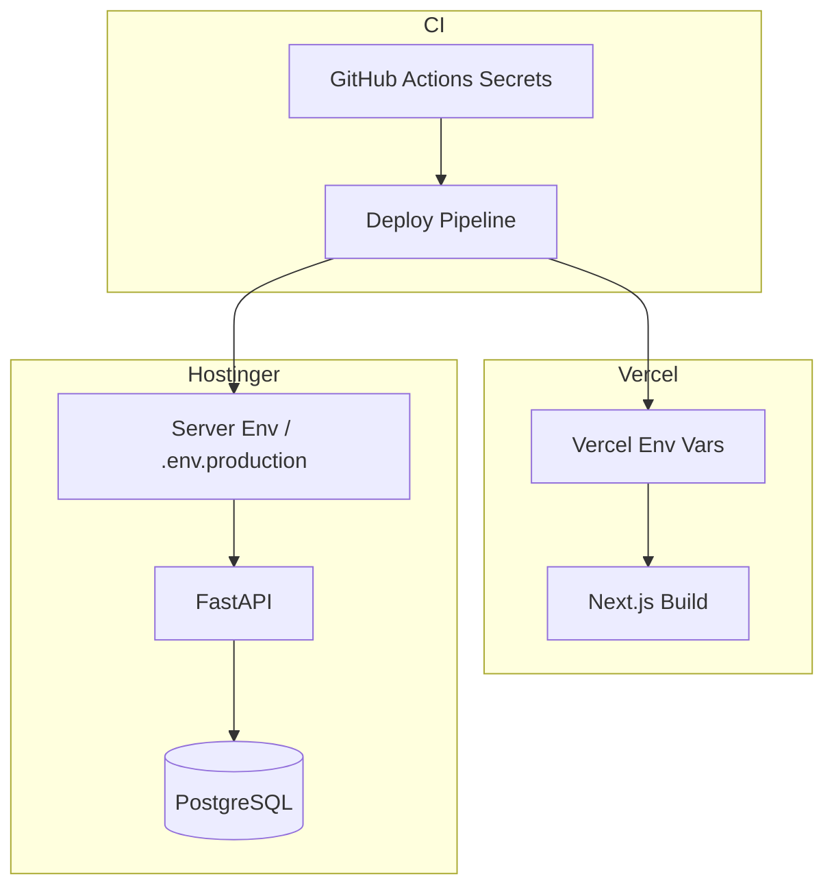

# Secrets Management

| Field | Value |
|-------|-------|
| **Document ID** | SEC-SEC-001 |
| **Product** | Founder Portfolio Platform (FounderOS v1.0) |
| **Status** | Approved |
| **Last Updated** | 2026-06-29 |
| **Related** | [Encryption](./Encryption.md) · [Authentication](./Authentication.md) · [Environment](../13_Deployment/Environment.md) |

---

## Purpose

Define how secrets, credentials, and cryptographic keys are generated, stored, injected, rotated, and revoked for FounderOS v1.0 — ensuring white-label tenants and platform operators never expose sensitive values in source control, logs, or client bundles.

## Scope

| In Scope | Out of Scope |
|----------|--------------|
| Environment variable secret taxonomy | Enterprise vault HSM (v2.0) |
| JWT, database, and Redis credentials | Customer-managed BYOK (v2.1) |
| Third-party API keys (GitHub, YouTube) | Secret scanning of tenant content |
| Vercel and Hostinger secret injection | Kubernetes sealed secrets (v2.0) |
| Rotation and incident response | Physical key ceremony |
| Local development secret handling | — |

## Business Context

A single leaked `JWT_SECRET` or database password compromises every admin session and all tenant data on a FounderOS VPS deployment. White-label licensees rely on platform documentation to deploy securely without security expertise. Secrets management is the highest-impact control after network segmentation.

## Goals

| # | Goal | Success Metric |
|---|------|----------------|
| G1 | Zero secrets in git history | Pre-commit and CI secret scan pass |
| G2 | Least-privilege DB credentials | App user ≠ superuser |
| G3 | Documented rotation runbooks | Quarterly drill completed |
| G4 | Separate secrets per environment | No prod keys in staging |
| G5 | No secrets in client bundles | Frontend build audit clean |

## Functional Requirements

| ID | Requirement | Priority |
|----|-------------|----------|
| FR-SEC-SEC-001 | All secrets SHALL be supplied via environment variables or platform secret stores | P0 |
| FR-SEC-SEC-002 | `.env` files SHALL be gitignored; `.env.example` contains keys only | P0 |
| FR-SEC-SEC-003 | `JWT_SECRET` SHALL be ≥ 32 bytes cryptographically random | P0 |
| FR-SEC-SEC-004 | Database credentials SHALL use dedicated app role with minimal grants | P0 |
| FR-SEC-SEC-005 | Production secrets SHALL differ from staging and local | P0 |
| FR-SEC-SEC-006 | CI/CD SHALL inject secrets from protected store, not repo | P0 |
| FR-SEC-SEC-007 | Logs SHALL redact known secret patterns | P0 |
| FR-SEC-SEC-008 | Bootstrap admin password SHALL be one-time and forced change | P1 |
| FR-SEC-SEC-009 | Third-party API keys SHALL be scoped to minimum permissions | P1 |
| FR-SEC-SEC-010 | Secret access SHALL be auditable per [Audit](./Audit.md) | P2 |

## Non-functional Requirements

| ID | Requirement | Target |
|----|-------------|--------|
| NFR-SEC-SEC-001 | Secret rotation RTO | &lt; 1 hour (JWT overlap) |
| NFR-SEC-SEC-002 | Secret scan in CI | Every pull request |
| NFR-SEC-SEC-003 | Access to production secrets | ≤ 3 platform operators |

## User Stories

| ID | As a… | I want… | So that… |
|----|-------|---------|----------|
| US-SEC-SEC-001 | DevOps | Vercel env vars for frontend secrets | deploys are secure |
| US-SEC-SEC-002 | Backend dev | `.env.example` without values | onboarding is clear |
| US-SEC-SEC-003 | Security officer | rotation runbook | I respond to leaks fast |
| US-SEC-SEC-004 | White-label licensee | deployment checklist for secrets | I don't misconfigure |
| US-SEC-SEC-005 | CI pipeline | no secrets in build logs | artifacts stay clean |

## UX Requirements

- Admin UI never displays raw API keys after initial creation (masked with reveal-once pattern in v1.1).
- Error pages and API responses never include environment variable names or values.
- Bootstrap CLI output warns operator to store credentials securely and delete terminal history.

## Technical Considerations

### Secret Taxonomy

| Secret | Consumer | Storage (Prod) | Rotation Cadence |
|--------|----------|----------------|------------------|
| `JWT_SECRET` | FastAPI | Hostinger env / vault | Quarterly |
| `DATABASE_URL` | FastAPI | Hostinger env | On credential change |
| `REDIS_URL` | FastAPI | Hostinger env | On credential change |
| `GITHUB_TOKEN` | FastAPI integrations | Hostinger env | Annual |
| `YOUTUBE_API_KEY` | FastAPI integrations | Hostinger env | Annual |
| `R2_ACCESS_KEY` | FastAPI / Next.js | Vercel + Hostinger | Annual |
| `NEXT_PUBLIC_*` | Next.js browser | Vercel only | Only truly public values |
| `BOOTSTRAP_ADMIN_PASSWORD` | One-time CLI | Ephemeral | Single use |

### Injection Architecture

### Public vs Server-Only Variables

| Prefix | Exposure | Allowed Examples |
|--------|----------|------------------|
| `NEXT_PUBLIC_` | Browser bundle | Site URL, analytics ID |
| No prefix (Next.js server) | Server components only | Internal API URL |
| FastAPI env | API process only | All credentials |

### Rotation Runbook Summary

| Secret Type | Steps | Downtime |
|-------------|-------|----------|
| JWT_SECRET | Deploy new key with overlap → rolling restart → revoke old | Zero (overlap window) |
| DATABASE_URL | Create new role → update env → restart → revoke old role | &lt; 2 min |
| R2 keys | Create new key → dual-write period → revoke old | Zero |
| Compromise (all) | Invalidate refresh tokens → rotate all → force re-login | User re-auth |

### Anti-Patterns (Prohibited)

| Anti-Pattern | Risk | Alternative |
|--------------|------|-------------|
| Secrets in git | Permanent exposure | Env vars + secret scan |
| `NEXT_PUBLIC_JWT_SECRET` | Client-readable | Server-only signing |
| Shared prod/staging DB password | Blast radius | Per-environment credentials |
| Logging `DATABASE_URL` | Credential leak | Redaction middleware |
| Hardcoded fallback secrets | Predictable keys | Fail fast if unset |

## Security Considerations

- Run `gitleaks` or equivalent on every PR via [CI/CD](../13_Deployment/CI_CD.md).
- Production `.env` files on VPS: permissions `600`, owner deploy user only.
- See [Encryption](./Encryption.md) for algorithm requirements on derived keys.
- Incident response: rotate all secrets if any VPS filesystem compromise suspected.
- White-label tenants receive secret checklist in [Hostinger](../13_Deployment/Hostinger.md) guide.

## Acceptance Criteria

- [ ] No secrets detected in repository scan.
- [ ] `.env.example` documents all keys without values.
- [ ] `NEXT_PUBLIC_*` audit confirms no sensitive keys exposed.
- [ ] Production and staging use distinct `JWT_SECRET` and DB credentials.
- [ ] JWT rotation drill completed in staging with zero downtime.
- [ ] Log redaction verified for connection strings and tokens.
- [ ] Bootstrap password forced change on first admin login.

## Future Enhancements

| Enhancement | Target Version | Reference |
|-------------|----------------|-----------|
| HashiCorp Vault / Doppler integration | v1.2 | [Enterprise Features](../14_Future/Enterprise_Features.md) |
| Per-tenant secret isolation | v2.0 | [Multi Tenant](../14_Future/Multi_Tenant.md) |
| API key management UI | v2.0 | [Plugin System](../14_Future/Plugin_System.md) |
| Automated rotation via CI | v1.2 | [CI/CD](../13_Deployment/CI_CD.md) |

## Open Questions

| ID | Question | Owner | Status |
|----|----------|-------|--------|
| OQ-SEC-SEC-001 | Doppler vs native Vercel/Hostinger only for v1.0? | DevOps | Open |
| OQ-SEC-SEC-002 | Separate Redis password per tenant v2.0? | Platform | Deferred |
| OQ-SEC-SEC-003 | Secret versioning in audit log? | Security | Open |

---

## Related Documents

- [Encryption](./Encryption.md)
- [Authentication](./Authentication.md)
- [Audit](./Audit.md)
- [Environment](../13_Deployment/Environment.md)
- [CI/CD](../13_Deployment/CI_CD.md)
- [Hostinger](../13_Deployment/Hostinger.md)
- [Docker](../13_Deployment/Docker.md)
- [Compliance](./Compliance.md)
