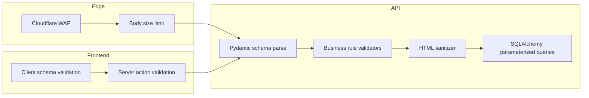
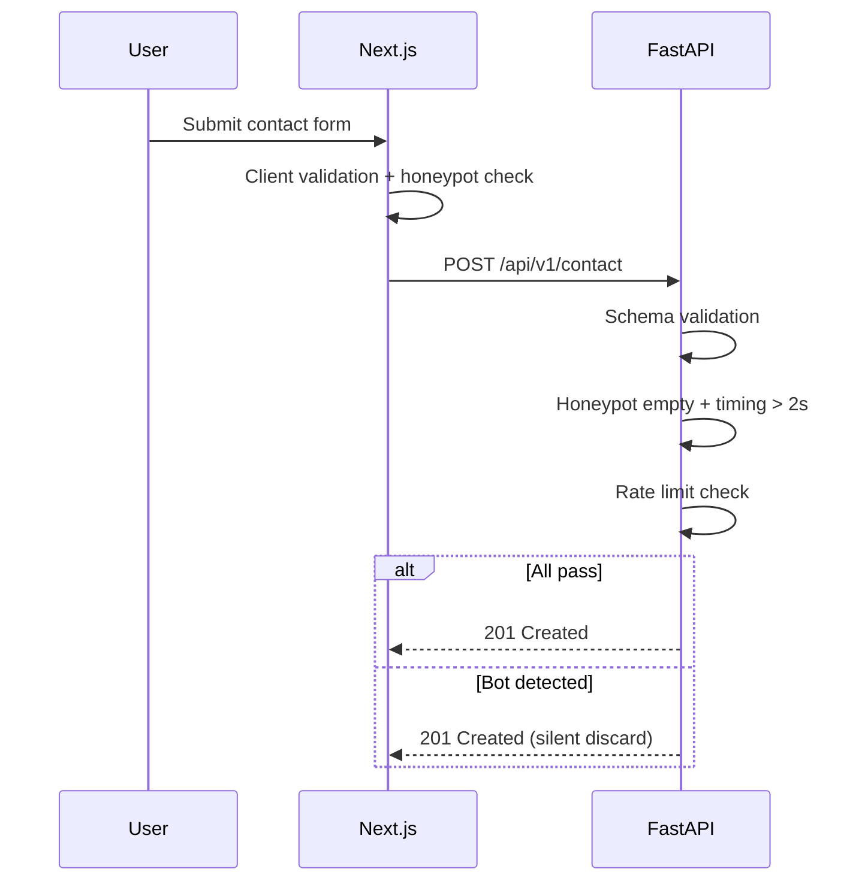

# Input Validation Security

| Field | Value |
|-------|-------|
| **Document ID** | SEC-VAL-001 |
| **Product** | Founder Portfolio Platform (FounderOS v1.0) |
| **Status** | Approved |
| **Last Updated** | 2026-06-29 |
| **Related** | [Authentication](./Authentication.md) · [Authorization](./Authorization.md) · [Rate Limits](./Rate_Limits.md) |

---

## Purpose

Establish input validation, sanitization, and output-encoding policies for FounderOS v1.0 — protecting the FastAPI backend, Next.js frontend, and PostgreSQL data layer from injection, overflow, and data-integrity attacks across all public and admin surfaces.

## Scope

| In Scope | Out of Scope |
|----------|--------------|
| API request body, query, and path validation | Third-party webhook payload schemas (v1.1) |
| Form validation (contact, inquiry, admin CMS) | Client-side-only validation without server mirror |
| File upload metadata validation | Antivirus scanning (v1.2) |
| Error response shape for validation failures | WAF rule configuration (see [Cloudflare](../13_Deployment/Cloudflare.md)) |
| Unicode and length constraints | Full content moderation AI (v2.0) |

## Business Context

FounderOS collects enterprise inquiries, contact leads, and rich CMS content from public visitors and admin users. Invalid or malicious input can corrupt SEO metadata, leak stack traces, or enable stored XSS in white-label deployments. Validation must be strict at the API boundary and mirrored in the admin UI for usability.

## Goals

| # | Goal | Success Metric |
|---|------|----------------|
| G1 | Validate 100% of API inputs via schema | Zero unvalidated write endpoints |
| G2 | Consistent error format for clients | Single validation error envelope |
| G3 | Prevent injection classes (SQLi, XSS, path traversal) | Pass OWASP ASVS L1 |
| G4 | Reject oversize payloads before processing | Enforce body size limits at edge and API |
| G5 | Align frontend and backend validation rules | Shared constraint documentation |

## Functional Requirements

| ID | Requirement | Priority |
|----|-------------|----------|
| FR-SEC-VAL-001 | System SHALL validate all API inputs with Pydantic v2 schemas | P0 |
| FR-SEC-VAL-002 | System SHALL return 422 with field-level errors on validation failure | P0 |
| FR-SEC-VAL-003 | System SHALL enforce max string lengths per field type | P0 |
| FR-SEC-VAL-004 | System SHALL sanitize HTML in rich text fields (allowlist tags) | P0 |
| FR-SEC-VAL-005 | System SHALL validate email, URL, and slug formats | P0 |
| FR-SEC-VAL-006 | System SHALL reject unexpected fields on strict schemas | P1 |
| FR-SEC-VAL-007 | System SHALL validate file MIME type and size on media upload | P0 |
| FR-SEC-VAL-008 | System SHALL normalize Unicode (NFC) for searchable text | P1 |
| FR-SEC-VAL-009 | Public forms SHALL apply honeypot and timing checks | P1 |
| FR-SEC-VAL-010 | System SHALL not echo raw user input in error messages | P0 |

## Non-functional Requirements

| ID | Requirement | Target |
|----|-------------|--------|
| NFR-SEC-VAL-001 | Validation overhead per request | &lt; 10 ms p95 |
| NFR-SEC-VAL-002 | Max JSON body size (API) | 1 MB default; 10 MB media metadata |
| NFR-SEC-VAL-003 | Max upload file size | 25 MB images; 100 MB video metadata |
| NFR-SEC-VAL-004 | Validation error response time | Same as successful path ± 5 ms |

## User Stories

| ID | As a… | I want… | So that… |
|----|-------|---------|----------|
| US-SEC-VAL-001 | Admin | clear field errors on CMS forms | I fix mistakes quickly |
| US-SEC-VAL-002 | Visitor | contact form to reject invalid email | my message reaches the founder |
| US-SEC-VAL-003 | Security engineer | strict API schemas | injection attacks are blocked |
| US-SEC-VAL-004 | API consumer | predictable 422 error shape | I integrate reliably |
| US-SEC-VAL-005 | Compliance officer | PII fields length-limited | data minimization is enforced |

## UX Requirements

- Inline field errors on admin forms matching API 422 field keys.
- Public forms show accessible error summaries linked to fields (`aria-describedby`).
- Slug fields auto-generate from title with manual override and format hint.
- Rich text editor restricts paste of disallowed HTML with user-visible notice.
- No stack traces or internal field names exposed to public visitors.

## Technical Considerations

### Validation Pipeline

### Field Constraint Reference

| Field Type | Max Length | Format Rules | Sanitization |
|------------|------------|--------------|--------------|
| Email | 254 | RFC 5322 subset | Lowercase, trim |
| URL | 2048 | HTTPS preferred | Strip javascript: |
| Slug | 128 | `^[a-z0-9-]+$` | Lowercase |
| Title | 256 | Unicode allowed | HTML escape on output |
| Rich text body | 100,000 | Allowlist HTML tags | DOMPurify-equivalent server |
| Meta description | 320 | Plain text | Strip HTML |
| Phone | 32 | E.164 optional | Digits and + only |
| JSON settings | 64 KB | Valid JSON object | Schema per settings key |

### Validation Error Envelope

| Field | Type | Description |
|-------|------|-------------|
| `error` | string | Stable machine code (e.g., `VALIDATION_ERROR`) |
| `message` | string | Human-readable summary |
| `details` | array | List of `{ field, message, type }` objects |
| `request_id` | string | Correlation ID for support |

### Attack Vector Mitigation

| Vector | Layer | Control |
|--------|-------|---------|
| SQL injection | ORM | Parameterized queries only |
| XSS (stored) | API + render | HTML allowlist + CSP |
| XSS (reflected) | API | No raw echo; encode output |
| Path traversal | Media | UUID filenames; no user paths |
| Mass assignment | API | Explicit schema fields; `extra=forbid` |
| SSRF (URL fields) | API | Block private IP ranges in URL validator |
| ReDoS | API | Bounded regex; length limits first |

### Public Form Bot Mitigation

## Security Considerations

- Server-side validation is authoritative; client validation is UX only.
- Log validation failures at `WARN` without storing full malicious payloads.
- File uploads: validate magic bytes, not extension alone.
- See [CSP](./CSP.md) and [Headers](./Headers.md) for output-encoding defense in depth.
- Coordinate with [Rate Limits](./Rate_Limits.md) on enumeration via validation errors.

## Acceptance Criteria

- [ ] All write API endpoints have documented Pydantic schemas.
- [ ] 422 responses include field-level `details` array.
- [ ] SQL injection test suite passes on all query endpoints.
- [ ] Stored XSS test cases blocked in rich text fields.
- [ ] Oversize payloads rejected at 413 before handler execution.
- [ ] Public contact form honeypot silently discards bot submissions.
- [ ] Admin and API validation rules documented in single constraint table.

## Future Enhancements

| Enhancement | Target Version | Reference |
|-------------|----------------|-----------|
| JSON Schema export for API consumers | v1.1 | [Versioning](../14_Future/Versioning.md) |
| ClamAV upload scanning | v1.2 | [Media Architecture](../04_Architecture/Media_Architecture.md) |
| AI content moderation | v2.0 | [AI Assistant](../14_Future/AI_Assistant.md) |
| Shared Zod ↔ Pydantic codegen | v1.2 | [Frontend Architecture](../04_Architecture/Frontend_Architecture.md) |

## Open Questions

| ID | Question | Owner | Status |
|----|----------|-------|--------|
| OQ-SEC-VAL-001 | Silent 201 vs 400 for honeypot bot detection? | Security | Open |
| OQ-SEC-VAL-002 | Markdown vs HTML as canonical rich text format? | Product | Open |
| OQ-SEC-VAL-003 | SSRF allowlist for oEmbed URL fetches? | Backend | Open |

---

## Related Documents

- [Authentication](./Authentication.md)
- [Authorization](./Authorization.md)
- [Rate Limits](./Rate_Limits.md)
- [CSP](./CSP.md)
- [Headers](./Headers.md)
- [API Architecture](../04_Architecture/API_Architecture.md)
- [Backend Architecture](../04_Architecture/Backend_Architecture.md)
- [Integration Testing](../12_Testing/Integration_Testing.md)
