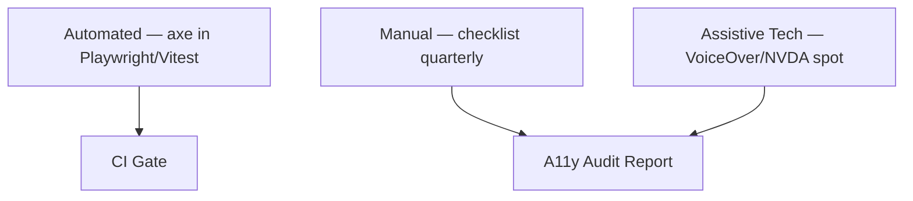
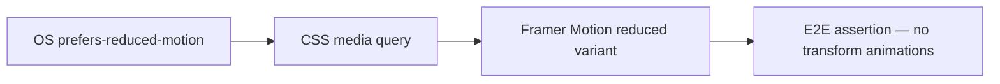

# Accessibility Testing

| Field | Value |
|-------|-------|
| **Document ID** | TEST-A11Y-001 |
| **Product** | Founder Portfolio Platform (FounderOS v1.0) |
| **Status** | Approved |
| **Last Updated** | 2026-06-29 |
| **Related** | [Testing Strategy](./Testing_Strategy.md) · [E2E Testing](./E2E_Testing.md) · [Accessibility UX](../02_UX/Accessibility.md) |

---

## Purpose

Define accessibility testing requirements for FounderOS v1.0 — ensuring public marketing pages and admin interfaces meet WCAG 2.1 Level AA through automated scans, manual checks, and assistive technology validation.

## Scope

| In Scope | Out of Scope |
|----------|--------------|
| WCAG 2.1 AA automated and manual testing | WCAG AAA full compliance |
| Public pages and admin shell | Third-party embedded players (YouTube) internals |
| Keyboard navigation and focus management | Native OS screen reader certification |
| Color contrast and motion preferences | PDF accessibility |
| CI accessibility gates | Legal ADA compliance certification |

## Business Context

Enterprise buyers and public-sector adjacent founders evaluate digital accessibility as a procurement criterion. White-label deployments inherit FounderOS accessibility baseline — automated regression prevents contrast, labeling, and keyboard trap defects from shipping to tenant domains and damaging brand credibility.

## Goals

| # | Goal | Success Metric |
|---|------|----------------|
| G1 | WCAG 2.1 AA on P0 pages | Zero critical axe violations |
| G2 | Automated a11y in CI | Every PR to main |
| G3 | Keyboard-only admin workflows | Core CMS paths completable |
| G4 | `prefers-reduced-motion` honored | Animation audit pass |
| G5 | Documented manual test checklist | Quarterly manual audit |

## Functional Requirements

| ID | Requirement | Priority |
|----|-------------|----------|
| FR-A11Y-001 | P0 public pages SHALL pass axe-core with zero critical violations | P0 |
| FR-A11Y-002 | Admin login and product edit SHALL pass axe-core | P0 |
| FR-A11Y-003 | All interactive elements SHALL be keyboard reachable | P0 |
| FR-A11Y-004 | Focus order SHALL follow visual order | P0 |
| FR-A11Y-005 | Images SHALL have alt text via CMS enforcement | P0 |
| FR-A11Y-006 | Form fields SHALL have associated labels | P0 |
| FR-A11Y-007 | Color contrast SHALL meet 4.5:1 (normal text) | P0 |
| FR-A11Y-008 | Skip navigation link SHALL be present on public pages | P0 |
| FR-A11Y-009 | Modals SHALL trap focus and restore on close | P1 |
| FR-A11Y-010 | Live regions SHALL announce async errors | P1 |

## Non-functional Requirements

| ID | Requirement | Target |
|----|-------------|--------|
| NFR-A11Y-001 | axe scan runtime per page | &lt; 30 seconds |
| NFR-A11Y-002 | Manual audit frequency | Quarterly |
| NFR-A11Y-003 | Critical violation fix SLA | Before next release |
| NFR-A11Y-004 | Screen readers tested | VoiceOver + NVDA annually |

## User Stories

| ID | As a… | I want… | So that… |
|----|-------|---------|----------|
| US-A11Y-001 | Keyboard user | full site navigation without mouse | I can browse independently |
| US-A11Y-002 | Screen reader user | semantic headings and landmarks | I understand page structure |
| US-A11Y-003 | Low vision user | sufficient contrast | content is readable |
| US-A11Y-004 | Motion-sensitive user | reduced animations | I avoid vestibular discomfort |
| US-A11Y-005 | QA engineer | automated a11y in CI | regressions are caught early |

## UX Requirements

- Visible focus indicators on all interactive elements (not `outline: none` without replacement).
- Error messages linked to fields via `aria-describedby`.
- Admin data tables support keyboard row actions.
- Cookie consent banner fully keyboard operable per [Compliance](../11_Security/Compliance.md).
- See [Accessibility UX](../02_UX/Accessibility.md) for design system rules.

## Technical Considerations

### Testing Layers

### P0 Page Scan List

| Page | Public / Admin | Scan Tool |
|------|----------------|-----------|
| Home | Public | axe + Lighthouse |
| Products list | Public | axe |
| Product detail | Public | axe |
| Blog list + detail | Public | axe |
| Contact | Public | axe + form labels |
| About | Public | axe |
| Admin login | Admin | axe |
| Product editor | Admin | axe + keyboard |
| Blog editor | Admin | axe + keyboard |

### WCAG Checkpoint Matrix

| Criterion | Requirement | Test Method |
|-----------|-------------|-------------|
| 1.1.1 Non-text Content | Alt text | axe + CMS validation |
| 1.3.1 Info and Relationships | Semantic HTML | axe + manual |
| 1.4.3 Contrast (Minimum) | 4.5:1 / 3:1 large | axe + design tokens |
| 2.1.1 Keyboard | All functionality | Manual + E2E |
| 2.4.1 Bypass Blocks | Skip link | E2E |
| 2.4.7 Focus Visible | Focus ring | Manual |
| 3.3.1 Error Identification | Field errors | axe + E2E |
| 4.1.2 Name, Role, Value | ARIA correctness | axe |

### Reduced Motion Testing

## Security Considerations

- Accessibility overlays/third-party widgets discouraged — maintain native a11y.
- Screen reader text must not expose internal IDs or secrets.
- Focus trap in session expiry modal must not block emergency logout path.

## Acceptance Criteria

- [ ] axe-core integrated in Playwright smoke for P0 pages.
- [ ] Zero critical axe violations on main branch staging.
- [ ] Skip link present and functional on public layout.
- [ ] Admin product editor completable via keyboard only.
- [ ] Lighthouse accessibility score ≥ 95 on home page.
- [ ] `prefers-reduced-motion` disables Framer Motion transitions.
- [ ] Quarterly manual checklist completed and archived.

## Future Enhancements

| Enhancement | Target Version | Reference |
|-------------|----------------|-----------|
| Accessibility statement page template | v1.1 | [Compliance](../11_Security/Compliance.md) |
| Admin full WCAG audit | v1.2 | [Enterprise Features](../14_Future/Enterprise_Features.md) |
| Automated screen reader snapshots | v2.0 | — |
| i18n RTL accessibility testing | v2.0 | [Roadmap](../14_Future/Roadmap.md) |

## Open Questions

| ID | Question | Owner | Status |
|----|----------|-------|--------|
| OQ-A11Y-001 | Block merge on serious axe violations? | Eng Lead | Open |
| OQ-A11Y-002 | YouTube embed accessibility fallback text? | Content | Open |
| OQ-A11Y-003 | Admin data table virtual scroll a11y pattern? | Frontend | Open |

---

## Related Documents

- [Testing Strategy](./Testing_Strategy.md)
- [E2E Testing](./E2E_Testing.md)
- [Performance Testing](./Performance_Testing.md)
- [Accessibility UX](../02_UX/Accessibility.md)
- [Interaction Principles](../02_UX/Interaction_Principles.md)
- [CSP](../11_Security/CSP.md)
- [Compliance](../11_Security/Compliance.md)
