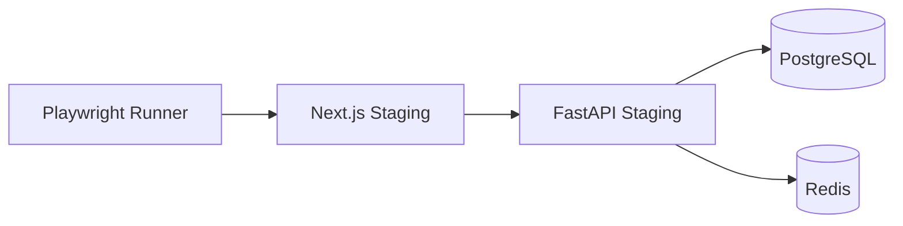
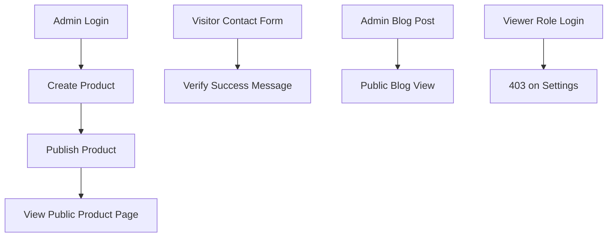

# End-to-End Testing

| Field | Value |
|-------|-------|
| **Document ID** | TEST-E2E-001 |
| **Product** | Founder Portfolio Platform (FounderOS v1.0) |
| **Status** | Approved |
| **Last Updated** | 2026-06-29 |
| **Related** | [Testing Strategy](./Testing_Strategy.md) · [Accessibility Testing](./Accessibility_Testing.md) · [CI/CD](../13_Deployment/CI_CD.md) |

---

## Purpose

Define end-to-end (E2E) testing standards for FounderOS v1.0 using browser automation — validating critical user journeys across the Next.js 15 public site and admin shell against live or staging API and database stacks.

## Scope

| In Scope | Out of Scope |
|----------|--------------|
| Playwright browser automation | Mobile native app E2E |
| Critical path user journeys | Exhaustive combinatorial UI tests |
| Cross-browser smoke (Chromium primary) | IE11 support |
| Visual debugging artifacts (screenshots, traces) | Production synthetic monitoring (see [Monitoring](../13_Deployment/Monitoring.md)) |
| Staging and CI ephemeral environments | Manual UAT scripts |

## Business Context

E2E tests are the final gate before white-label tenants receive platform updates. Failures in admin login, product publishing, or contact form submission represent direct revenue and lead-capture risk. E2E scope must stay lean — covering high-value paths only — to maintain CI speed and low flake rates.

## Goals

| # | Goal | Success Metric |
|---|------|----------------|
| G1 | P0 journeys automated | 100% critical path coverage |
| G2 | Smoke suite &lt; 10 minutes | CI timing |
| G3 | Flaky rate &lt; 2% | 30-day rolling |
| G4 | Trace on failure | 100% failure artifacts |
| G5 | Staging full suite before prod | Release gate enforced |

## Functional Requirements

| ID | Requirement | Priority |
|----|-------------|----------|
| FR-E2E-001 | E2E framework SHALL be Playwright | P0 |
| FR-E2E-002 | Smoke suite SHALL run on every PR merge to main | P0 |
| FR-E2E-003 | Full suite SHALL run on staging before production | P0 |
| FR-E2E-004 | Tests SHALL use data-testid selectors for stability | P0 |
| FR-E2E-005 | Admin login/logout journey SHALL be covered | P0 |
| FR-E2E-006 | Product create → publish → public view SHALL be covered | P0 |
| FR-E2E-007 | Contact form submission SHALL be covered | P0 |
| FR-E2E-008 | Failed tests SHALL capture screenshot and trace | P0 |
| FR-E2E-009 | Tests SHALL run headless in CI | P0 |
| FR-E2E-010 | Parallel workers limited to avoid rate limits | P1 |

## Non-functional Requirements

| ID | Requirement | Target |
|----|-------------|--------|
| NFR-E2E-001 | Smoke suite runtime | &lt; 10 minutes |
| NFR-E2E-002 | Full suite runtime | &lt; 30 minutes |
| NFR-E2E-003 | Retry on failure | Max 1 retry in CI |
| NFR-E2E-004 | Browser coverage | Chromium required; Firefox optional |

## User Stories

| ID | As a… | I want… | So that… |
|----|-------|---------|----------|
| US-E2E-001 | QA lead | automated critical path tests | releases are safe |
| US-E2E-002 | Developer | trace viewer on failure | I debug quickly |
| US-E2E-003 | Founder | contact form E2E | leads are never broken |
| US-E2E-004 | DevOps | staging gate before prod | bad deploys are blocked |
| US-E2E-005 | Agency | white-label smoke template | each tenant deploy is verified |

## UX Requirements

- `data-testid` attributes on interactive admin and form elements.
- E2E tests avoid brittle CSS class selectors.
- Tests wait for network idle or explicit API responses, not arbitrary sleeps.
- Admin tests clean up created entities or use isolated test prefix slugs.

## Technical Considerations

### E2E Environment Topology

### Critical Journey Map

### Test Suite Tiers

| Tier | Trigger | Journeys | Runtime |
|------|---------|----------|---------|
| Smoke | PR merge to main | Login, contact, home load | &lt; 10 min |
| Regression | Staging deploy | All P0 + P1 journeys | &lt; 30 min |
| Full | Weekly / pre-release | Smoke + regression + a11y spot | &lt; 45 min |
| White-label | Tenant deploy | Smoke against tenant URL | &lt; 10 min |

### Selector Strategy

| Priority | Selector Type | Example |
|----------|---------------|---------|
| 1 | `data-testid` | `data-testid="product-save-btn"` |
| 2 | ARIA role + name | `getByRole('button', { name: 'Save' })` |
| 3 | Label text | `getByLabel('Email')` |
| 4 | CSS / XPath | Avoid except last resort |

### CI Artifact Policy

| Artifact | When Captured | Retention |
|----------|---------------|-----------|
| Screenshot | On failure | 14 days |
| Playwright trace | On failure | 14 days |
| Video | On failure (optional) | 7 days |
| HTML report | Every run | 7 days |

## Security Considerations

- E2E credentials stored in CI secrets; rotate quarterly.
- Test admin accounts isolated from production users.
- Do not commit traces containing tokens to public artifacts.
- Include RBAC denial journey (viewer cannot access settings).
- Rate limit aware: serialize login tests or use dedicated test IP allowlist.

## Acceptance Criteria

- [ ] Playwright configured with smoke and regression projects.
- [ ] Smoke runs on merge to main and passes.
- [ ] Admin login → product publish → public view journey green.
- [ ] Contact form journey verifies success UI and API 201.
- [ ] Failed CI runs upload trace artifacts.
- [ ] `data-testid` present on all P0 interactive elements.
- [ ] Staging full suite required before production promotion.

## Future Enhancements

| Enhancement | Target Version | Reference |
|-------------|----------------|-----------|
| Visual regression snapshots | v1.1 | [Testing Strategy](./Testing_Strategy.md) |
| Cross-browser Firefox/WebKit matrix | v1.1 | — |
| Production synthetic checks | v1.2 | [Monitoring](../13_Deployment/Monitoring.md) |
| Multi-tenant E2E matrix | v2.0 | [Multi Tenant](../14_Future/Multi_Tenant.md) |

## Open Questions

| ID | Question | Owner | Status |
|----|----------|-------|--------|
| OQ-E2E-001 | Dedicated E2E tenant vs shared staging? | DevOps | Open |
| OQ-E2E-002 | Video capture on every run vs failure only? | QA | Failure only |
| OQ-E2E-003 | Mobile viewport E2E in smoke? | Frontend | v1.1 |

---

## Related Documents

- [Testing Strategy](./Testing_Strategy.md)
- [Integration Testing](./Integration_Testing.md)
- [Accessibility Testing](./Accessibility_Testing.md)
- [Performance Testing](./Performance_Testing.md)
- [CI/CD](../13_Deployment/CI_CD.md)
- [Environment](../13_Deployment/Environment.md)
- [Authentication](../11_Security/Authentication.md)
