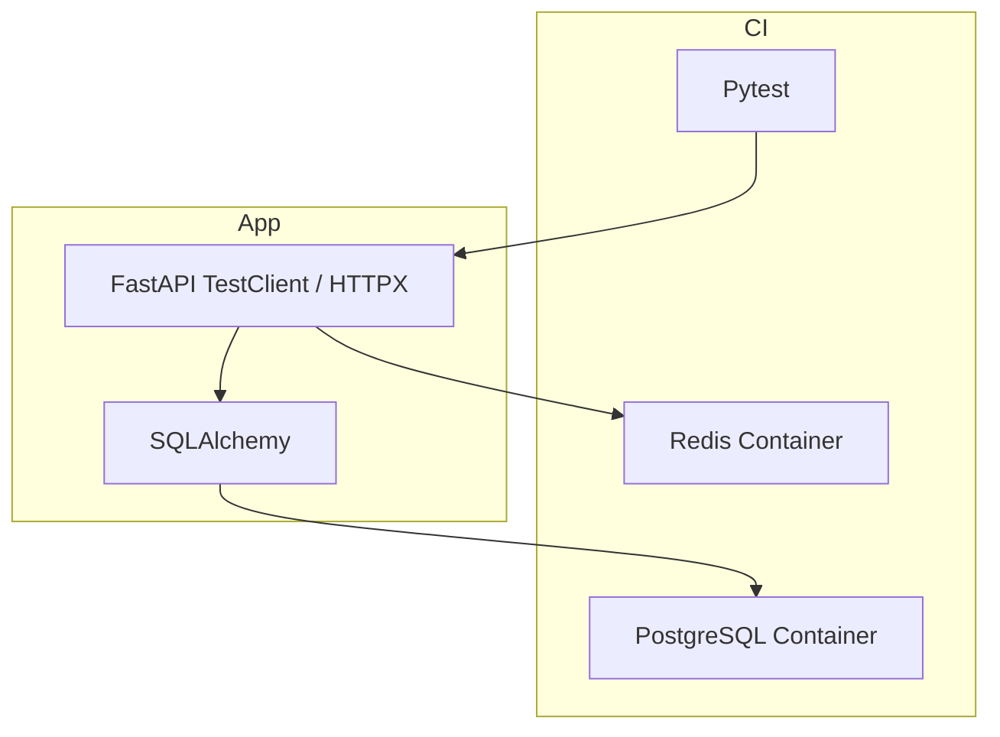
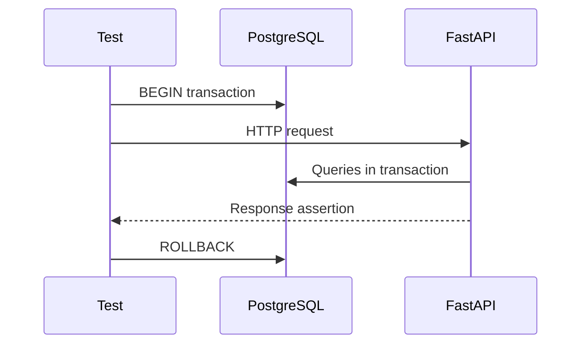

# Integration Testing

| Field | Value |
|-------|-------|
| **Document ID** | TEST-INT-001 |
| **Product** | Founder Portfolio Platform (FounderOS v1.0) |
| **Status** | Approved |
| **Last Updated** | 2026-06-29 |
| **Related** | [Testing Strategy](./Testing_Strategy.md) · [Unit Testing](./Unit_Testing.md) · [E2E Testing](./E2E_Testing.md) |

---

## Purpose

Define integration testing approach for FounderOS v1.0 — verifying FastAPI routes, PostgreSQL persistence, Redis caching, and cross-module interactions with real infrastructure in isolated test environments.

## Scope

| In Scope | Out of Scope |
|----------|--------------|
| API endpoint tests with test database | Full browser UI flows |
| Auth + authz integration paths | Production data testing |
| Redis cache behavior | Third-party API live integration (mocked) |
| Database migration tests | Multi-region failover |
| Transaction rollback patterns | Performance load tests |

## Business Context

Integration tests catch failures at the boundary between API handlers, ORM queries, and cache layers — where most production bugs in CMS platforms originate. For white-label deployments sharing the same API codebase, integration coverage guarantees every tenant benefits from verified write paths for products, inquiries, and blog content.

## Goals

| # | Goal | Success Metric |
|---|------|----------------|
| G1 | All P0 API routes have integration tests | 100% P0 coverage |
| G2 | Tests use ephemeral PostgreSQL | No shared dirty state |
| G3 | Auth and RBAC paths fully tested | Zero open authz gaps |
| G4 | Suite runtime &lt; 8 minutes | CI timing |
| G5 | Migrations tested up and down | Rollback verified |

## Functional Requirements

| ID | Requirement | Priority |
|----|-------------|----------|
| FR-INT-001 | Integration tests SHALL use real PostgreSQL (containerized) | P0 |
| FR-INT-002 | Each test SHALL run in transaction rollback or fresh schema | P0 |
| FR-INT-003 | Auth login/refresh/logout SHALL be integration tested | P0 |
| FR-INT-004 | RBAC 403 scenarios SHALL be tested per protected route | P0 |
| FR-INT-005 | CRUD flows for products, blog, portfolio SHALL be tested | P0 |
| FR-INT-006 | Contact/inquiry persistence SHALL be tested | P0 |
| FR-INT-007 | Rate limit behavior SHALL be tested with Redis | P1 |
| FR-INT-008 | Cache hit/miss paths SHALL be tested for read endpoints | P1 |
| FR-INT-009 | Alembic migrations SHALL apply cleanly on empty DB | P0 |
| FR-INT-010 | OpenAPI documented routes SHALL match tested endpoints | P1 |

## Non-functional Requirements

| ID | Requirement | Target |
|----|-------------|--------|
| NFR-INT-001 | Integration suite runtime | &lt; 8 minutes |
| NFR-INT-002 | Test DB startup time | &lt; 30 seconds |
| NFR-INT-003 | Parallel test workers | Up to 4 (no shared state) |
| NFR-INT-004 | Flaky rate | &lt; 1% |

## User Stories

| ID | As a… | I want… | So that… |
|----|-------|---------|----------|
| US-INT-001 | Backend dev | API tests with real DB | ORM queries are verified |
| US-INT-002 | Security engineer | authz integration tests | privilege escalation is caught |
| US-INT-003 | DevOps | migration tests in CI | deploys don't break schema |
| US-INT-004 | QA | API-level regression suite | UI E2E scope stays focused |
| US-INT-005 | Agency | seed fixtures for white-label | tenant scenarios are repeatable |

## UX Requirements

- Integration failures show HTTP status, response body, and SQL context in CI logs.
- Test fixtures create realistic founder site data (products, blog posts).
- API test reports map failures to OpenAPI operation IDs.

## Technical Considerations

### Integration Test Stack

### API Route Coverage Matrix

| Route Group | Methods Tested | Auth Scenarios | DB Assertions |
|-------------|----------------|----------------|---------------|
| `/auth/*` | POST, GET | Valid, invalid, expired | User row, Redis key |
| `/products` | GET, POST, PUT, DELETE | Public read, admin write, 403 | CRUD row counts |
| `/blog` | GET, POST, PUT, DELETE | Same | Slug uniqueness |
| `/contact` | POST | Anonymous, rate limit | Inquiry row |
| `/portfolio` | GET, POST, PUT, DELETE | Editor vs viewer | Media references |
| `/settings` | GET, PUT | Admin only | Settings JSON blob |
| `/health` | GET | Public | 200 status |

### Test Isolation Pattern

### Fixture Strategy

| Fixture | Scope | Contents |
|---------|-------|----------|
| `db_session` | Per test | Rolled-back transaction |
| `admin_user` | Per test | super_admin with token |
| `editor_user` | Per test | editor role with token |
| `seed_site` | Per module | Site settings + sample content |
| `redis_client` | Per test | Flushed namespace |

### External Service Mocking

| Service | Integration Test Approach |
|---------|--------------------------|
| GitHub API | HTTPX mock responder |
| YouTube API | HTTPX mock responder |
| Cloudflare R2 | Local filesystem adapter |
| Email (v1.1) | Capture backend outbox |

## Security Considerations

- Test database must never point to production connection strings.
- Include horizontal privilege escalation tests per [Authorization](../11_Security/Authorization.md).
- Rate limit tests verify 429 without weakening production thresholds.
- SQL injection regression strings in contact and search endpoints.
- Audit log creation verified for admin mutations per [Audit](../11_Security/Audit.md).

## Acceptance Criteria

- [ ] PostgreSQL container starts in CI for every PR.
- [ ] All P0 routes in coverage matrix have passing tests.
- [ ] RBAC 403 tested for at least editor-on-settings and viewer-on-write.
- [ ] Migrations apply on empty database without error.
- [ ] Transaction rollback leaves no cross-test pollution.
- [ ] Rate limit integration test passes with Redis container.
- [ ] Suite completes in &lt; 8 minutes.

## Future Enhancements

| Enhancement | Target Version | Reference |
|-------------|----------------|-----------|
| Contract tests from OpenAPI | v1.1 | [API Architecture](../04_Architecture/API_Architecture.md) |
| Multi-tenant isolation tests | v2.0 | [Multi Tenant](../14_Future/Multi_Tenant.md) |
| Read replica lag simulation | v1.5 | [Database Architecture](../04_Architecture/Database_Architecture.md) |

## Open Questions

| ID | Question | Owner | Status |
|----|----------|-------|--------|
| OQ-INT-001 | testcontainers vs GitHub Actions service containers? | DevOps | Open |
| OQ-INT-002 | httpx AsyncClient vs TestClient? | Backend | Open |
| OQ-INT-003 | Shared seed migration for test data? | Backend | Open |

---

## Related Documents

- [Testing Strategy](./Testing_Strategy.md)
- [Unit Testing](./Unit_Testing.md)
- [E2E Testing](./E2E_Testing.md)
- [Authentication](../11_Security/Authentication.md)
- [Authorization](../11_Security/Authorization.md)
- [Rate Limits](../11_Security/Rate_Limits.md)
- [Docker](../13_Deployment/Docker.md)
- [CI/CD](../13_Deployment/CI_CD.md)
