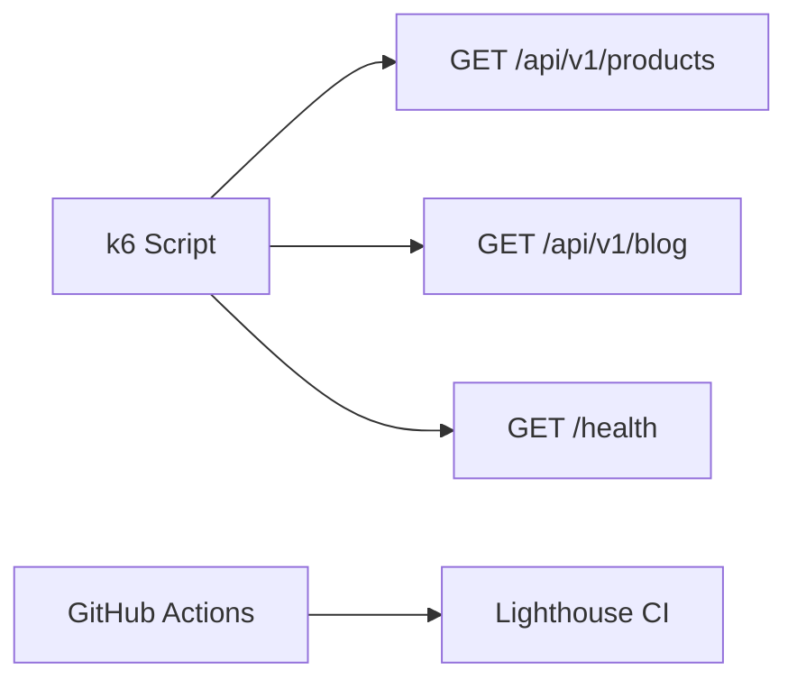

# Performance Testing

| Field | Value |
|-------|-------|
| **Document ID** | TEST-PERF-001 |
| **Product** | Founder Portfolio Platform (FounderOS v1.0) |
| **Version** | 1.0 |
| **Status** | Approved |
| **Last Updated** | 2026-06-29 |
| **Owner** | QA / Engineering |
| **Related** | [Testing Strategy](./Testing_Strategy.md) · [E2E Testing](./E2E_Testing.md) · [Home Page](../05_Pages/Home.md) · [Scalability](../04_Architecture/Scalability.md) |

---

## Purpose

Define performance testing standards for FounderOS — Lighthouse budgets, load testing, API benchmarks, and CI gates — ensuring the platform meets enterprise-grade speed expectations.

---

## Scope

| In Scope | Out of Scope |
|----------|--------------|
| Frontend Lighthouse CI | Chaos engineering |
| k6/Artillery API load tests | DDoS simulation |
| Database query benchmarks | Multi-region latency testing |

---

## Business Context

Enterprise buyers evaluate Lighthouse scores and Time to Interactive. Slow admin under load erodes trust. Performance is a feature, not an afterthought.

---

## Goals

| # | Goal | Target |
|---|------|--------|
| G1 | Mobile Lighthouse Performance | ≥ 90 |
| G2 | API p95 latency (read) | &lt; 200ms |
| G3 | LCP on Home | &lt; 2.0s |
| G4 | No regression in CI without approval | Budget file |

---

## Functional Requirements

| ID | Requirement | Priority |
|----|-------------|----------|
| FR-PERF-001 | Lighthouse CI on PR for Home, Products, Enterprise | P0 |
| FR-PERF-002 | Performance budget in `lighthouserc.json` | P0 |
| FR-PERF-003 | k6 smoke load: 50 VU, 5 min on `/api/v1/health` and public reads | P1 |
| FR-PERF-004 | Bundle size check via `@next/bundle-analyzer` on main | P1 |
| FR-PERF-005 | Core Web Vitals tracked in staging | P1 |

---

## Non-functional Requirements

| ID | Requirement | Target |
|----|-------------|--------|
| NFR-PERF-001 | TTFB (cached public page) | &lt; 600ms |
| NFR-PERF-002 | JS bundle (public route) | &lt; 200KB gzip |
| NFR-PERF-003 | CLS | &lt; 0.1 |

---

## User Stories

| ID | As a… | I want… | So that… |
|----|-------|---------|----------|
| US-PERF-001 | Developer | CI fail on LCP regression | we catch slowness early |
| US-PERF-002 | SRE | load test scripts | I validate VPS capacity |
| US-PERF-003 | Product | defined budgets | tradeoffs are explicit |

---

## UX Requirements

- Performance targets align with page specs ([Home](../05_Pages/Home.md), [Enterprise](../05_Pages/Enterprise.md)).
- Loading patterns per [Loading States](../03_Design_System/Loading_States.md) must not inflate LCP.

---

## Technical Considerations

### Lighthouse Budgets (excerpt)

| Metric | Budget |
|--------|--------|
| Performance score | ≥ 90 |
| LCP | ≤ 2500ms |
| TBT | ≤ 200ms |
| Speed Index | ≤ 3000ms |

### Load Test Scenarios

- Tools: Lighthouse CI, k6, optional `autocannon` for quick local checks.
- Run load tests against staging, not production.
- Profile SQL with `EXPLAIN ANALYZE` for slow admin endpoints.

---

## Security Considerations

- Load tests only on authorized environments.
- No credential brute-force patterns in perf scripts.

---

## Acceptance Criteria

- [ ] Lighthouse budget thresholds documented
- [ ] CI integration points listed
- [ ] k6 scenario outline defined
- [ ] Page-level LCP targets cross-linked
- [ ] Bundle size gate documented

---

## Future Enhancements

- Synthetic monitoring from Cloudflare
- Visual regression + perf correlation
- Auto-bisect perf regressions

---

## Open Questions

| # | Question | Owner |
|---|----------|-------|
| OQ-1 | Block merge on Lighthouse &lt; 90? | Engineering |
| OQ-2 | Perf tests on every PR or nightly? | QA |
| OQ-3 | Target VPS specs for load baseline? | DevOps |
