# Testing Strategy

| Field | Value |
|-------|-------|
| **Document ID** | TEST-STR-001 |
| **Product** | Founder Portfolio Platform (FounderOS v1.0) |
| **Status** | Approved |
| **Last Updated** | 2026-06-29 |
| **Related** | [Unit Testing](./Unit_Testing.md) · [Integration Testing](./Integration_Testing.md) · [E2E Testing](./E2E_Testing.md) |

---

## Purpose

Define the overall quality assurance and testing strategy for FounderOS v1.0 — establishing test pyramid layers, coverage targets, tooling, CI gates, and release criteria for the Next.js 15 frontend, FastAPI backend, and white-label deployment pipeline.

## Scope

| In Scope | Out of Scope |
|----------|--------------|
| Test pyramid and layer ownership | Manual exploratory test scripts (ad hoc) |
| CI/CD quality gates | Third-party penetration testing contracts |
| Coverage targets per layer | Load testing at 10× scale (v2.0) |
| Test environment strategy | Mobile native app testing |
| Release sign-off criteria | Vendor SLA testing |

## Business Context

FounderOS is sold as a commercial white-label platform. Regressions in authentication, enterprise inquiry capture, or SEO metadata directly impact tenant revenue and brand reputation. A documented testing strategy ensures consistent quality across reference and licensee deployments without relying on individual developer discipline.

## Goals

| # | Goal | Success Metric |
|---|------|----------------|
| G1 | Automated regression on every PR | CI required checks pass |
| G2 | Balanced test pyramid | 70% unit / 20% integration / 10% E2E |
| G3 | Critical path E2E coverage | Auth, contact, product publish |
| G4 | Accessibility and performance baselines | WCAG 2.1 AA + Core Web Vitals gates |
| G5 | White-label smoke test on deploy | Post-deploy checklist automated |

## Functional Requirements

| ID | Requirement | Priority |
|----|-------------|----------|
| FR-TEST-001 | CI SHALL run unit tests on every pull request | P0 |
| FR-TEST-002 | CI SHALL run integration tests against test DB | P0 |
| FR-TEST-003 | CI SHALL run E2E smoke on merge to main | P0 |
| FR-TEST-004 | Coverage report SHALL be generated per build | P1 |
| FR-TEST-005 | Failed tests SHALL block merge to main | P0 |
| FR-TEST-006 | Staging deploy SHALL run full E2E suite | P0 |
| FR-TEST-007 | Security tests SHALL validate auth and authz paths | P0 |
| FR-TEST-008 | Accessibility audit SHALL run on key pages in CI | P1 |
| FR-TEST-009 | Performance budget check on Lighthouse CI | P1 |
| FR-TEST-010 | Test data factories SHALL support white-label scenarios | P1 |

## Non-functional Requirements

| ID | Requirement | Target |
|----|-------------|--------|
| NFR-TEST-001 | Unit test suite runtime | &lt; 3 minutes |
| NFR-TEST-002 | Integration test suite runtime | &lt; 8 minutes |
| NFR-TEST-003 | E2E smoke runtime | &lt; 10 minutes |
| NFR-TEST-004 | Flaky test rate | &lt; 2% over 30 days |
| NFR-TEST-005 | Backend unit coverage | ≥ 80% |
| NFR-TEST-006 | Frontend unit coverage | ≥ 70% |

## User Stories

| ID | As a… | I want… | So that… |
|----|-------|---------|----------|
| US-TEST-001 | Developer | fast unit feedback on PR | I fix issues before review |
| US-TEST-002 | QA lead | E2E on critical paths | releases don't break login or forms |
| US-TEST-003 | DevOps | deploy blocked on test failure | bad builds don't reach production |
| US-TEST-004 | Founder (tenant) | reliable contact form | my leads are never lost |
| US-TEST-005 | Accessibility advocate | automated a11y checks | the platform is inclusive |

## UX Requirements

- Test failures in CI produce actionable reports with screenshot/video for E2E.
- Flaky tests quarantined within 48 hours of identification.
- Preview deployments linked to PR for manual verification.
- Test naming follows `describe module / it should behavior` convention.

## Technical Considerations

### Test Pyramid

```mermaid
pyramid
    title FounderOS Test Pyramid
    "E2E (Playwright)" : 10
    "Integration (API + DB)" : 20
    "Unit (Vitest + Pytest)" : 70
```

### Layer Ownership Matrix

| Layer | Scope | Tooling | Owner |
|-------|-------|---------|-------|
| Unit (Frontend) | Components, hooks, utils | Vitest, Testing Library | Frontend |
| Unit (Backend) | Services, validators, auth | Pytest | Backend |
| Integration | API routes + PostgreSQL | Pytest + testcontainers | Backend |
| E2E | Browser flows | Playwright | QA / Full-stack |
| A11y | WCAG checks | axe-core, Playwright | Frontend |
| Performance | Core Web Vitals | Lighthouse CI | Frontend |
| Contract | API schema (v1.1) | OpenAPI diff | Backend |

### CI Pipeline Test Stages

```mermaid
flowchart LR
    PR[Pull Request] --> Lint[Lint + Typecheck]
    Lint --> Unit[Unit Tests]
    Unit --> Int[Integration Tests]
    Int --> Build[Build]
    Build --> E2E[E2E Smoke]
    E2E --> A11y[A11y Scan]
    A11y --> Merge[Merge to main]
    Merge --> Staging[Full E2E on Staging]
    Staging --> Prod[Production Deploy]
```



### Critical Path Test Matrix

| Flow | Unit | Integration | E2E | Priority |
|------|:----:|:-----------:|:---:|:--------:|
| Admin login / logout | ✓ | ✓ | ✓ | P0 |
| Product CRUD + publish | ✓ | ✓ | ✓ | P0 |
| Contact form submit | ✓ | ✓ | ✓ | P0 |
| Blog publish + public view | ✓ | ✓ | ✓ | P0 |
| RBAC 403 enforcement | ✓ | ✓ | ✓ | P0 |
| Media upload | ✓ | ✓ | — | P1 |
| SEO metadata render | ✓ | — | ✓ | P1 |
| Rate limit 429 | — | ✓ | — | P1 |

### Environment Strategy

| Environment | Purpose | Data | Tests Run |
|-------------|---------|------|-----------|
| Local | Developer | Docker Compose seed | Unit + selective integration |
| CI | Automated PR | Ephemeral PostgreSQL | Unit + integration + E2E smoke |
| Staging | Pre-prod | Anonymized seed | Full E2E + a11y + perf |
| Production | Live tenant | Real | Synthetic monitoring only |

## Security Considerations

- Integration tests use dedicated test credentials; never production secrets.
- E2E tests must not log tokens or passwords in CI artifacts.
- Auth bypass shortcuts forbidden in staging/production test configs.
- Security regression tests for [Authentication](../11_Security/Authentication.md) and [Authorization](../11_Security/Authorization.md) required before release.
- See [CI/CD](../13_Deployment/CI_CD.md) for secret injection in test pipelines.

## Acceptance Criteria

- [ ] CI pipeline runs unit, integration, and E2E smoke on every PR to main.
- [ ] Coverage reports published as CI artifacts.
- [ ] Critical path matrix has tests implemented for all P0 rows.
- [ ] Staging full E2E runs before production promotion.
- [ ] Flaky test policy documented and enforced.
- [ ] Test pyramid ratio tracked monthly.
- [ ] Release checklist signed by engineering lead.

## Future Enhancements

| Enhancement | Target Version | Reference |
|-------------|----------------|-----------|
| Visual regression (Percy/Chromatic) | v1.1 | [E2E Testing](./E2E_Testing.md) |
| Contract testing with OpenAPI | v1.1 | [API Architecture](../04_Architecture/API_Architecture.md) |
| Chaos testing on VPS | v2.0 | [Disaster Recovery](../13_Deployment/Disaster_Recovery.md) |
| Multi-tenant test isolation suite | v2.0 | [Multi Tenant](../14_Future/Multi_Tenant.md) |

## Open Questions

| ID | Question | Owner | Status |
|----|----------|-------|--------|
| OQ-TEST-001 | Playwright vs Cypress final selection? | QA | Playwright chosen |
| OQ-TEST-002 | testcontainers vs docker-compose in CI? | DevOps | Open |
| OQ-TEST-003 | Mandatory manual QA sign-off for releases? | Product | Open |

---

## Related Documents

- [Unit Testing](./Unit_Testing.md)
- [Integration Testing](./Integration_Testing.md)
- [E2E Testing](./E2E_Testing.md)
- [Accessibility Testing](./Accessibility_Testing.md)
- [Performance Testing](./Performance_Testing.md)
- [CI/CD](../13_Deployment/CI_CD.md)
- [Docker](../13_Deployment/Docker.md)
- [Authentication](../11_Security/Authentication.md)
