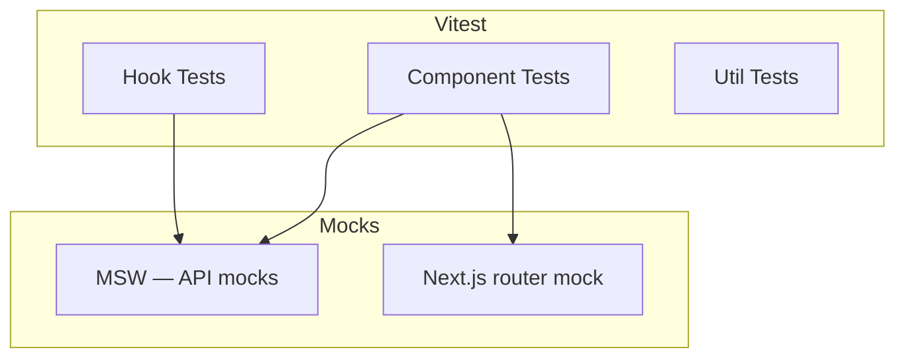
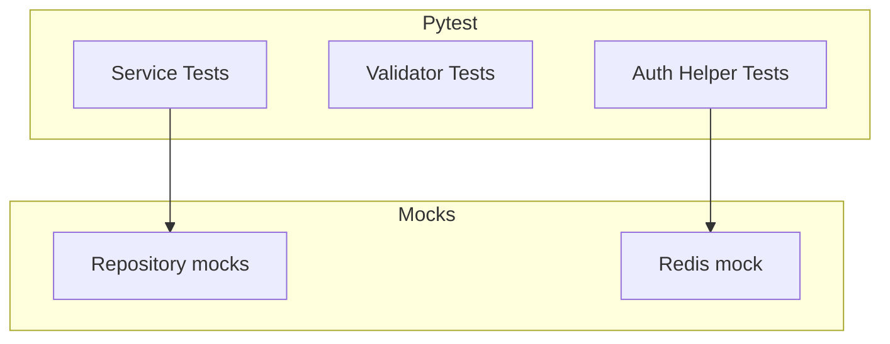

# Unit Testing

| Field | Value |
|-------|-------|
| **Document ID** | TEST-UNIT-001 |
| **Product** | Founder Portfolio Platform (FounderOS v1.0) |
| **Status** | Approved |
| **Last Updated** | 2026-06-29 |
| **Related** | [Testing Strategy](./Testing_Strategy.md) · [Integration Testing](./Integration_Testing.md) |

---

## Purpose

Specify unit testing standards, tooling, and coverage expectations for FounderOS v1.0 frontend (Next.js 15 / TypeScript) and backend (FastAPI / Python) — ensuring isolated components, services, and validators are verified without external dependencies.

## Scope

| In Scope | Out of Scope |
|----------|--------------|
| Frontend component and hook tests | Browser automation |
| Backend service and validator tests | Database integration tests |
| Pure utility function tests | E2E flows |
| Mocking conventions | Load and stress testing |
| Coverage reporting in CI | Third-party API live calls |

## Business Context

Unit tests provide the fastest feedback loop for white-label feature development. High coverage on authentication helpers, Pydantic validators, and CMS form logic prevents regressions that would otherwise surface only in slow integration or E2E suites — reducing cost for agencies shipping multiple tenant customizations.

## Goals

| # | Goal | Success Metric |
|---|------|----------------|
| G1 | ≥ 80% backend unit coverage | Measured in CI |
| G2 | ≥ 70% frontend unit coverage | Measured in CI |
| G3 | All validators have edge-case tests | 100% validator coverage |
| G4 | Tests run in &lt; 3 minutes total | CI timing gate |
| G5 | No network/DB in unit tests | Enforced by lint rule |

## Functional Requirements

| ID | Requirement | Priority |
|----|-------------|----------|
| FR-UNIT-001 | Frontend unit tests SHALL use Vitest + Testing Library | P0 |
| FR-UNIT-002 | Backend unit tests SHALL use Pytest | P0 |
| FR-UNIT-003 | Unit tests SHALL not connect to PostgreSQL or Redis | P0 |
| FR-UNIT-004 | Auth token parsing/validation SHALL have unit tests | P0 |
| FR-UNIT-005 | Pydantic validators SHALL have parametrized edge cases | P0 |
| FR-UNIT-006 | React hooks SHALL be tested with renderHook | P1 |
| FR-UNIT-007 | Coverage reports SHALL upload to CI artifacts | P1 |
| FR-UNIT-008 | Snapshot tests limited to stable presentational components | P2 |
| FR-UNIT-009 | Unit test files SHALL colocate or mirror source structure | P1 |
| FR-UNIT-010 | Failing unit tests SHALL block PR merge | P0 |

## Non-functional Requirements

| ID | Requirement | Target |
|----|-------------|--------|
| NFR-UNIT-001 | Single test file runtime | &lt; 5 seconds |
| NFR-UNIT-002 | Full unit suite runtime | &lt; 3 minutes |
| NFR-UNIT-003 | Test isolation | No shared mutable state |
| NFR-UNIT-004 | Deterministic results | No time/random without seed |

## User Stories

| ID | As a… | I want… | So that… |
|----|-------|---------|----------|
| US-UNIT-001 | Frontend dev | component tests with Testing Library | UI logic is verified |
| US-UNIT-002 | Backend dev | pytest fixtures for services | I mock repositories easily |
| US-UNIT-003 | Reviewer | coverage diff on PR | I see untested changes |
| US-UNIT-004 | Security engineer | validator edge case tests | injection inputs are rejected |
| US-UNIT-005 | Agency dev | fast local test run | I iterate quickly on white-label |

## UX Requirements

- Test output in CI shows clear failure messages with file and line.
- Local `npm test` and `pytest` commands documented in developer README.
- Watch mode supported for local development.
- No flaky unit tests — fix or delete within same sprint.

## Technical Considerations

### Frontend Unit Architecture

### Backend Unit Architecture

### Priority Unit Test Targets

| Module | Frontend | Backend | Min Coverage |
|--------|:--------:|:-------:|:------------:|
| Authentication helpers | ✓ | ✓ | 90% |
| Pydantic / Zod schemas | ✓ | ✓ | 95% |
| Permission hooks | ✓ | ✓ | 90% |
| Slug / URL formatters | ✓ | ✓ | 85% |
| CMS form components | ✓ | — | 75% |
| SEO metadata builders | ✓ | — | 80% |
| Price / currency formatters | ✓ | ✓ | 85% |

### Naming and Structure Conventions

| Convention | Frontend | Backend |
|------------|----------|---------|
| File suffix | `.test.tsx` / `.test.ts` | `test_*.py` |
| Describe block | Component or module name | Class or module name |
| It block | `should {behavior} when {condition}` | Same pattern |
| Location | Adjacent to source or `__tests__/` | `tests/unit/` mirror |

### Mocking Guidelines

| Dependency | Mock Strategy |
|------------|---------------|
| Fetch / API | MSW handlers |
| Next.js navigation | `next/navigation` mock |
| PostgreSQL | Repository interface mock |
| Redis | In-memory fake or mock |
| Date/time | Injected clock / freezegun |
| Environment vars | `vi.stubEnv` / `monkeypatch` |

## Security Considerations

- Unit tests for [Validation](../11_Security/Validation.md) must include malicious input samples.
- Never use production secrets in unit test fixtures.
- Auth tests verify token expiry, invalid signature, and missing claims.
- Password hashing tests use known test vectors only.

## Acceptance Criteria

- [ ] Vitest and Pytest configured in CI with coverage reports.
- [ ] Backend unit coverage ≥ 80% on main branch.
- [ ] Frontend unit coverage ≥ 70% on main branch.
- [ ] All Pydantic schemas have at least one invalid-input test.
- [ ] No unit test makes network or database connections.
- [ ] Unit suite completes in &lt; 3 minutes in CI.
- [ ] Auth helper tests cover expiry and tampered token cases.

## Future Enhancements

| Enhancement | Target Version | Reference |
|-------------|----------------|-----------|
| Mutation testing (mutmut) | v1.2 | [Testing Strategy](./Testing_Strategy.md) |
| Shared schema test codegen | v1.2 | [Validation](../11_Security/Validation.md) |
| Component visual unit tests | v1.1 | [E2E Testing](./E2E_Testing.md) |

## Open Questions

| ID | Question | Owner | Status |
|----|----------|-------|--------|
| OQ-UNIT-001 | Enforce coverage threshold as CI hard gate? | Eng Lead | Open |
| OQ-UNIT-002 | MSW default handlers in shared package? | Frontend | Open |
| OQ-UNIT-003 | Property-based testing (Hypothesis) for validators? | Backend | v1.1 |

---

## Related Documents

- [Testing Strategy](./Testing_Strategy.md)
- [Integration Testing](./Integration_Testing.md)
- [Validation](../11_Security/Validation.md)
- [Authentication](../11_Security/Authentication.md)
- [Frontend Architecture](../04_Architecture/Frontend_Architecture.md)
- [Backend Architecture](../04_Architecture/Backend_Architecture.md)
- [CI/CD](../13_Deployment/CI_CD.md)
