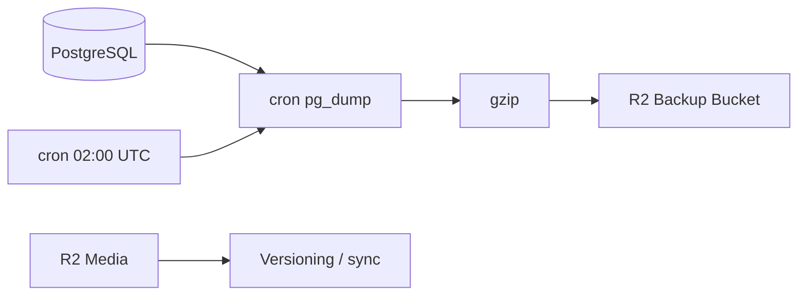

# Backup Strategy

| Field | Value |
|-------|-------|
| **Document ID** | DEP-BAK-001 |
| **Product** | Founder Portfolio Platform (FounderOS v1.0) |
| **Version** | 1.0 |
| **Status** | Approved |
| **Last Updated** | 2026-06-29 |
| **Owner** | DevOps / Engineering |
| **Related** | [Disaster Recovery](./Disaster_Recovery.md) · [Hostinger](./Hostinger.md) · [Docker](./Docker.md) · [Database Architecture](../04_Architecture/Database_Architecture.md) |

---

## Purpose

Define backup procedures for FounderOS production data — PostgreSQL, Redis persistence, media objects, and configuration — ensuring recoverability within documented RPO/RTO targets.

---

## Scope

| In Scope | Out of Scope |
|----------|--------------|
| Automated pg_dump schedules | Cross-region replication |
| R2/S3 media backup | Legal hold archival policy |
| Backup verification | |

---

## Business Context

Content loss (blog, products, media) destroys founder credibility. Enterprise contracts may require documented backup frequency and restore tests.

---

## Goals

| # | Goal | Target |
|---|------|--------|
| G1 | RPO (max data loss) | ≤ 24 hours |
| G2 | Backup retention | 30 daily, 4 weekly |
| G3 | Encrypted backups at rest | AES-256 |
| G4 | Quarterly restore test | documented |

---

## Functional Requirements

| ID | Requirement | Priority |
|----|-------------|----------|
| FR-BAK-001 | Daily automated PostgreSQL dump | P0 |
| FR-BAK-002 | Backups stored off-VPS (R2/S3) | P0 |
| FR-BAK-003 | Pre-migration manual backup in CI/CD | P0 |
| FR-BAK-004 | Media bucket versioning or sync | P1 |
| FR-BAK-005 | Redis RDB snapshots if persistence enabled | P2 |
| FR-BAK-006 | `.env` secrets backed up separately in vault | P0 |

---

## Non-functional Requirements

| ID | Requirement | Target |
|----|-------------|--------|
| NFR-BAK-001 | Backup window | 02:00 UTC low traffic |
| NFR-BAK-002 | Dump compression | gzip |
| NFR-BAK-003 | Backup job failure alert | within 1 hour |

---

## User Stories

| ID | As a… | I want… | So that… |
|----|-------|---------|----------|
| US-BAK-001 | DevOps | automated pg_dump | I don't forget backups |
| US-BAK-002 | Founder | content recoverable | mistakes aren't fatal |
| US-BAK-003 | Auditor | retention policy | we pass vendor review |

---

## UX Requirements

N/A — operational. Restore scenarios may require maintenance page per [Disaster Recovery](./Disaster_Recovery.md).

---

## Technical Considerations



### Backup Script Outline

```bash
pg_dump $DATABASE_URL | gzip > /backups/fos_$(date +%F).sql.gz
aws s3 cp /backups/ s3://fos-backups/ --recursive  # or rclone to R2
```

- Retention lifecycle rule: delete &gt; 30 days except weekly snapshots.
- Encrypt bucket with SSE-S3 or client-side gpg for sensitive deployments.
- Document restore in [Disaster Recovery](./Disaster_Recovery.md).

---

## Security Considerations

- Backup bucket private; IAM/R2 token least privilege.
- Dumps contain PII — same protection as production DB.
- Test restores on isolated instance, not production overwrite blind.

---

## Acceptance Criteria

- [ ] RPO/RTO targets documented
- [ ] Daily pg_dump schedule defined
- [ ] Off-site storage requirement stated
- [ ] Media backup approach documented
- [ ] Pre-migration backup gate in CI/CD noted
- [ ] Cross-link to Disaster Recovery

---

## Future Enhancements

- Continuous WAL archiving (PITR)
- Per-tenant backup in multi-tenant mode
- One-click restore in admin (danger zone)

---

## Open Questions

| # | Question | Owner |
|---|----------|-------|
| OQ-1 | Hostinger automated backups sufficient as supplement? | DevOps |
| OQ-2 | gpg encrypt dumps before upload? | Security |
| OQ-3 | Backup media from same R2 account or separate? | Architecture |
