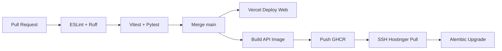

# CI/CD Pipeline

| Field | Value |
|-------|-------|
| **Document ID** | DEP-CICD-001 |
| **Product** | Founder Portfolio Platform (FounderOS v1.0) |
| **Version** | 1.0 |
| **Status** | Approved |
| **Last Updated** | 2026-06-29 |
| **Owner** | DevOps / Engineering |
| **Related** | [Docker](./Docker.md) · [Performance Testing](../12_Testing/Performance_Testing.md) · [Unit Testing](../12_Testing/Unit_Testing.md) · [Hostinger](./Hostinger.md) |

---

## Purpose

Define continuous integration and deployment pipelines for FounderOS — GitHub Actions workflows, quality gates, artifact builds, and deployment triggers to Vercel and Hostinger VPS.

---

## Scope

| In Scope | Out of Scope |
|----------|--------------|
| PR checks, main branch deploy | Mobile app pipelines |
| Docker image build and push | Multi-region blue-green |
| Database migration gate | |

---

## Business Context

Automated CI prevents regressions from reaching the reference tenant and enterprise demos. CD must support frontend on Vercel and API on VPS without downtime migrations.

---

## Goals

1. All PRs pass lint, typecheck, unit tests before merge.
2. Main deploys frontend automatically to Vercel.
3. API image built and deployed to Hostinger on tag or main.
4. Migrations run with rollback plan.

---

## Functional Requirements

| ID | Requirement | Priority |
|----|-------------|----------|
| FR-CICD-001 | PR workflow: lint, typecheck, unit tests, integration tests | P0 |
| FR-CICD-002 | Main: deploy web to Vercel | P0 |
| FR-CICD-003 | Tag `v*`: build and push API Docker image | P0 |
| FR-CICD-004 | SSH deploy to Hostinger on API image push | P1 |
| FR-CICD-005 | Alembic migrate in deploy with backup step | P0 |
| FR-CICD-006 | Lighthouse CI on main weekly | P1 |
| FR-CICD-007 | Dependabot enabled for npm and pip | P1 |

---

## Non-functional Requirements

| ID | Requirement | Target |
|----|-------------|--------|
| NFR-CICD-001 | PR pipeline duration | &lt; 12 min |
| NFR-CICD-002 | Deploy rollback | &lt; 15 min procedure |

---

## User Stories

| ID | As a… | I want… | So that… |
|----|-------|---------|----------|
| US-CICD-001 | Developer | green CI on PR | I merge confidently |
| US-CICD-002 | DevOps | automated VPS deploy | releases are low-touch |
| US-CICD-003 | QA | test gates | broken builds don't ship |

---

## UX Requirements

N/A — pipeline document. Failed deploys impact user-facing uptime; status communicated via [Monitoring](./Monitoring.md).

---

## Technical Considerations

| Workflow | Trigger | Actions |
|----------|---------|---------|
| `ci.yml` | PR, push main | lint, test, build |
| `deploy-web.yml` | push main | Vercel production |
| `deploy-api.yml` | tag v* | docker build, ssh deploy |
| `lighthouse.yml` | cron weekly | perf budgets |

- Secrets: `VERCEL_TOKEN`, `HOSTINGER_SSH_KEY`, `GHCR_TOKEN`.
- Branch protection: require CI pass, 1 review.

---

## Security Considerations

- OIDC to cloud preferred over long-lived tokens where possible.
- SSH keys scoped to deploy user only.
- No production secrets in workflow logs.
- Trivy scan on Docker image before deploy.

---

## Acceptance Criteria

- [ ] Workflow list and triggers documented
- [ ] Quality gates enumerated
- [ ] Vercel + Hostinger deploy paths described
- [ ] Migration gate with backup noted
- [ ] Cross-links to Docker and Performance Testing

---

## Future Enhancements

- Preview environments per PR
- Canary deploy for API
- Automated rollback on health check fail

---

## Open Questions

| # | Question | Owner |
|---|----------|-------|
| OQ-1 | Deploy API on every main push or tags only? | DevOps |
| OQ-2 | Monorepo vs split repo CI? | Engineering |
| OQ-3 | Required code coverage threshold? | QA |
