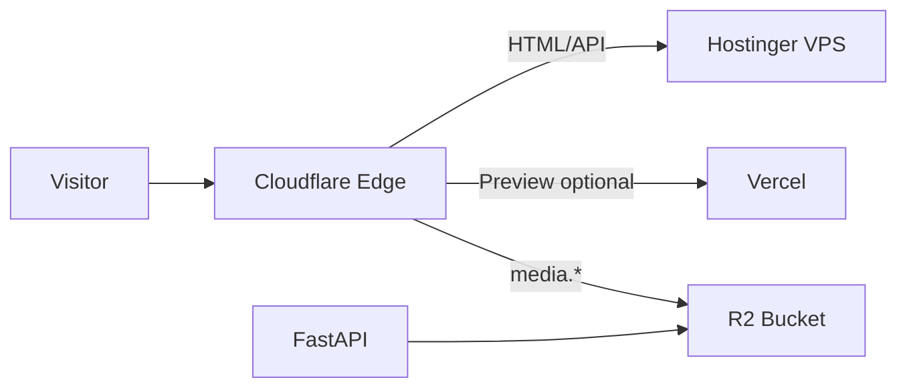

# Cloudflare Configuration

| Field | Value |
|-------|-------|
| **Document ID** | DEP-CF-001 |
| **Product** | Founder Portfolio Platform (FounderOS v1.0) |
| **Version** | 1.0 |
| **Status** | Approved |
| **Last Updated** | 2026-06-29 |
| **Owner** | DevOps / Engineering |
| **Related** | [Hostinger](./Hostinger.md) · [Docker](./Docker.md) · [CSP](../11_Security/CSP.md) · [Caching Strategy](../04_Architecture/Caching_Strategy.md) |

---

## Purpose

Document Cloudflare integration for FounderOS — DNS, CDN, SSL, WAF, R2 media storage, and cache rules for global performance and security at the edge.

---

## Scope

| In Scope | Out of Scope |
|----------|--------------|
| Cloudflare DNS and proxy setup | Cloudflare Workers custom logic (v1.1) |
| SSL/TLS mode and HSTS | Enterprise Cloudflare contract details |
| R2 bucket for media | |

---

## Business Context

Cloudflare sits in front of Hostinger VPS and Vercel origins — reducing latency, absorbing traffic spikes, and providing DDoS protection for enterprise-facing sites.

---

## Goals

1. Full SSL with automatic certificate renewal.
2. Static assets cached at edge with correct TTLs.
3. WAF managed rules enabled.
4. Media served from R2 with custom domain.

---

## Functional Requirements

| ID | Requirement | Priority |
|----|-------------|----------|
| FR-CF-001 | DNS orange-cloud proxy for apex and www | P0 |
| FR-CF-002 | SSL mode Full (strict) with origin cert | P0 |
| FR-CF-003 | Cache rules for `/_next/static/*` long TTL | P0 |
| FR-CF-004 | Bypass cache for `/admin/*` and API | P0 |
| FR-CF-005 | R2 bucket for media with public custom domain | P1 |
| FR-CF-006 | Turnstile on contact form (optional) | P2 |

---

## Non-functional Requirements

| ID | Requirement | Target |
|----|-------------|--------|
| NFR-CF-001 | Cache hit ratio static assets | &gt; 90% |
| NFR-CF-002 | TTFB improvement vs origin | &gt; 30% |

---

## User Stories

| ID | As a… | I want… | So that… |
|----|-------|---------|----------|
| US-CF-001 | DevOps | DNS checklist | domain points correctly |
| US-CF-002 | Global visitor | CDN-cached assets | site loads fast |
| US-CF-003 | Security | WAF enabled | attacks mitigated |

---

## UX Requirements

- Cache misconfiguration must not serve stale admin content.
- Contact form Turnstile accessible and labeled.

---

## Technical Considerations

| Rule | Pattern | Cache |
|------|---------|-------|
| Static | `/_next/static/*` | 1 year |
| Images | `/media/*` or R2 domain | 1 month |
| API | `/api/*` | Bypass |
| Admin | `/admin/*` | Bypass |

- Page Rules or Cache Rules per Cloudflare dashboard.
- Origin headers: `Cache-Control` from Next.js ISR.
- See [Headers](../11_Security/Headers.md) for HSTS alignment.

---

## Security Considerations

- Authenticated origin pulls only; valid origin cert.
- WAF OWASP core ruleset enabled.
- Rate limiting at edge for `/api/v1/contact`.
- R2 bucket not publicly listable.

---

## Acceptance Criteria

- [ ] DNS and SSL setup documented
- [ ] Cache rule table defined
- [ ] R2 media path described
- [ ] Admin/API bypass cache stated
- [ ] Cross-links to CSP and Caching Strategy

---

## Future Enhancements

- Workers for geo routing
- Cloudflare Images transformation
- Logpush to observability stack

---

## Open Questions

| # | Question | Owner |
|---|----------|-------|
| OQ-1 | Web on Vercel + API on VPS split DNS? | DevOps |
| OQ-2 | Turnstile vs hCaptcha? | Security |
| OQ-3 | Argo Smart Routing worth cost? | Finance |
