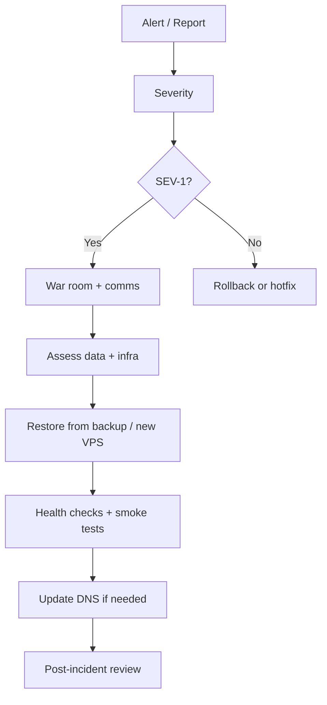

# Disaster Recovery

| Field | Value |
|-------|-------|
| **Document ID** | DEP-DR-001 |
| **Product** | Founder Portfolio Platform (FounderOS v1.0) |
| **Version** | 1.0 |
| **Status** | Approved |
| **Last Updated** | 2026-06-29 |
| **Owner** | DevOps / Leadership |
| **Related** | [Backup](./Backup.md) · [Hostinger](./Hostinger.md) · [Docker](./Docker.md) · [Monitoring](./Monitoring.md) |

---

## Purpose

Define disaster recovery (DR) procedures for FounderOS — incident classification, recovery runbooks, RTO/RPO commitments, and communication plans when production is compromised or lost.

---

## Scope

| In Scope | Out of Scope |
|----------|--------------|
| VPS failure, DB corruption, region outage | Cyber insurance claims process |
| Restore runbooks from backup | Full active-active multi-region |
| Communication templates | |

---

## Business Context

Founders and enterprise clients depend on site availability for sales and credibility. A documented DR plan reduces panic downtime and supports enterprise due diligence.

---

## Goals

| # | Goal | Target |
|---|------|--------|
| G1 | RTO (time to restore service) | ≤ 4 hours |
| G2 | RPO | ≤ 24 hours (see Backup) |
| G3 | Quarterly DR drill | logged results |
| G4 | Incident comms within 1 hour of confirmed outage |

---

## Functional Requirements

| ID | Requirement | Priority |
|----|-------------|----------|
| FR-DR-001 | DR runbook SHALL cover VPS rebuild from scratch | P0 |
| FR-DR-002 | DB restore procedure from latest backup | P0 |
| FR-DR-003 | DNS failover steps to new IP documented | P0 |
| FR-DR-004 | Maintenance mode page deployable | P1 |
| FR-DR-005 | Post-incident review template | P1 |
| FR-DR-006 | Contact list for escalation | P0 |

---

## Non-functional Requirements

| ID | Requirement | Target |
|----|-------------|--------|
| NFR-DR-001 | Runbook accessible offline | PDF in vault |
| NFR-DR-002 | Drill documentation | quarterly |

---

## User Stories

| ID | As a… | I want… | So that… |
|----|-------|---------|----------|
| US-DR-001 | On-call | step-by-step restore | I recover under stress |
| US-DR-002 | Enterprise client | RTO/RPO in writing | I trust vendor |
| US-DR-003 | Founder | status comms template | stakeholders stay informed |

---

## UX Requirements

- Maintenance page: branded, ETA if known, link to status page.
- 404 vs maintenance: use 503 with `Retry-After` during recovery.

---

## Technical Considerations

### Incident Severity

| Level | Example | Response |
|-------|---------|----------|
| SEV-1 | Site down, data loss risk | All hands, DR runbook |
| SEV-2 | API degraded, admin broken | Fix forward or rollback |
| SEV-3 | Non-critical feature broken | Next business day |

### Recovery Flow

### VPS Rebuild Summary

1. Provision new VPS (Hostinger)
2. Install Docker, pull images
3. Restore latest `pg_dump` to new Postgres volume
4. Restore env secrets from vault
5. `docker compose up -d`
6. Update Cloudflare DNS A record
7. Verify `/health`, smoke test admin login

---

## Security Considerations

- DR credentials stored separately from production `.env`.
- Compromise scenario: rotate all secrets after restore.
- Backup integrity verify checksum before restore.

---

## Acceptance Criteria

- [ ] RTO/RPO stated and aligned with Backup doc
- [ ] SEV classification table documented
- [ ] VPS rebuild + DB restore steps listed
- [ ] DNS failover procedure documented
- [ ] Maintenance mode behavior specified
- [ ] Quarterly drill requirement noted

---

## Future Enhancements

- Warm standby VPS
- Automated failover orchestration
- Multi-region active-passive

---

## Open Questions

| # | Question | Owner |
|---|----------|-------|
| OQ-1 | Contractual RTO for enterprise tier? | Legal |
| OQ-2 | Vercel frontend fallback if VPS down? | Architecture |
| OQ-3 | Insurance for extended outage? | Finance |
