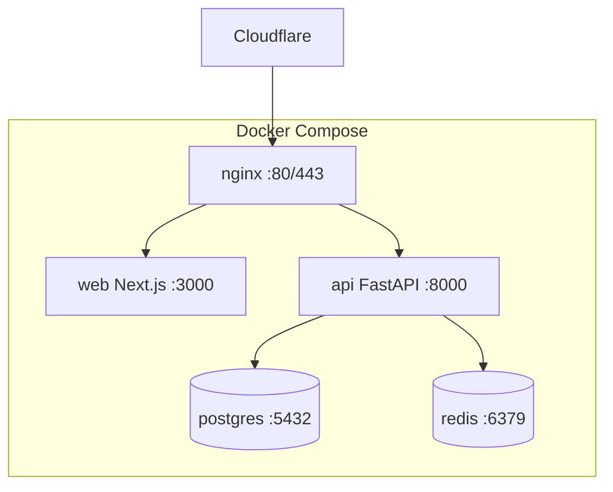

# Docker Deployment

| Field | Value |
|-------|-------|
| **Document ID** | DEP-DOCKER-001 |
| **Product** | Founder Portfolio Platform (FounderOS v1.0) |
| **Version** | 1.0 |
| **Status** | Approved |
| **Last Updated** | 2026-06-29 |
| **Owner** | DevOps / Engineering |
| **Related** | [Environment](./Environment.md) · [CI/CD](./CI_CD.md) · [Hostinger](./Hostinger.md) · [Deployment Architecture](../04_Architecture/Deployment_Architecture.md) |

---

## Purpose

Document Docker-based deployment for FounderOS — container images, docker-compose topology, build args, volumes, and operational commands for local and VPS production.

---

## Scope

| In Scope | Out of Scope |
|----------|--------------|
| Multi-service compose stack | Kubernetes manifests (future) |
| Dockerfile best practices | Windows container support |
| Local dev and production compose profiles | |

---

## Business Context

Docker provides reproducible deploys across developer laptops, CI, and Hostinger VPS. Solo founders and agencies need `docker compose up` simplicity with production-hardened overrides.

---

## Goals

1. One-command local stack (frontend, API, Postgres, Redis).
2. Production compose with healthchecks and restart policies.
3. Images &lt; 500MB each where practical.
4. Secrets via env files, not baked into images.

---

## Functional Requirements

| ID | Requirement | Priority |
|----|-------------|----------|
| FR-DOCK-001 | Services: `web`, `api`, `postgres`, `redis`, optional `nginx` | P0 |
| FR-DOCK-002 | `docker-compose.yml` for dev; `docker-compose.prod.yml` override | P0 |
| FR-DOCK-003 | Healthchecks on all services | P0 |
| FR-DOCK-004 | Named volumes for Postgres data persistence | P0 |
| FR-DOCK-005 | Multi-stage builds for web and api images | P0 |
| FR-DOCK-006 | Non-root user in production containers | P0 |

---

## Non-functional Requirements

| ID | Requirement | Target |
|----|-------------|--------|
| NFR-DOCK-001 | Cold start (dev stack) | &lt; 120s |
| NFR-DOCK-002 | Image rebuild cache | layer-optimized |

---

## User Stories

| ID | As a… | I want… | So that… |
|----|-------|---------|----------|
| US-DOCK-001 | Developer | compose up locally | I match production |
| US-DOCK-002 | DevOps | prod compose file | VPS deploy is repeatable |
| US-DOCK-003 | Agency | documented volumes | data survives restarts |

---

## UX Requirements

N/A — operator-facing. Impacts deployment reliability and thus uptime for end users.

---

## Technical Considerations

### Service Topology



| Service | Image Base | Container port | Host port (local) |
|---------|------------|----------------|-------------------|
| `web` | node:20-alpine | 3000 | **13000** |
| `api` | python:3.12-slim | 8000 | **18000** |
| `postgres` | postgres:16-alpine | 5432 | **15432** |
| `redis` | redis:7-alpine | 6379 | **16379** |

See [PORTS.md](../../../PORTS.md) at repository root.

### Commands

```bash
docker compose up -d
docker compose -f docker-compose.yml -f docker-compose.prod.yml up -d
docker compose exec api alembic upgrade head
```

- `.env` from `.env.example`; never commit secrets.
- See root `docker-compose.yml` in repository.

---

## Security Considerations

- Scan images with Trivy in CI.
- Internal network for DB/Redis — not exposed publicly.
- Read-only filesystem where possible for web container.

---

## Acceptance Criteria

- [ ] Service list and topology documented
- [ ] Dev vs prod compose strategy defined
- [ ] Healthcheck and volume requirements stated
- [ ] Multi-stage build requirement noted
- [ ] Cross-links to Environment and Hostinger

---

## Future Enhancements

- Docker Swarm or k8s migration path
- Watchtower auto-updates (opt-in)
- ARM64 build matrix

---

## Open Questions

| # | Question | Owner |
|---|----------|-------|
| OQ-1 | Nginx in compose or Hostinger host nginx? | DevOps |
| OQ-2 | Separate compose for worker/celery? | Backend |
| OQ-3 | Pin image digests in prod? | Security |
