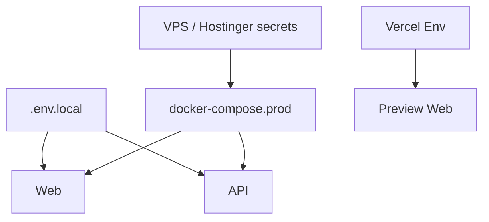

# Environment Configuration

| Field | Value |
|-------|-------|
| **Document ID** | DEP-ENV-001 |
| **Product** | Founder Portfolio Platform (FounderOS v1.0) |
| **Version** | 1.0 |
| **Status** | Approved |
| **Last Updated** | 2026-06-29 |
| **Owner** | DevOps / Engineering |
| **Related** | [Docker](./Docker.md) · [Secrets](../11_Security/Secrets.md) · [CI/CD](./CI_CD.md) · [Settings API](../08_API/Settings_API.md) |

---

## Purpose

Catalog environment variables and configuration layers for FounderOS across development, staging, and production — what each variable does, required vs optional, and security classification.

---

## Scope

| In Scope | Out of Scope |
|----------|--------------|
| `.env` variable reference | Tenant CMS settings (see Admin Settings) |
| Environment promotion rules | Cloud provider account setup |
| Secret management patterns | |

---

## Business Context

Misconfigured `DATABASE_URL` or `JWT_SECRET` causes outages or security incidents. Documented env contract enables safe onboarding and CI secret injection.

---

## Goals

1. `.env.example` complete and synced with this doc.
2. No secrets in git.
3. Clear dev/staging/prod differences.
4. Validation on API startup for required vars.

---

## Functional Requirements

| ID | Requirement | Priority |
|----|-------------|----------|
| FR-ENV-001 | `.env.example` SHALL list all variables with comments | P0 |
| FR-ENV-002 | API SHALL fail fast if required vars missing | P0 |
| FR-ENV-003 | `NODE_ENV` / `APP_ENV` distinguish environments | P0 |
| FR-ENV-004 | Secrets SHALL NOT be logged on startup | P0 |
| FR-ENV-005 | Vercel env for preview deployments documented | P1 |

---

## Non-functional Requirements

| ID | Requirement | Target |
|----|-------------|--------|
| NFR-ENV-001 | Env doc sync with example file | on every env change PR |

---

## User Stories

| ID | As a… | I want… | So that… |
|----|-------|---------|----------|
| US-ENV-001 | New dev | env example | I start in 10 minutes |
| US-ENV-002 | DevOps | prod var list | I configure VPS correctly |
| US-ENV-003 | Security | secret classification | nothing leaks to client |

---

## UX Requirements

N/A — configuration document. Wrong `NEXT_PUBLIC_*` vars may break public site theming and analytics consent.

---

## Technical Considerations

### Variable Reference

| Variable | Service | Required | Secret | Description |
|----------|---------|----------|--------|-------------|
| `DATABASE_URL` | API | Yes | Yes | PostgreSQL connection |
| `REDIS_URL` | API | Yes | Yes | Redis connection |
| `JWT_SECRET` | API | Yes | Yes | Token signing |
| `CORS_ORIGINS` | API | Yes | No | Allowed frontend origins |
| `NEXT_PUBLIC_API_URL` | Web | Yes | No | Public API base URL |
| `NEXT_PUBLIC_SITE_URL` | Web | Yes | No | Canonical site URL |
| `SMTP_*` | API | No | Yes | Email for contact notifications |
| `GITHUB_TOKEN` | API | No | Yes | GitHub integration |
| `S3_*` / `R2_*` | API | No | Yes | Media object storage |

- Server-only vars never prefixed `NEXT_PUBLIC_`.
- See [Secrets](../11_Security/Secrets.md) for rotation policy.

---

## Security Considerations

- Use Docker secrets or host env files with `chmod 600`.
- Rotate `JWT_SECRET` invalidates sessions — plan maintenance window.
- Separate DB credentials per environment.

---

## Acceptance Criteria

- [ ] Variable table with required/secret flags
- [ ] Fail-fast startup behavior documented
- [ ] NEXT_PUBLIC vs server-only rules stated
- [ ] Cross-links to Secrets and Docker
- [ ] `.env.example` parity verified

---

## Future Enhancements

- Doppler or Vault integration
- Env validation JSON schema in CI
- Per-tenant env isolation (multi-tenant)

---

## Open Questions

| # | Question | Owner |
|---|----------|-------|
| OQ-1 | Single `.env` or split web/api files? | DevOps |
| OQ-2 | Staging environment URL strategy? | Engineering |
| OQ-3 | Feature flags via env or DB? | Product |
