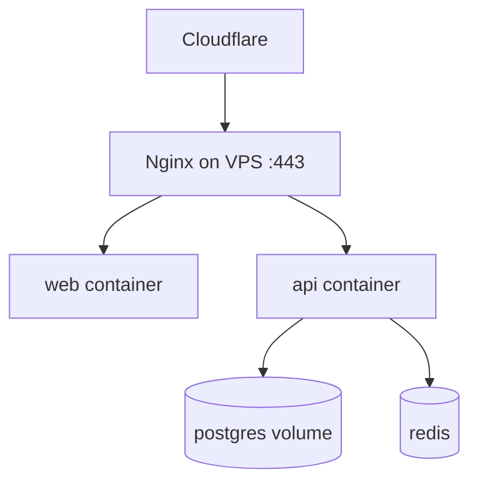

# Hostinger VPS Deployment

| Field | Value |
|-------|-------|
| **Document ID** | DEP-HOST-001 |
| **Product** | Founder Portfolio Platform (FounderOS v1.0) |
| **Version** | 1.0 |
| **Status** | Approved |
| **Last Updated** | 2026-06-29 |
| **Owner** | DevOps / Engineering |
| **Related** | [Docker](./Docker.md) · [Cloudflare](./Cloudflare.md) · [CI/CD](./CI_CD.md) · [Backup](./Backup.md) |

---

## Purpose

Document production deployment of FounderOS API and optional full stack on Hostinger VPS — server provisioning, Docker runtime, firewall, SSL termination, and operational runbooks.

---

## Scope

| In Scope | Out of Scope |
|----------|--------------|
| VPS sizing and OS setup | Managed Kubernetes |
| Docker Compose production deploy | Shared hosting PHP panels |
| SSH hardening and updates | |

---

## Business Context

Hostinger VPS provides cost-effective production hosting for FastAPI, PostgreSQL, and Redis while Vercel may host Next.js frontend. Agencies expect predictable monthly cost and full control.

---

## Goals

1. Reproducible VPS bootstrap from documented steps.
2. Uptime ≥ 99.5% with monitoring alerts.
3. Secure SSH and firewall defaults.
4. Zero-downtime deploy procedure documented.

---

## Functional Requirements

| ID | Requirement | Priority |
|----|-------------|----------|
| FR-HOST-001 | Minimum VPS: 2 vCPU, 4GB RAM, 80GB SSD | P0 |
| FR-HOST-002 | Ubuntu 22.04 LTS with Docker Engine | P0 |
| FR-HOST-003 | UFW: allow 22, 80, 443 only | P0 |
| FR-HOST-004 | Deploy user non-root with docker group | P0 |
| FR-HOST-005 | docker compose prod with healthchecks | P0 |
| FR-HOST-006 | Automated deploy via CI SSH | P1 |
| FR-HOST-007 | Certbot or Cloudflare origin cert for TLS | P0 |

---

## Non-functional Requirements

| ID | Requirement | Target |
|----|-------------|--------|
| NFR-HOST-001 | Deploy downtime | &lt; 30s API restart |
| NFR-HOST-002 | Disk usage alert | &gt; 80% |

---

## User Stories

| ID | As a… | I want… | So that… |
|----|-------|---------|----------|
| US-HOST-001 | DevOps | bootstrap checklist | new VPS in 1 hour |
| US-HOST-002 | Founder | affordable hosting | costs stay predictable |
| US-HOST-003 | CI pipeline | SSH deploy | releases are automated |

---

## UX Requirements

N/A — infrastructure. VPS outages directly impact site availability.

---

## Technical Considerations

### Bootstrap Checklist

- [ ] Provision KVM VPS (Hostinger panel)
- [ ] SSH key-only auth; disable password login
- [ ] Install Docker + compose plugin
- [ ] Clone repo or pull GHCR images
- [ ] Copy `.env` with production secrets
- [ ] `docker compose -f docker-compose.prod.yml up -d`
- [ ] Run migrations: `docker compose exec api alembic upgrade head`
- [ ] Point Cloudflare DNS to VPS IP

- Optional: frontend on same VPS or Vercel origin only for API.
- Log rotation: docker json-file max-size 10m.
- See [Backup](./Backup.md) for pg_dump schedule.

---

## Security Considerations

- fail2ban on SSH.
- Unattended security upgrades enabled.
- Postgres not exposed to public internet.
- Regular `apt upgrade` maintenance window monthly.

---

## Acceptance Criteria

- [ ] Minimum VPS specs documented
- [ ] Bootstrap checklist complete
- [ ] Firewall and SSH hardening stated
- [ ] Compose prod deploy path described
- [ ] Cross-links to Docker, Cloudflare, Backup

---

## Future Enhancements

- Ansible/Terraform VPS provisioning
- Secondary VPS failover
- Automated OS patching window

---

## Open Questions

| # | Question | Owner |
|---|----------|-------|
| OQ-1 | Run Next.js on VPS or Vercel-only? | Architecture |
| OQ-2 | Nginx on host vs Traefik in compose? | DevOps |
| OQ-3 | 4GB RAM sufficient for Postgres + Redis + API? | Engineering |
