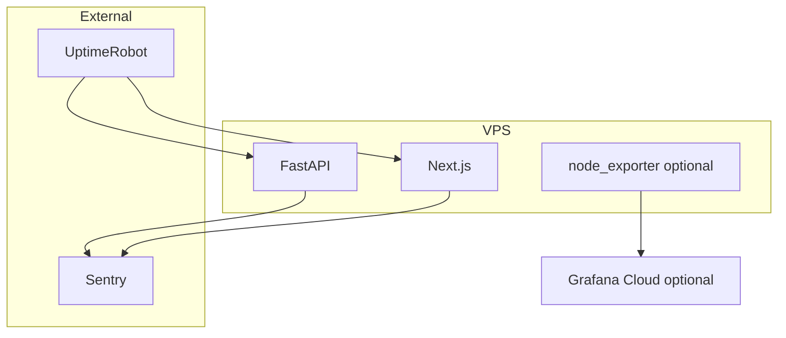

# Deployment Monitoring

| Field | Value |
|-------|-------|
| **Document ID** | DEP-MON-001 |
| **Product** | Founder Portfolio Platform (FounderOS v1.0) |
| **Version** | 1.0 |
| **Status** | Approved |
| **Last Updated** | 2026-06-29 |
| **Owner** | DevOps / SRE |
| **Related** | [Admin Monitoring](../07_Admin/Monitoring.md) · [Observability](../04_Architecture/Observability.md) · [Hostinger](./Hostinger.md) · [Docker](./Docker.md) |

---

## Purpose

Define infrastructure and application monitoring for deployed FounderOS instances — external uptime checks, metrics collection, log aggregation, and alerting outside the admin UI.

---

## Scope

| In Scope | Out of Scope |
|----------|--------------|
| UptimeRobot / Better Stack checks | Full APM vendor selection contract |
| VPS resource monitoring | On-call rotation policy |
| Error tracking (Sentry) | |

---

## Business Context

Admin monitoring covers in-app health; deployment monitoring watches production 24/7 even when admins are asleep. Enterprise SLAs reference external uptime evidence.

---

## Goals

1. Alert within 5 minutes of production outage.
2. 90-day uptime history exportable.
3. Error rate and latency trends visible.
4. Correlate deploy events with metric spikes.

---

## Functional Requirements

| ID | Requirement | Priority |
|----|-------------|----------|
| FR-DMON-001 | External HTTP check every 1 min on `/` and `/api/health` | P0 |
| FR-DMON-002 | Sentry for frontend and API exceptions | P0 |
| FR-DMON-003 | VPS disk/CPU/RAM alerts at 80% threshold | P1 |
| FR-DMON-004 | Slack or email notification channel | P0 |
| FR-DMON-005 | Status page optional subdomain | P2 |
| FR-DMON-006 | Log shipping to centralized store | P2 |

---

## Non-functional Requirements

| ID | Requirement | Target |
|----|-------------|--------|
| NFR-DMON-001 | Alert false positive rate | &lt; 2/month |
| NFR-DMON-002 | Metric retention | 90 days |

---

## User Stories

| ID | As a… | I want… | So that… |
|----|-------|---------|----------|
| US-DMON-001 | On-call engineer | outage alert | I respond quickly |
| US-DMON-002 | Founder | uptime report | I share with investors |
| US-DMON-003 | Dev | Sentry stack traces | I fix production bugs |

---

## UX Requirements

- Public status page (if enabled) uses brand styling; no internal hostnames exposed.
- Admin Monitoring complements but does not replace external checks.

---

## Technical Considerations

| Signal | Tool | Alert |
|--------|------|-------|
| Uptime | UptimeRobot | Email + Slack |
| Exceptions | Sentry | Issue alerts |
| Resources | Hostinger panel / node_exporter | Disk 80% |
| Logs | Docker logs + Loki optional | Error spike |

- Tag Sentry releases with git SHA from [CI/CD](./CI_CD.md).
- See [Observability](../04_Architecture/Observability.md) for OpenTelemetry future.

---

## Security Considerations

- Monitoring endpoints must not expose secrets in health JSON publicly.
- Sentry scrubs PII from breadcrumbs.
- Alert channels use least-privilege webhooks.

---

## Acceptance Criteria

- [ ] External uptime check configuration documented
- [ ] Sentry integration points listed
- [ ] VPS resource alert thresholds defined
- [ ] Notification channels specified
- [ ] Cross-link to Admin Monitoring

---

## Future Enhancements

- OpenTelemetry traces to Grafana Tempo
- SLO/error budget dashboards
- Synthetic transaction monitoring (login flow)

---

## Open Questions

| # | Question | Owner |
|---|----------|-------|
| OQ-1 | Better Stack vs UptimeRobot? | DevOps |
| OQ-2 | Public status page in v1.0? | Product |
| OQ-3 | PagerDuty for enterprise tier? | Sales |
