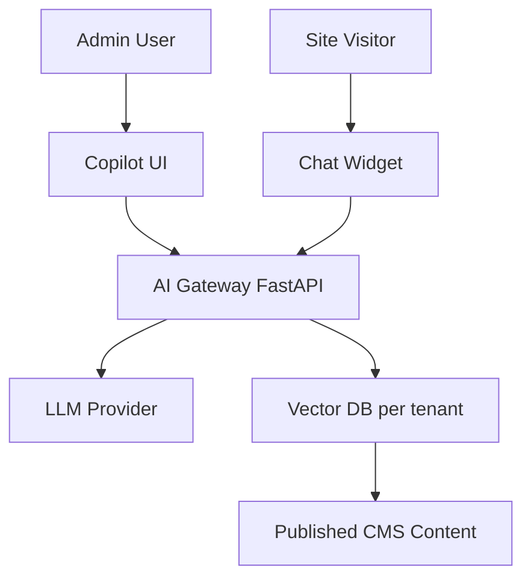

# AI Assistant

| Field | Value |
|-------|-------|
| **Document ID** | FUT-AI-001 |
| **Product** | Founder Portfolio Platform (FounderOS) |
| **Version** | Planned (v2.0) |
| **Status** | Draft |
| **Last Updated** | 2026-06-29 |
| **Owner** | Product / AI Engineering |
| **Related** | [Brand Voice](../01_Brand/Brand_Voice.md) · [CMS Module](../06_Modules/CMS.md) · [Enterprise Features](./Enterprise_Features.md) · [Multi Tenant](./Multi_Tenant.md) |

---

## Purpose

Define the FounderOS AI Assistant — capabilities, architecture, safety boundaries, and UX for helping founders and admins create content, optimize SEO, and answer visitor questions on their portfolio sites.

---

## Scope

| In Scope | Out of Scope |
|----------|--------------|
| Admin copilot (content, SEO) | Fully autonomous publishing without human approval |
| Public visitor chat widget (optional per tenant) | Custom model training on tenant data without consent |
| RAG over tenant content | |

---

## Business Context

AI differentiates FounderOS in enterprise demos. Founders spend hours writing case studies and blog posts; an on-brand assistant accelerates content velocity while respecting [Brand Voice](../01_Brand/Brand_Voice.md) and tenant data boundaries.

---

## Goals

1. Draft blog post from bullet outline in &lt; 60 seconds.
2. SEO suggestions grounded in tenant's actual pages.
3. Zero cross-tenant context leakage in RAG.
4. Human-in-the-loop for all published content.

---

## Functional Requirements

| ID | Requirement | Priority |
|----|-------------|----------|
| FR-AI-001 | Admin sidebar copilot chat panel | P0 |
| FR-AI-002 | Actions: draft blog, improve SEO meta, suggest headlines | P0 |
| FR-AI-003 | RAG index per tenant over published content only | P0 |
| FR-AI-004 | System prompt includes Brand Voice + tenant tone settings | P0 |
| FR-AI-005 | Public chat widget opt-in per tenant | P1 |
| FR-AI-006 | Rate limits per user and tenant | P0 |
| FR-AI-007 | Audit log of AI-generated drafts | P0 |

---

## Non-functional Requirements

| ID | Requirement | Target |
|----|-------------|--------|
| NFR-AI-001 | First token latency | &lt; 2s |
| NFR-AI-002 | Monthly token budget per tenant tier | configurable |

---

## User Stories

| ID | As a… | I want… | So that… |
|----|-------|---------|----------|
| US-AI-001 | Founder | AI draft from outline | I publish faster |
| US-AI-002 | Editor | review before publish | quality stays high |
| US-AI-003 | Visitor | ask about products | I get instant answers |
| US-AI-004 | Compliance | no PII in training | we stay GDPR-safe |

---

## UX Requirements

- Copilot: non-blocking panel; suggestions as diff preview before apply.
- Clear "AI-generated" label on drafts.
- Public widget: branded bubble; disclaimer; escalate to contact form.
- Streaming responses with cancel button.
- Respect `prefers-reduced-motion` on widget animations.

---

## Technical Considerations

- LLM via OpenAI / Anthropic API with abstraction layer.
- Embeddings: pgvector or dedicated vector store per tenant namespace.
- Prompt templates versioned in repo; tenant tone in `settings.ai`.
- Background job re-index on content publish.
- Cost tracking per `tenant_id` for billing.

---

## Security Considerations

- Prompt injection mitigations: sanitize retrieved chunks; tool allowlist.
- No admin credentials or secrets in context.
- Public widget: no access to unpublished or other tenants' data.
- Data processing agreement for enterprise tier.
- Opt-out of model training on tenant content (provider API flags).

---

## Acceptance Criteria

- [ ] Admin copilot features listed
- [ ] RAG per-tenant isolation documented
- [ ] Human approval gate for publish stated
- [ ] Rate limit and audit requirements defined
- [ ] Cross-links to Brand Voice and CMS

---

## Future Enhancements

- Image alt text generation
- A/B headline suggestions with analytics feedback
- Voice input for mobile admin
- Local/on-prem LLM for air-gapped enterprise

---

## Open Questions

| # | Question | Owner |
|---|----------|-------|
| OQ-1 | Default LLM provider? | Engineering |
| OQ-2 | Public chat on by default or opt-in? | Product |
| OQ-3 | Include AI in base tier or Enterprise only? | Pricing |
