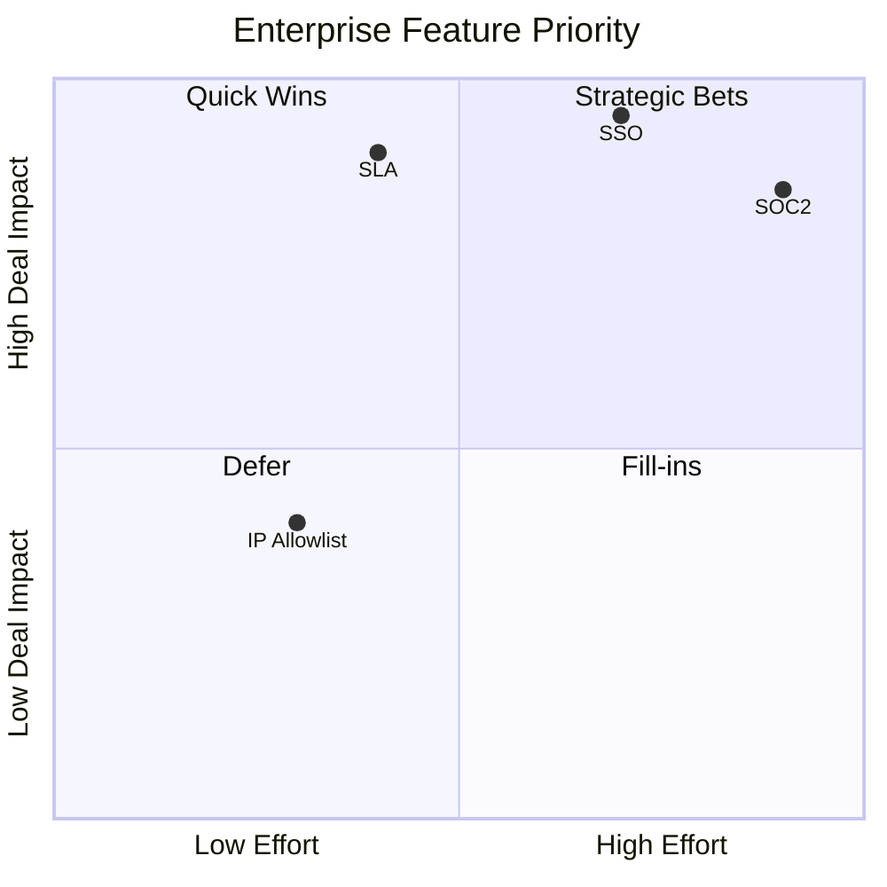

# Enterprise Features

| Field | Value |
|-------|-------|
| **Document ID** | FUT-ENT-001 |
| **Product** | Founder Portfolio Platform (FounderOS) |
| **Version** | Planned (v2.0+) |
| **Status** | Draft |
| **Last Updated** | 2026-06-29 |
| **Owner** | Product / Enterprise Sales |
| **Related** | [Enterprise Page](../05_Pages/Enterprise.md) · [White Label](./White_Label.md) · [Multi Tenant](./Multi_Tenant.md) · [Compliance](../11_Security/Compliance.md) |

---

## Purpose

Catalog enterprise-grade features planned beyond v1.0 — SSO, SLA, audit, dedicated infrastructure, and compliance certifications — that justify Enterprise tier pricing and procurement cycles.

---

## Scope

| In Scope | Out of Scope |
|----------|--------------|
| Feature backlog with priority | Signed customer SOW templates |
| Mapping to sales narrative | Certification audit timelines |
| Dependencies on platform architecture | |

---

## Business Context

v1.0 proves product-market fit with reference tenant. Enterprise deals require SSO, contractual SLA, DPA, and often SOC2 roadmap credibility. This doc aligns product build with sales commitments.

---

## Goals

1. Enterprise page claims backed by dated delivery targets.
2. No feature sold without engineering estimate on roadmap.
3. Compliance features prioritized by deal pipeline.
4. Clear bundle vs à la carte enterprise add-ons.

---

## Functional Requirements

| ID | Requirement | Priority | Target Release |
|----|-------------|----------|----------------|
| FR-ENT-001 | SAML 2.0 / OIDC SSO for admin | P0 | v2.0 |
| FR-ENT-002 | SCIM user provisioning | P1 | v2.1 |
| FR-ENT-003 | 99.9% SLA with credits | P0 | v2.0 |
| FR-ENT-004 | Dedicated VPS or DB option | P1 | v1.5 |
| FR-ENT-005 | SOC2 Type II roadmap publication | P0 | v2.0 |
| FR-ENT-006 | Custom DPA and subprocessors list | P0 | v1.5 |
| FR-ENT-007 | Advanced audit export (SIEM) | P1 | v2.0 |
| FR-ENT-008 | IP allowlist for admin | P2 | v2.1 |
| FR-ENT-009 | Priority support channel | P0 | v1.5 |
| FR-ENT-010 | [AI Assistant](./AI_Assistant.md) enterprise data boundary | P1 | v2.0 |

---

## Non-functional Requirements

| ID | Requirement | Target |
|----|-------------|--------|
| NFR-ENT-001 | SSO login latency | &lt; 3s |
| NFR-ENT-002 | Audit log retention (enterprise) | 2 years |
| NFR-ENT-003 | Dedicated instance provision | &lt; 24h |

---

## User Stories

| ID | As a… | I want… | So that… |
|----|-------|---------|----------|
| US-ENT-001 | IT admin | SSO with Okta | users use corporate identity |
| US-ENT-002 | Procurement | signed SLA | vendor risk accepted |
| US-ENT-003 | Security team | SIEM audit feed | we monitor admin actions |
| US-ENT-004 | Legal | DPA | GDPR procurement clears |

---

## UX Requirements

- SSO: "Sign in with SSO" on admin login; domain discovery input.
- Enterprise settings section separate from standard Settings.
- SLA status visible on [Admin Monitoring](../07_Admin/Monitoring.md) for enterprise tenants.
- Compliance docs linked from footer and Enterprise page.

---

## Technical Considerations

- SSO: `python-saml` or Auth0 embedded; map IdP groups to [Roles](../07_Admin/Roles.md).
- Dedicated infra: Terraform module extending [Hostinger](../13_Deployment/Hostinger.md) pattern.
- SIEM: webhook or syslog export from [Audit](../11_Security/Audit.md).
- Depends on [Multi Tenant](./Multi_Tenant.md) for per-tenant enterprise flags.

---

## Security Considerations

- SSO certificates rotated annually.
- Dedicated instances still receive security patches within 72h.
- Enterprise audit logs immutable with WORM storage option.

---

## Acceptance Criteria

- [ ] Enterprise feature table with priorities and releases
- [ ] SSO and SLA requirements documented
- [ ] Compliance artifacts list (DPA, SOC2 roadmap)
- [ ] Sales/marketing alignment with Enterprise page
- [ ] Cross-links to White Label and Compliance

---

## Future Enhancements

- HIPAA BAA for health vertical
- FedRAMP path (long-term)
- Custom contract MSAs in admin

---

## Open Questions

| # | Question | Owner |
|---|----------|-------|
| OQ-1 | Build SSO in-house vs Auth0/WorkOS? | Engineering |
| OQ-2 | SOC2 before or after first enterprise close? | Leadership |
| OQ-3 | SLA credits automatic or manual? | Finance |
