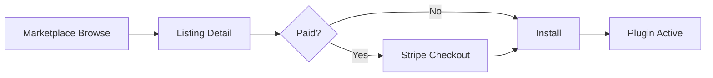

# Marketplace

| Field | Value |
|-------|-------|
| **Document ID** | FUT-MKT-001 |
| **Product** | Founder Portfolio Platform (FounderOS) |
| **Version** | Planned (v2.0) |
| **Status** | Draft |
| **Last Updated** | 2026-06-29 |
| **Owner** | Product / Platform |
| **Related** | [Plugin System](./Plugin_System.md) · [White Label](./White_Label.md) · [Enterprise Features](./Enterprise_Features.md) · [Roadmap](./Roadmap.md) |

---

## Purpose

Define the FounderOS Marketplace — discovery, purchase, and distribution of plugins, themes, and content packs for tenants and agencies.

---

## Scope

| In Scope | Out of Scope |
|----------|--------------|
| Marketplace UX and listing model | Payment processor legal entity setup |
| Review and publishing workflow | Physical goods |
| Revenue share model (conceptual) | |

---

## Business Context

Marketplace creates network effects: more plugins attract agencies, more tenants attract plugin authors. Revenue share funds platform development and incentivizes quality extensions.

---

## Goals

1. Curated launch catalog of 10+ first-party listings.
2. Sub-5-minute install from browse to active plugin.
3. Review process blocks malicious listings.
4. Theme packs apply via design token import.

---

## Functional Requirements

| ID | Requirement | Priority |
|----|-------------|----------|
| FR-MKT-001 | Marketplace route `/admin/marketplace` browse and search | P0 |
| FR-MKT-002 | Listings: plugin, theme, content pack types | P0 |
| FR-MKT-003 | Install triggers plugin enable per [Plugin System](./Plugin_System.md) | P0 |
| FR-MKT-004 | Paid listings via Stripe Connect (future) | P1 |
| FR-MKT-005 | Reviews and ratings post-install | P2 |
| FR-MKT-006 | Publisher dashboard for authors | P1 |

---

## Non-functional Requirements

| ID | Requirement | Target |
|----|-------------|--------|
| NFR-MKT-001 | Search latency | &lt; 500ms |
| NFR-MKT-002 | Listing metadata cache | CDN edge |

---

## User Stories

| ID | As a… | I want… | So that… |
|----|-------|---------|----------|
| US-MKT-001 | Agency | buy a fintech theme | I launch client faster |
| US-MKT-002 | Plugin author | publish listing | I earn revenue share |
| US-MKT-003 | Tenant admin | one-click install | I avoid manual config |
| US-MKT-004 | Platform | moderate listings | ecosystem stays trusted |

---

## UX Requirements

- Card grid with icon, title, author, price, rating.
- Detail page: screenshots, permissions, changelog, install CTA.
- Installed tab with update available badge.
- Free vs paid clearly labeled.

---

## Technical Considerations

- Listing metadata API; artifacts in R2 with signed download.
- Version compatibility matrix with core [Versioning](./Versioning.md).
- Webhook on purchase → license key → tenant entitlement table.

---

## Security Considerations

- Malware scan on uploaded plugin bundles.
- Manual review for first publish per author.
- Permission disclosure mandatory before install.
- Refund/chargeback policy documented.

---

## Acceptance Criteria

- [ ] Listing types and metadata schema defined
- [ ] Install flow documented
- [ ] Review workflow outlined
- [ ] Revenue share concept noted
- [ ] Cross-links to Plugin System and Roadmap

---

## Future Enhancements

- Public marketplace marketing site
- Affiliate program for agencies
- Enterprise private marketplace (curated only)

---

## Open Questions

| # | Question | Owner |
|---|----------|-------|
| OQ-1 | Revenue split 70/30 or tiered? | Finance |
| OQ-2 | Themes as npm packages or zip? | Engineering |
| OQ-3 | Marketplace before multi-tenant GA? | Product |
