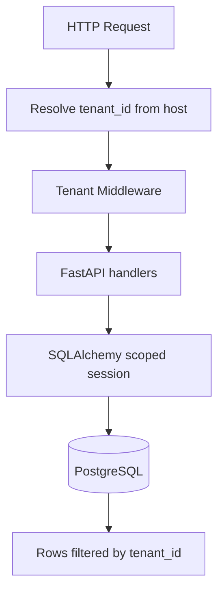

# Multi-Tenant Architecture

| Field | Value |
|-------|-------|
| **Document ID** | FUT-MT-001 |
| **Product** | Founder Portfolio Platform (FounderOS) |
| **Version** | Planned (v1.5) |
| **Status** | Draft |
| **Last Updated** | 2026-06-29 |
| **Owner** | Platform Architecture |
| **Related** | [White Label](./White_Label.md) · [Database Architecture](../04_Architecture/Database_Architecture.md) · [Relationships](../09_Database/Relationships.md) · [Scalability](../04_Architecture/Scalability.md) |

---

## Purpose

Specify multi-tenancy design for FounderOS — tenant isolation model, identification, data partitioning, and migration path from single-tenant v1.0 reference deployment.

---

## Scope

| In Scope | Out of Scope |
|----------|--------------|
| Shared DB with `tenant_id` row-level isolation | Per-tenant dedicated DB (enterprise option noted) |
| Tenant resolution (domain, header, path) | Cross-tenant analytics warehouse |
| Migration strategy from v1.0 | |

---

## Business Context

Agencies manage dozens of founder clients. Running separate VPS per client does not scale. Multi-tenant architecture is prerequisite for marketplace, centralized billing, and platform margins.

---

## Goals

1. Zero cross-tenant data leakage (verified by tests).
2. Tenant provisioned in &lt; 5 minutes automated.
3. v1.0 single-tenant deployable as `tenant_id = default`.
4. Path to dedicated DB for enterprise isolation.

---

## Functional Requirements

| ID | Requirement | Priority |
|----|-------------|----------|
| FR-MT-001 | All tenant-scoped tables SHALL include `tenant_id` UUID NOT NULL | P0 |
| FR-MT-002 | API SHALL resolve tenant from hostname or `X-Tenant-ID` | P0 |
| FR-MT-003 | SQLAlchemy session filter auto-applies `tenant_id` | P0 |
| FR-MT-004 | Super-admin role for platform operator cross-tenant | P1 |
| FR-MT-005 | Tenant provisioning API creates schema seed | P0 |
| FR-MT-006 | Integration tests for isolation per tenant | P0 |

---

## Non-functional Requirements

| ID | Requirement | Target |
|----|-------------|--------|
| NFR-MT-001 | Tenant lookup cache | Redis 5 min TTL |
| NFR-MT-002 | Support tenants per instance | 500+ (target) |

---

## User Stories

| ID | As a… | I want… | So that… |
|----|-------|---------|----------|
| US-MT-001 | Agency | many clients one deploy | ops cost stays low |
| US-MT-002 | Tenant A | no see Tenant B data | privacy guaranteed |
| US-MT-003 | Platform ops | provision tenant API | onboarding is automated |
| US-MT-004 | Enterprise | dedicated DB option | I meet compliance |

---

## UX Requirements

- Tenant switcher only for super-admin, not regular tenant users.
- Custom domain maps 1:1 to tenant (see [White Label](./White_Label.md)).
- Onboarding wizard for new tenant: name, domain, brand, seed content.

---

## Technical Considerations

### Isolation Model

| Approach | v1.0 | v1.5 | Enterprise option |
|----------|------|------|-------------------|
| Isolation | Single tenant | Shared DB + RLS | Dedicated DB |
| `tenant_id` | default UUID | per tenant | per tenant |

- PostgreSQL Row Level Security (RLS) as defense in depth.
- Migration: backfill `tenant_id = '00000000-0000-0000-0000-000000000001'` on v1.0 upgrade.
- Indexes on `tenant_id` composite keys — see [Indexes](../09_Database/Indexes.md).

---

## Security Considerations

- Tenant ID never guessable from sequential integers — UUID only.
- Audit log includes `tenant_id` on every action.
- Penetration test scope: cross-tenant IDOR attempts.
- Cache keys prefixed `tenant:{id}:`.

---

## Acceptance Criteria

- [ ] Isolation model documented (shared DB + RLS)
- [ ] Tenant resolution strategy defined
- [ ] Migration from v1.0 path described
- [ ] ORM scoping requirement stated
- [ ] Enterprise dedicated DB option noted
- [ ] Cross-links to White Label and Database docs

---

## Future Enhancements

- Shard tenants by geography
- Tenant-specific feature flags
- Usage metering per tenant

---

## Open Questions

| # | Question | Owner |
|---|----------|-------|
| OQ-1 | RLS mandatory or app-layer only initially? | Security |
| OQ-2 | Subdomain vs custom domain only? | Product |
| OQ-3 | Tenant data export for portability? | Legal |
