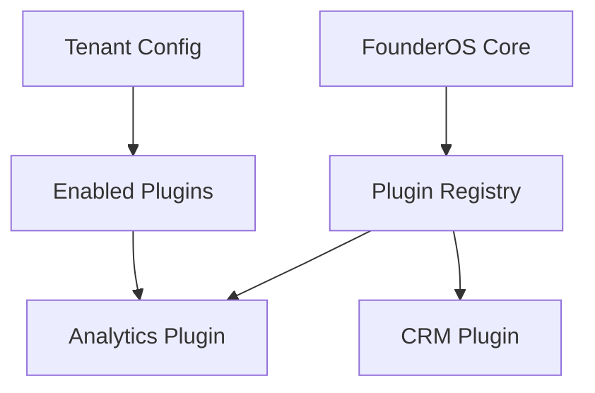

# Plugin System

| Field | Value |
|-------|-------|
| **Document ID** | FUT-PLG-001 |
| **Product** | Founder Portfolio Platform (FounderOS) |
| **Version** | Planned (v1.5) |
| **Status** | Draft |
| **Last Updated** | 2026-06-29 |
| **Owner** | Platform Engineering |
| **Related** | [Marketplace](./Marketplace.md) · [Versioning](./Versioning.md) · [Multi Tenant](./Multi_Tenant.md) · [API Architecture](../04_Architecture/API_Architecture.md) |

---

## Purpose

Specify the FounderOS plugin architecture — extension points, manifest format, lifecycle hooks, sandboxing, and developer experience for third-party and first-party modules.

---

## Scope

| In Scope | Out of Scope |
|----------|--------------|
| Plugin manifest schema | Arbitrary server-side code execution without review |
| Hook points (content, nav, analytics) | Browser extension plugins |
| Enable/disable per tenant | |

---

## Business Context

Plugins differentiate FounderOS from static site builders. Agencies need custom integrations (CRM, analytics, chat) without forking core. Marketplace revenue shares depend on a stable plugin API.

---

## Goals

1. First-party plugins ship as reference implementations.
2. Third-party plugins cannot access other tenants' data.
3. Plugin install/uninstall without downtime.
4. Semantic versioning on plugin API.

---

## Functional Requirements

| ID | Requirement | Priority |
|----|-------------|----------|
| FR-PLG-001 | Plugin manifest `founderos-plugin.json` with id, version, hooks | P0 |
| FR-PLG-002 | Hooks: `onContentPublish`, `navItems`, `settingsPanel`, `analytics` | P0 |
| FR-PLG-003 | Plugins enabled per tenant in admin | P0 |
| FR-PLG-004 | Server plugins run in isolated subprocess or WASM sandbox | P1 |
| FR-PLG-005 | Client plugins loaded dynamic import with integrity hash | P0 |
| FR-PLG-006 | Plugin API version in [Versioning](./Versioning.md) | P0 |

---

## Non-functional Requirements

| ID | Requirement | Target |
|----|-------------|--------|
| NFR-PLG-001 | Plugin load impact on TTFB | &lt; 50ms |
| NFR-PLG-002 | Max active plugins per tenant | 20 |

---

## User Stories

| ID | As a… | I want… | So that… |
|----|-------|---------|----------|
| US-PLG-001 | Agency dev | register a CRM hook | leads sync automatically |
| US-PLG-002 | Tenant admin | toggle plugins | I control integrations |
| US-PLG-003 | Platform | review plugins | marketplace stays safe |

---

## UX Requirements

- Plugin settings appear as tabs in [Admin Settings](../07_Admin/Settings.md).
- Install flow: browse marketplace → preview permissions → confirm.
- Clear error when plugin incompatible with core version.

---

## Technical Considerations

- Hook bus: internal event emitter + typed contracts (TypeScript + Pydantic).
- Server plugins: FastAPI router prefix `/plugins/{id}/` behind auth.
- Manifest signing for marketplace-listed plugins.
- Depends on [Multi Tenant](./Multi_Tenant.md) for isolation.

---

## Security Considerations

- Permission manifest: `read:content`, `write:settings`, `network:outbound`.
- Code review for marketplace plugins; self-hosted plugins at tenant risk.
- CSP updated for allowed plugin script origins.
- Rate limits on plugin outbound HTTP.

---

## Acceptance Criteria

- [ ] Manifest schema documented
- [ ] Hook catalog v1 defined
- [ ] Sandboxing approach chosen
- [ ] Admin enable/disable UX specified
- [ ] Cross-links to Marketplace and Versioning

---

## Future Enhancements

- Plugin CLI (`founderos plugin init`)
- Hot reload in dev
- Revenue share billing hooks

---

## Open Questions

| # | Question | Owner |
|---|----------|-------|
| OQ-1 | WASM vs subprocess for server plugins? | Security |
| OQ-2 | Allow plugins to add DB tables? | Architecture |
| OQ-3 | Open plugins before marketplace? | Product |
