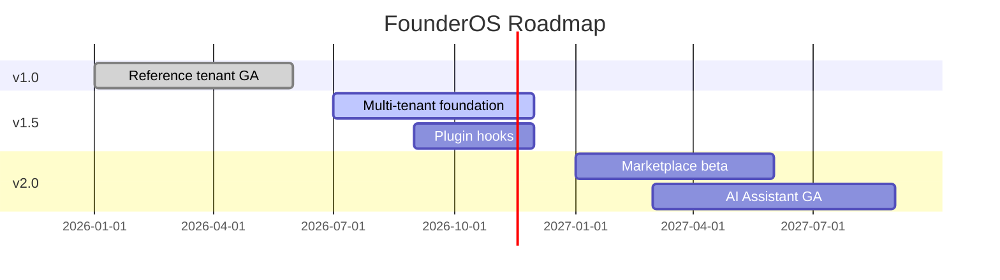

# Product Roadmap

| Field | Value |
|-------|-------|
| **Document ID** | FUT-ROAD-001 |
| **Product** | Founder Portfolio Platform (FounderOS v1.0+) |
| **Version** | 1.0 |
| **Status** | Living Document |
| **Last Updated** | 2026-06-29 |
| **Owner** | Product / Leadership |
| **Related** | [Vision](../01_Brand/Vision.md) · [Project Roadmap](../00_Project/07_Roadmap.md) · [Plugin System](./Plugin_System.md) · [Multi Tenant](./Multi_Tenant.md) |

---

## Purpose

Consolidate the FounderOS product roadmap beyond v1.0 — themes, milestones, dependencies, and success metrics — aligned with vision and enterprise white-label strategy.

---

## Scope

| In Scope | Out of Scope |
|----------|--------------|
| v1.0 → v2.0 feature themes | Sprint-level task breakdown |
| Dependency graph between initiatives | Revenue forecasts |
| Public vs internal roadmap items | |

---

## Business Context

Roadmap communicates to team, investors, and enterprise prospects what ships when. v1.0 delivers reference tenant excellence; subsequent releases unlock platform revenue (multi-tenant, marketplace, AI).

---

## Goals

1. Every major initiative has an owner and dependency map.
2. v1.0 scope protected from roadmap creep.
3. Future docs in `14_Future/` trace to roadmap themes.
4. Quarterly roadmap review with stakeholder sign-off.

---

## Functional Requirements

| ID | Requirement | Priority |
|----|-------------|----------|
| FR-ROAD-001 | Roadmap SHALL group features by release train | P0 |
| FR-ROAD-002 | Each item SHALL link to spec doc when exists | P0 |
| FR-ROAD-003 | Shipped vs planned clearly labeled | P0 |
| FR-ROAD-004 | Enterprise commitments tracked separately | P1 |

---

## Non-functional Requirements

| ID | Requirement | Target |
|----|-------------|--------|
| NFR-ROAD-001 | Review cadence | Quarterly |
| NFR-ROAD-002 | Version doc sync | With each minor release |

---

## User Stories

| ID | As a… | I want… | So that… |
|----|-------|---------|----------|
| US-ROAD-001 | Engineer | dependency clarity | I sequence work |
| US-ROAD-002 | Sales | credible dates | I set expectations |
| US-ROAD-003 | Investor | platform evolution | I see moat building |

---

## UX Requirements

- Public roadmap page (future): themes not internal codenames.
- Admin changelog linked from releases.

---

## Technical Considerations

### Release Trains

| Release | Theme | Key Deliverables |
|---------|-------|------------------|
| **v1.0** | Reference excellence | CMS, enterprise pages, Docker deploy |
| **v1.5** | Platformization | [Multi Tenant](./Multi_Tenant.md), [Plugin System](./Plugin_System.md), [Versioning](./Versioning.md) |
| **v2.0** | Ecosystem | [Marketplace](./Marketplace.md), [AI Assistant](./AI_Assistant.md), [Enterprise Features](./Enterprise_Features.md) |
| **v2.5+** | Scale | Full [White Label](./White_Label.md), SSO federation, global edge |

---

## Security Considerations

- Roadmap must not commit to security features without eng feasibility review.
- Multi-tenant on roadmap implies tenant isolation as P0 dependency.

---

## Acceptance Criteria

- [ ] Release train table v1.0–v2.0 documented
- [ ] Gantt or timeline diagram included
- [ ] Links to all 14_Future topic docs
- [ ] Distinction from 00_Project/07_Roadmap.md noted
- [ ] Quarterly review process stated

---

## Future Enhancements

- Public roadmap with voting
- Roadmap API for partner portal
- OKR linkage per theme

---

## Open Questions

| # | Question | Owner |
|---|----------|-------|
| OQ-1 | Publish roadmap dates externally? | Leadership |
| OQ-2 | v1.5 before marketplace or parallel? | Product |
| OQ-3 | Open-source core split timing? | Engineering |
